# arima-stock-forecasting

**ARIMA stock forecasting, done carefully.** This repo forecasts Apple (AAPL) daily closing prices with ARIMA and asks the question that decides whether a price forecast is worth anything: *does it beat a random walk?* It rebuilds the ten modules of a sample ARIMA course (AAPL, 2015–2023, a 90/10 train/test split) in tested Python, measures what each of the course's mistakes costs, and then tests the same models on 2 January 2024 to 30 September 2026, 689 trading days on which no model, order or forecast was chosen (the inference method for the comparisons was chosen after milestone 4's results on them were seen). Python computes every number; a React and three.js app only draws the JSON that Python exports.

> **Status: milestone 5 (where the sample goes wrong, and polish) built; milestones 0 to 4 done.** All six milestones are built. The numbers below are printed from the committed `app/public/data/evaluation.json` by `tools/results_table.py`, and a test fails if this page and the file disagree.

> **Not financial advice.** This is an educational study of one statistical method on one stock.

> **Data.** The prices come from Yahoo Finance via yfinance and are not covered by this repository's MIT licence. [`DATA.md`](DATA.md) says what is committed, what is not, and why.

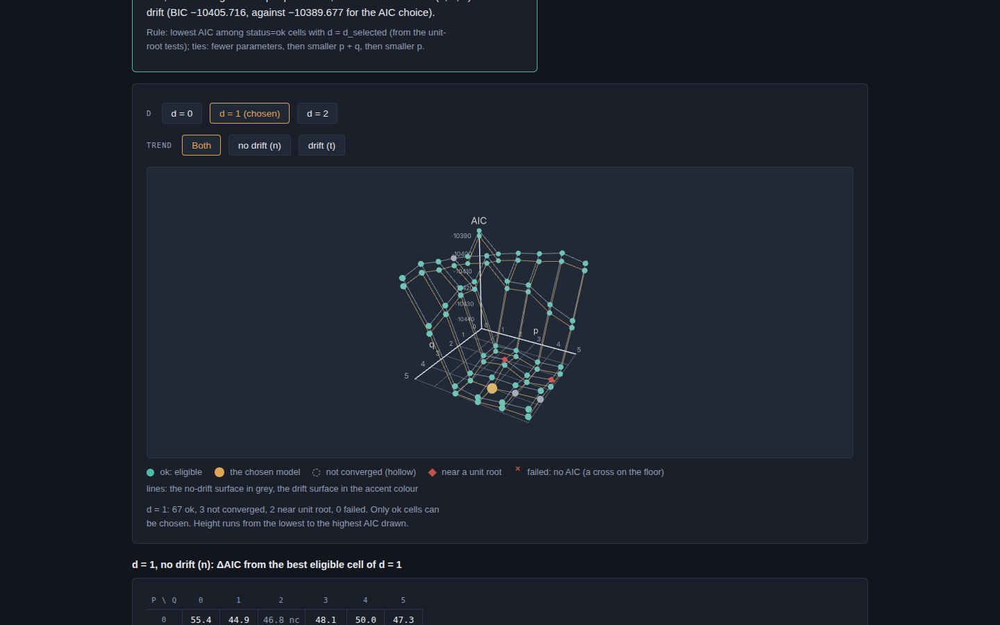

*The AIC landscape (three.js, in the app): the 72 ARIMA(p, 1, q) fits of the training data, one point per (p, q) and trend (with and without a drift). Hero renders: not rendered: Blender unreachable. The images on this page are stills of the app, taken by `tools/screenshots/`.*

## The headline result

**One day ahead, no ARIMA model has a lower RMSE than yesterday's price.** On both windows, every one-step forecast has a higher dollar RMSE than the random walk (ratios 1.0056 to 1.0174). The Diebold–Mariano verdicts in `evaluation.json` (DM-HLN, per test, uncorrected for the 16 tests) are "worse than the random walk" in 5 tests, all in the out-of-sample window, "no difference" in the other 11, and "better" in none. After a pre-registered re-analysis corrected for all 28 comparisons, one "worse" survives: BIC, out of sample, absolute loss. It is not a fresh holdout (milestone 4 had already scored both windows), and its metric is a proxy: log loss on the adjusted close, not a P&L ([below](#inference-robustness-corrected-for-28-tests)). The AIC model's static paths, the only ones with a **drift**, are far below their baseline (RMSE ratios 0.4134 on test and 0.5370 out of sample). A random walk carrying the same drift has an RMSE of $10.34 against the AIC model's $10.63 on the same test path: one path each, not a test, which points to the drift in a rising market rather than the ARMA terms. The course's driftless static out-of-sample path is at 0.9991, a hair below 1. The course's own recipe drops the drift by accident; with it, the course's own model would have cut its test-window RMSE from $25.99 to $10.55 ([milestone 5](docs/milestones/05-where-the-sample-goes-wrong.md)).

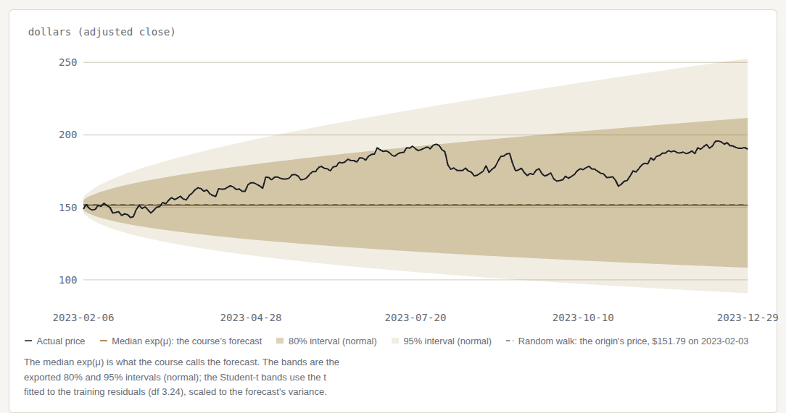

*The course's forecast: the static path of its ARIMA(0, 1, 1) without a drift is a flat line at $151.47 for all 227 test days, while the price rose to $190.21.*

## Results

RMSE of the median price in dollars; "Random walk" is the baseline of the same kind (a static path: the price at the origin, every day; one step: yesterday's price); "Ratio" is the model's RMSE over the random walk's, **bold** below 1. DM p-values are DM-HLN, per test, uncorrected: two-sided, on squared then absolute log errors, **bold** where that single test rejects at 5% (with its direction). In the simulated size check, DM-HLN rejected 4.35% to 26.65% of true nulls (it ignores autocorrelation), so a bold mark is one uncorrected test; [Inference robustness](#inference-robustness-corrected-for-28-tests) below corrects for the number of tests. Windows: **test**, 2023-02-06 to 2023-12-29 (227 days, the course's), and **oos**, 2024-01-02 to 2026-09-30 (689 days; no model, order or forecast was chosen on it, but the inference method below was chosen after milestone 4's results on it were seen). Models: **aic**, ARIMA(3, 1, 4) with a drift, chosen by AIC on the training data only ([ADR-0002](docs/adr/0002-order-selection.md)); **bic**, ARIMA(2, 1, 2); **course**, the course's ARIMA(0, 1, 1) refit, which has no drift. The second table is the share of days whose price fell inside each one-step interval, with Kupiec's verdict; the static paths' coverage is shown in the app, not tested. The 32 Kupiec tests are per test, uncorrected: Holm's correction over the 32 keeps 13 of the 20 "too wide" verdicts (9 on test, 4 on oos).

```bash
uv run python tools/results_table.py
```

<!-- results:start -->
| Model | Method | Window | RMSE $ | Random walk $ | Ratio | DM p: squared; absolute |
|---|---|---|---|---|---|---|
| aic | static | test | 10.632 | 25.717 | **0.4134** | not tested |
| aic | static | oos | 34.256 | 63.796 | **0.5370** | not tested |
| aic | walk-forward | test | 2.111 | 2.087 | 1.0118 | 0.4483; 0.8125 |
| aic | walk-forward | oos | 4.114 | 4.044 | 1.0174 | 0.0801; **0.0100 worse** |
| aic | walk-forward, refit | test | 2.112 | 2.087 | 1.0122 | 0.4296; 0.7967 |
| aic | walk-forward, refit | oos | 4.099 | 4.044 | 1.0137 | 0.1090; **0.0103 worse** |
| bic | static | test | 25.788 | 25.717 | 1.0027 | not tested |
| bic | static | oos | 63.811 | 63.796 | 1.0002 | not tested |
| bic | walk-forward | test | 2.098 | 2.087 | 1.0056 | 0.5862; 0.9095 |
| bic | walk-forward | oos | 4.110 | 4.044 | 1.0165 | **0.0480 worse**; **0.0002 worse** |
| course | static | test | 25.991 | 25.717 | 1.0107 | not tested |
| course | static | oos | 63.738 | 63.796 | **0.9991** | not tested |
| course | walk-forward | test | 2.102 | 2.087 | 1.0075 | 0.2334; 0.6274 |
| course | walk-forward | oos | 4.078 | 4.044 | 1.0085 | 0.1813; **0.0242 worse** |

| Model | Method | Window | Normal 80% | Normal 95% | t 80% | t 95% |
|---|---|---|---|---|---|---|
| aic | walk-forward | test | 0.9559 too wide | 0.9868 too wide | 0.9031 too wide | 0.9868 too wide |
| aic | walk-forward | oos | 0.8694 too wide | 0.9507 consistent | 0.8099 consistent | 0.9463 consistent |
| aic | walk-forward, refit | test | 0.9515 too wide | 0.9868 too wide | 0.9031 too wide | 0.9868 too wide |
| aic | walk-forward, refit | oos | 0.8679 too wide | 0.9478 consistent | 0.7983 consistent | 0.9405 consistent |
| bic | walk-forward | test | 0.9559 too wide | 0.9868 too wide | 0.9163 too wide | 0.9824 too wide |
| bic | walk-forward | oos | 0.8752 too wide | 0.9536 consistent | 0.8026 consistent | 0.9521 consistent |
| course | walk-forward | test | 0.9559 too wide | 0.9912 too wide | 0.8899 too wide | 0.9868 too wide |
| course | walk-forward | oos | 0.8795 too wide | 0.9579 consistent | 0.7983 consistent | 0.9507 consistent |
<!-- results:end -->

How to read it, briefly (the reasons are measured in the [milestone-4 walkthrough](docs/milestones/04-forecast-and-evaluation.md#measured-results)):

- **The static paths are one path each, not tests.** Only the AIC model has a drift, and its static paths have 41% (test) and 54% (oos) of the flat line's RMSE. BIC's and the course's static paths, which have none, are within 1.1% of the flat line (the course's oos path, 0.9991, a hair below it).
- **The DM verdicts** are DM-HLN, per test, uncorrected: each is one test at 5%, and 16 were run. The next section tests them again with a test built for autocorrelated loss differences, corrected for all 28 comparisons. One "worse" survives.
- **The intervals.** In 2023 the one-step intervals were too wide: the market was calmer than in the training years, so the errors were 0.66 times the stated standard deviation. From 2024 on the scale is about right, and the fat-tailed Student-t interval covers its 80% where the normal one holds too many days.

## Inference robustness (corrected for 28 tests)

<!-- filled from docs/validation/m5-comparison-inference-v2.md -->

The DM column above is one test per row. Sixteen of them were run, so some may reject by chance. A pre-registered re-analysis tests every comparison in the table again ([plan](docs/validation/m5-preregistration-v2.md), [results](docs/validation/m5-comparison-inference-v2.md)). Its test is built for loss differences that are autocorrelated and few: the EWC fixed-smoothing t test of Lazarus, Lewis, Stock and Watson (2018), with ν = 14 on the test window and 31 on oos. Holm's correction then runs over all 28 comparisons at 5%.

- **One verdict survives the correction.** BIC's one-step forecast is worse than the random walk on the out-of-sample window under absolute loss: EWC p 0.000145, Holm p 0.0041.
- **The other 15 tested comparisons: no difference detected.** That is not "equal": the [minimum detectable effects](docs/validation/m5-comparison-inference-v2.md#minimum-detectable-effects) say how large a difference each test could see.
- **A limit the size check did not cover.** The real out-of-sample loss differentials have heavier tails than any process in the simulated size check: for aic walk-forward under squared loss, the excess kurtosis is 135.3 and the top 5 days carry 67% of the squared deviations. So the out-of-sample squared-loss p-values are not reliable, and none survives the correction anyway. The surviving result is on absolute loss ([addendum](docs/validation/m5-preregistration-addendum.md), §2).
- **The 12 static comparisons are not tested.** A static path's errors come from one origin and add up over the horizon, so no test here applies to them. Their ratios above each describe one path.
- **How the test was chosen.** The first plan used a block bootstrap with its block taken from the measured autocorrelation ([plan v1](docs/validation/m5-preregistration.md)). It failed its own size check on simulated data before any of its own results was computed: it rejected 9.70% of true nulls, against a limit of 8%. Three longer blocks also failed, and DM-HLN failed worse, at up to 27%. Plan v2 was frozen before its run. Both plans wrongly said that no real statistic had been seen: milestone 4 had already published block-bootstrap and Newey–West p-values on the real out-of-sample loss differentials. The [addendum](docs/validation/m5-preregistration-addendum.md) corrects them. Plan v2's test rejected 4.05% to 5.80% of true nulls in all ten simulated cells. The block bootstrap is still reported beside each result, with its measured size.
- **This is not a fresh holdout.** Milestone 4 scored both windows once, and this changes only the inference. The next evidence is the trading days from 2026-10-01 on (the snapshot ends on 2026-09-30).
- **What is measured.** The metric is the log forecast loss on AAPL's adjusted close. It is not a trading P&L.

## Where the course goes wrong

| Mistake | What it costs on AAPL |
|---|---|
| The order is chosen on the whole series, test period included | Nothing measurable here: the same ARIMA(0, 1, 1) with a drift is chosen with and without the 227 test rows. It is still a leak: the procedure lets the test pick the model it then scores. |
| The static multi-step path is reported as "the forecast" | The course model's path is flat at $151.47 for all 227 test days, while the price ranged over $52.74. Its RMSE, $25.99, is 1.07% worse than a flat line at the last training close. |
| Dollar errors with nothing to compare them to | Next to the random walk, no model has a lower one-step RMSE than yesterday's price, and the DM-HLN verdicts (per test, uncorrected) are "worse" in 5 of 16 tests and "better" in none (1 "worse" after a correction for all 28 comparisons; not a fresh holdout, and the metric is log loss on the adjusted close, not a P&L). Without the baseline, none of this can be seen. |
| exp of a log forecast is reported as the expected price | It is the median. The mean is 3.47% higher at the end of the course's test path, and 10.91% higher at the end of the out-of-sample path. |
| The refit drops the drift that the order search chose | It costs $15.44 of the course model's static test RMSE ($25.99 without the drift, $10.55 with it), the largest cost measured. One step ahead it costs almost nothing. |
| The QQ plot keeps the first residual, which is the price level | One point at 3.185 log points, 24.6 times the largest of the other 2,036. With it, the kurtosis is 1,774; without it, 7.76. |
| Module 9's forecast call and module 10's MAPE | The first raises "No supported index is available" on a trading-day index. The second prints `nan` on a one-column DataFrame. Tests reproduce both. |

Every cost has its command and its source field in the [milestone-5 walkthrough](docs/milestones/05-where-the-sample-goes-wrong.md#the-mistakes-and-their-costs). The ideas behind them are in [concept note 12](docs/concepts/12-where-the-sample-goes-wrong.md).

## Screenshots

Taken by `tools/screenshots/` from the built app (Playwright, headless Chromium), light and dark, desktop and 375 px mobile. Every page reads only the JSON in `app/public/data/`.

| | |
|---|---|
| 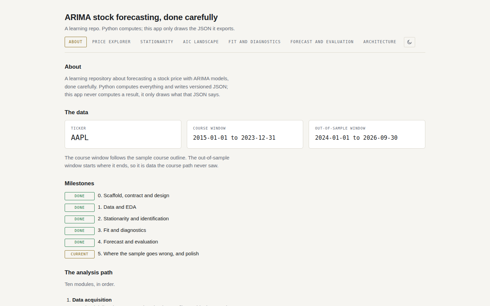 | 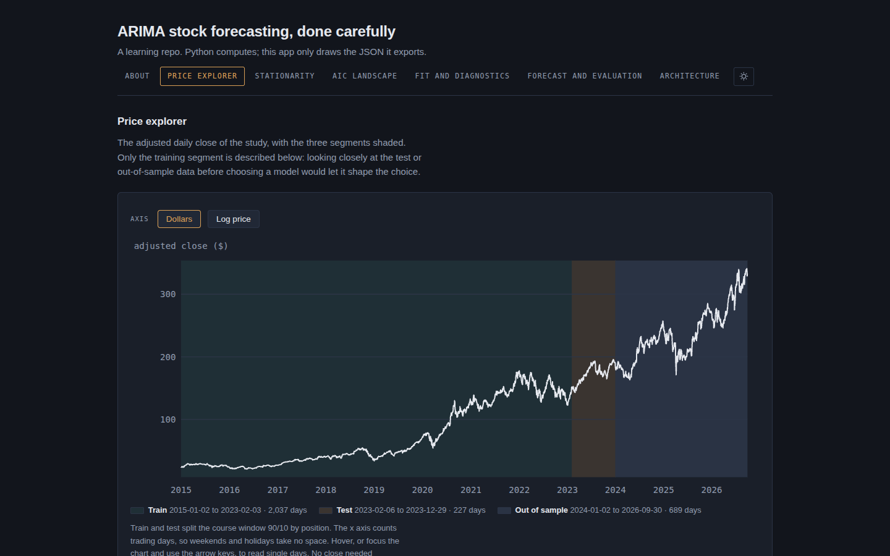 |
| **About**: the windows and the milestones, from `meta.json` | **Price explorer**: dollar or log axis, segments shaded, KDEs and the decomposition |
| 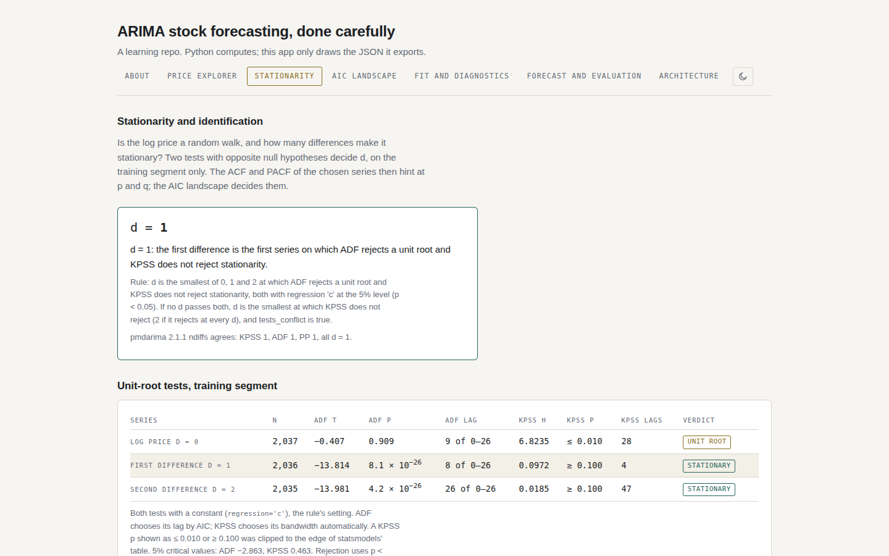 | 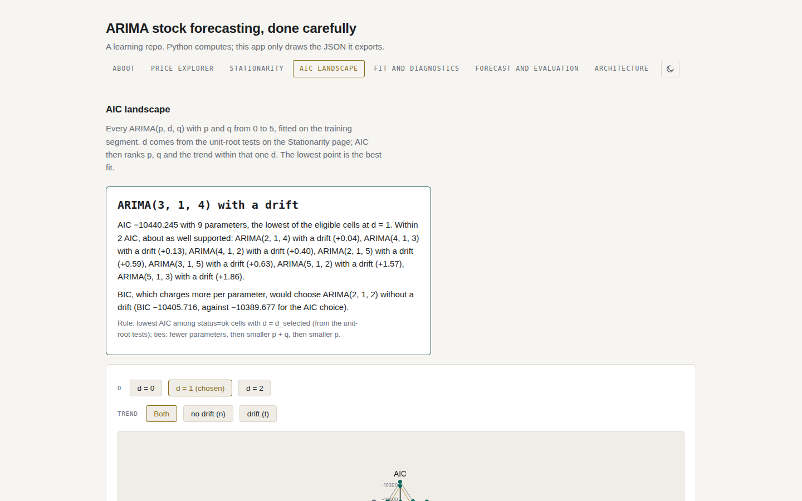 |
| **Stationarity**: ADF and KPSS side by side, the decision on d, the ACF and PACF | **AIC landscape**: every (p, q) cell of one d, in 3D and as a table |
| 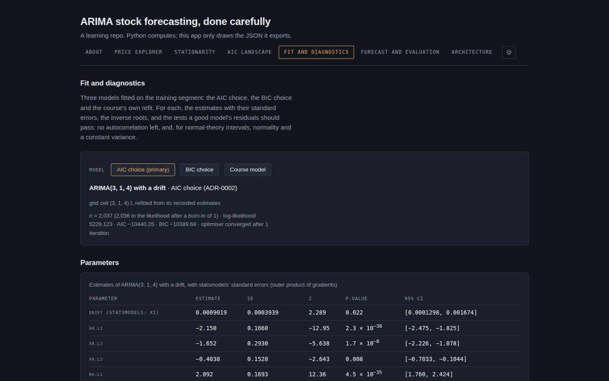 | 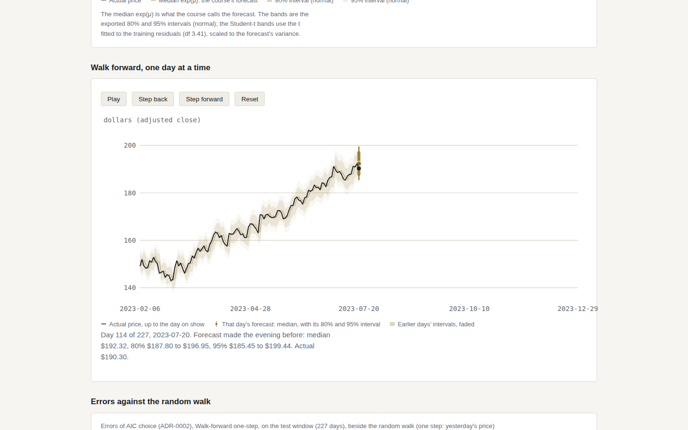 |
| **Fit and diagnostics**: parameters, inverse roots, residual tests | **Walk-forward**: one day at a time, paused here at day 114 of 227 |
| 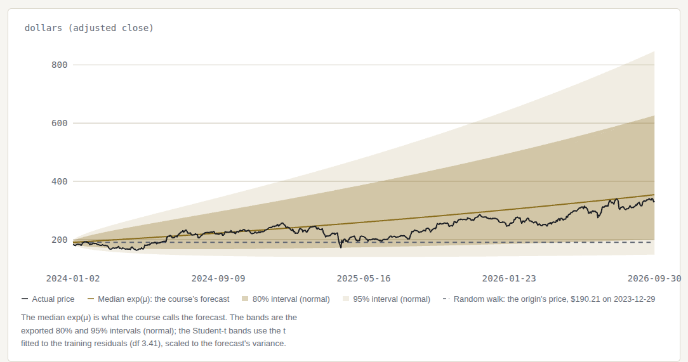 | 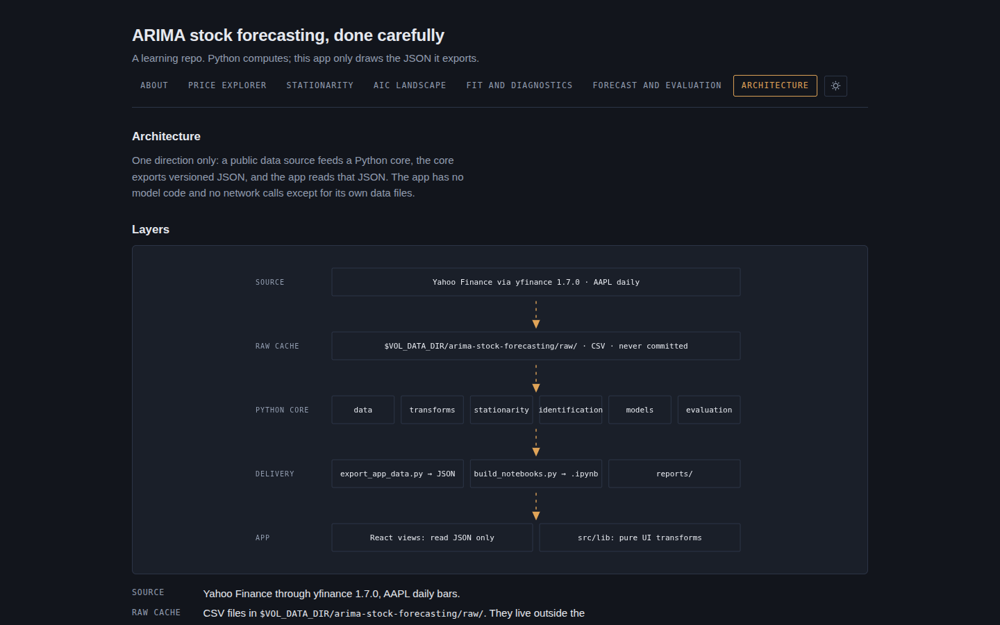 |
| **The AIC model's static path** out of sample: the drift line and its widening bands | **Architecture**: data flows one way, from the source to the app |

On a phone (375 px) the charts keep their axis text at about 10 px: 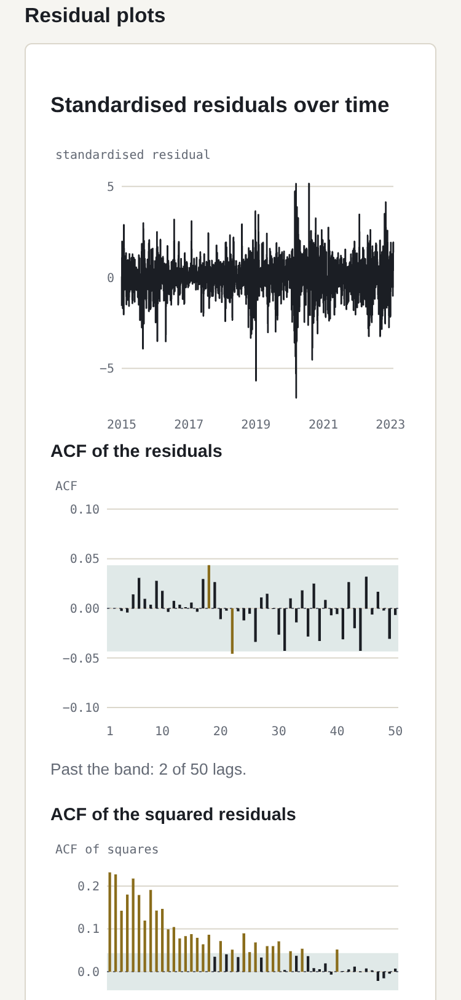 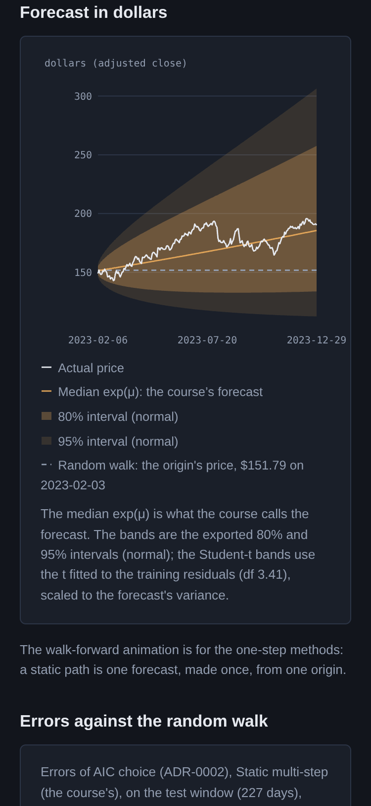

## How to run

Requirements: [uv](https://docs.astral.sh/uv/) (it installs Python 3.12 for you) and Node 22 with npm.

```bash
uv sync                                          # the Python environment, from uv.lock
uv run pytest -q                                 # every Python test
uv run python tools/build_notebooks.py --check   # the notebooks match their builder
uv run python tools/export_app_data.py --check   # the committed JSON matches the code (needs the raw snapshot)
uv run python tools/results_table.py             # the results tables above
```

```bash
cd app
npm ci
npm run dev       # the app on http://localhost:5173
npm run verify    # lint, tests with coverage thresholds, production build
npm run build && npm run screenshots   # the PNGs in docs/images/ (Playwright's cached Chromium)
```

To rebuild the data from a fresh download: `uv run python tools/fetch_prices.py` (the only step that uses the network; it caches the raw download outside git, in `$VOL_DATA_DIR/arima-stock-forecasting/raw/`, default `~/data/vol-projects`), then `uv run python tools/export_app_data.py` (862 s in milestone 4's measured run, on a shared machine). Every file in `app/public/data/` is committed ([ADR-0001](docs/adr/0001-python-computes-app-visualises.md#the-owners-decision-on-the-price-files-decided-2026-10-29), [`DATA.md`](DATA.md)), so a fresh clone runs the app, the tests and the notebooks without downloading anything. The notebooks in `notebooks/` run on the project's virtual environment and read the committed files.

## How it is built

- **Python computes, the app only draws.** All statistics come from the `arima_forecasting` package in `src/`. `tools/export_app_data.py` writes versioned JSON files (each stamped with `schema_version`, `generated_at` and `source_commit`) into `app/public/data/`. The React 19 + three.js app in `app/` reads only those files and recomputes nothing, not even a threshold comparison: every verdict it shows is a field Python wrote. See [ADR-0001](docs/adr/0001-python-computes-app-visualises.md).
- **One contract, two readers.** The [JSON contract](docs/architecture/contract.md) describes every field. Python's validators and the app's TypeScript parsers check each file; one shared corpus of good and bad payloads runs through both, so the two readers cannot drift apart. Every pinned setting (windows, test levels, lags, tolerances) is compared exactly, every list is bounded before it is read, and a reader stops at 200 problems.
- **Honest evaluation.** Order selection on the training split only, with the trend term chosen explicitly ([ADR-0002](docs/adr/0002-order-selection.md)); a static and a walk-forward forecast, a random walk under every metric, Diebold–Mariano with the HLN correction and interval coverage ([ADR-0003](docs/adr/0003-evaluation-protocol.md)).
- **Validation.** Tests use made-up values with hand-worked answers; each milestone's tests were mutation-checked (each test seen to fail when the code it guards is broken), and milestones 0 to 4 were each attacked by an adversarial review: the ledgers of milestones 0 to 2 are in [`docs/validation/`](docs/validation/), and milestones 3 and 4 record theirs in their walkthroughs. Milestone 5 was validated by the kind of claim, and its route line is at the top of [its walkthrough](docs/milestones/05-where-the-sample-goes-wrong.md). A hand mutant checked each new or changed test ([`m5-mutant-ledger.md`](docs/validation/m5-mutant-ledger.md)). Two independent channels checked 32 library claims ([`m5-egv-ledger.md`](docs/validation/m5-egv-ledger.md)). An adversarial reviewer (Opus) attacked the procedure of the pre-registered re-analysis, not its values ([addendum](docs/validation/m5-preregistration-addendum.md)). A verifier re-measured the numbers, paths and commands in this README and the PR/FAQ. No adversarial review of milestone 5's code as a whole was run, and none is pending.
- **Reproducible.** Exact pins (`pyproject.toml` and `uv.lock`, `app/package.json` and its lock), a raw snapshot with its SHA-256, byte-identical re-exports, and notebooks generated by `tools/build_notebooks.py`.

Diagrams (architecture, data flow, process, ERD, contract sequence) are in [`docs/architecture/`](docs/architecture/README.md). The product framing is in the [PR/FAQ](docs/prfaq.md).

## Learn from it

This is a learning repo. Each milestone ships a code walkthrough with `file:line` references, concept notes with the maths, questions to answer before you look at the results, and interview questions to explain back. Start at [`LEARNING_LOG.md`](LEARNING_LOG.md).

| # | Milestone | Walkthrough |
|---|---|---|
| 0 | Scaffold, data contract, design | [00-scaffold](docs/milestones/00-scaffold.md) |
| 1 | Data and EDA (course modules 2–4) | [01-data-and-eda](docs/milestones/01-data-and-eda.md) |
| 2 | Stationarity and identification (modules 5–6) | [02-stationarity-and-identification](docs/milestones/02-stationarity-and-identification.md) |
| 3 | Fit and diagnostics (modules 7–8) | [03-fit-and-diagnostics](docs/milestones/03-fit-and-diagnostics.md) |
| 4 | Forecast and evaluation (modules 9–10) | [04-forecast-and-evaluation](docs/milestones/04-forecast-and-evaluation.md) |
| 5 | Where the sample goes wrong, and polish | [05-where-the-sample-goes-wrong](docs/milestones/05-where-the-sample-goes-wrong.md) |

## Repo layout

```
src/arima_forecasting/   all logic: config, data (snapshot), prep, eda, stationarity, identification, selection,
                         fitting, diagnostics, forecasting, evaluation, the JSON contract and its validators
tests/                   pytest: hand-worked expected values, the shared payload corpus, the committed files rebuilt
notebooks/               generated by tools/build_notebooks.py
tools/                   fetch_prices, export_app_data, build_notebooks, results_table, screenshots/, diagrams/, blender/
app/                     Vite + React 19 + TypeScript + @react-three/fiber; reads app/public/data/*.json
docs/                    prfaq, concepts, milestones, architecture, adr, validation, images
```

## Credits

- The module structure follows the sample course outline *Stock Price Forecasting Using ARIMA Model in Python*. All code and text in this repo are our own; the outline itself is not included.
- Built on [statsmodels](https://www.statsmodels.org/), [pmdarima](https://alkaline-ml.com/pmdarima/), [yfinance](https://github.com/ranaroussi/yfinance), [pandas](https://pandas.pydata.org/), [SciPy](https://scipy.org/), React, Vite, [three.js](https://threejs.org/) via [@react-three/fiber](https://r3f.docs.pmnd.rs/), and [Playwright](https://playwright.dev/) for the screenshots.
- Prices come from Yahoo Finance through yfinance; Yahoo's terms of service govern their use. The data is not covered by this repository's MIT licence. The raw download is never committed; the exported JSON is, by the owner's decision of 2026-10-29. See [`DATA.md`](DATA.md).

## License

[MIT](LICENSE) for the code and the text. The data is not covered (see [`DATA.md`](DATA.md)).
