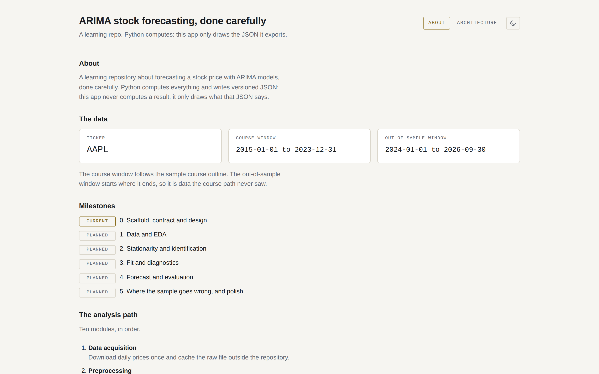
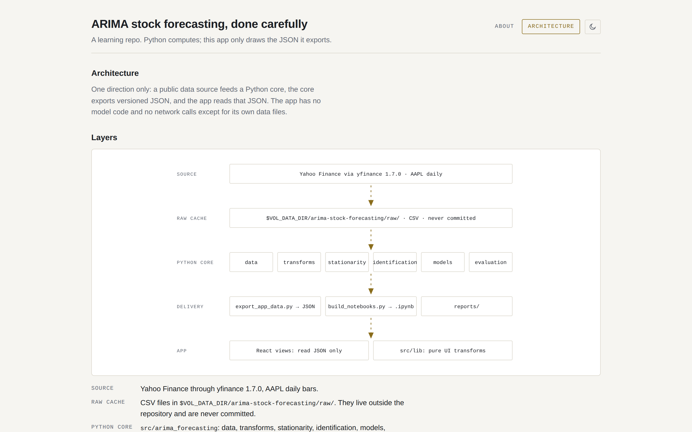

# arima-stock-forecasting

**ARIMA stock forecasting, done carefully.** This repo forecasts Apple (AAPL) daily closing prices with ARIMA and asks the question that decides whether a price forecast is any good: *does it beat a random walk?* It follows the ten-module structure of a sample ARIMA course (AAPL, 2015–2023, a 90/10 split), fixes the places where that sample goes wrong, and then tests on 1 Jan 2024 to 30 Sep 2026, data the models never saw while they were built.

It is a learning repo. Each milestone ships a code walkthrough with `file:line` references, concept notes with the maths, questions to answer before you look at the results, and interview questions to explain back. Start at [`LEARNING_LOG.md`](LEARNING_LOG.md).

> **Status: milestone 3 (fit and diagnostics) built; milestones 0 to 2 done.** On the training segment, ADF and KPSS choose d = 1, and an AIC grid of 144 ARIMA models, each fitted from several starts and polished, picks ARIMA(3, 1, 4) with a drift: the best the documented search found, with seven other models within 2 AIC of it (BIC would pick ARIMA(2, 1, 2) without a drift). Fitted, the AIC choice leaves no autocorrelation that Ljung–Box finds at the lags it can test (10 and 20), but its residuals are fat-tailed (kurtosis 7.03) and their volatility clusters (ARCH-LM p about 10⁻⁵⁰), as milestone 2 predicted; its AR and MA roots nearly cancel. The course's own recipe chooses ARIMA(0, 1, 1) with a drift on data that includes the test period, then refits it without the drift. The app has four data pages: the price explorer, the stationarity page, a 3D AIC landscape, and fit and diagnostics. No forecast has been made yet, so there are no forecast results below. Every number that appears here later is re-measured by an independent `verifier` pass before it is committed.

> **Not financial advice.** This is an educational study of one statistical method on one stock.

> **Data.** The prices come from Yahoo Finance via yfinance and are not covered by this repository's MIT licence. [`DATA.md`](DATA.md) says what is committed, what is not, and why.

## Results

*None yet.* Forecast accuracy (RMSE, MAE, MAPE) for the course's static forecast, a walk-forward one-step forecast and a random-walk baseline, on both windows, arrives in milestone 4.

## Screenshots

These are milestone 0's screenshots. Milestone 1 adds the **Price explorer** page: the adjusted close on a dollar or log axis with the train, test and out-of-sample segments shaded, KDEs of the log price and the log return, and the four parts of the decomposition. Milestone 2 adds the **Stationarity** page (the ADF and KPSS table, the decision on d, and the ACF and PACF with their bands) and the **AIC landscape** (every (p, q) cell of one d at a time, in 3D and in a table, with failed and flagged fits marked). Milestone 3 adds **Fit and diagnostics**: a picker for the AIC choice, BIC's choice and the course's refit, each model's parameter table, its inverse roots on the unit circle with near-cancelling pairs marked, its standardised residuals, the ACF of its residuals and squared residuals, a QQ plot, and the Ljung–Box, Jarque–Bera and ARCH-LM table. These pages have no screenshots yet, because milestone 0's screenshots were taken by hand and there is no script to repeat them.



*About: the study windows and the milestone list, all read from the exported `meta.json`.*



*Architecture: data flows one way, from the source to the app, which only reads JSON.*


*The 3D check: empty p, q and AIC axes that milestone 2's AIC landscape will fill.*

## How to run

Requirements: [uv](https://docs.astral.sh/uv/) (it installs Python 3.12 for you) and Node 22 with npm.

```bash
uv sync
```

```bash
uv run pytest -q
```

```bash
uv run python tools/build_notebooks.py --check
```

```bash
uv run python tools/fetch_prices.py
```

```bash
uv run python tools/export_app_data.py
```

```bash
uv run python tools/export_app_data.py --check
```

```bash
cd app && npm ci && npm run dev
```

`fetch_prices.py` downloads the prices once (it is the only step that uses the network) and reuses the snapshot after that. `export_app_data.py` builds the JSON from the snapshot, and `--check` exits 1 if the JSON in `app/public/data/` is stale. Every file in `app/public/data/` is committed, `prices.json` and `eda.json` included ([ADR-0001](docs/adr/0001-python-computes-app-visualises.md#the-owners-decision-on-the-price-files-decided-2026-10-29), [`DATA.md`](DATA.md)), so a fresh clone runs the whole app and every test without downloading anything; the two commands rebuild the files from a new download. `npm run verify` (inside `app/`) is the app's gate: lint, tests with coverage thresholds, and a production build.

The raw download is cached outside git, in `$VOL_DATA_DIR/arima-stock-forecasting/raw/` (default `~/data/vol-projects`), with a manifest that records its SHA-256. It is never committed.

## How it is built

- **Python computes, the app only draws.** All statistics come from the `arima_forecasting` package in `src/`. `tools/export_app_data.py` writes versioned JSON files (each stamped with `schema_version`, `generated_at` and `source_commit`) into `app/public/data/`. The React 19 + three.js app in `app/` reads only those files. See [ADR-0001](docs/adr/0001-python-computes-app-visualises.md) and the [contract](docs/architecture/contract.md).
- **Order selection on the training split only,** with the trend term chosen explicitly. See [ADR-0002](docs/adr/0002-order-selection.md).
- **Notebooks are generated** from `tools/build_notebooks.py`, and a test fails if the committed notebooks drift from the builder.
- **Exact pins.** Every dependency is pinned with `==` in `pyproject.toml` and locked in `uv.lock`, and every app dependency is pinned exactly in `app/package.json`.

Diagrams (architecture, data flow, process, ERD, contract sequence) are in [`docs/architecture/`](docs/architecture/README.md). The product framing is in the [PR/FAQ](docs/prfaq.md).

## Repo layout

```
src/arima_forecasting/   all logic: config, data (snapshot), prep, eda, stationarity, identification, selection, JSON contract and payloads, provenance; later models and evaluation
tests/                   pytest, hand-worked expected values, mutation-checked (see each milestone's Results)
notebooks/               generated by tools/build_notebooks.py
tools/                   fetch_prices.py, export_app_data.py, build_notebooks.py, diagrams/, blender/
app/                     Vite + React 19 + TypeScript + @react-three/fiber; reads app/public/data/*.json
docs/                    prfaq, concepts, milestones, architecture, adr, validation, images
reports/                 results tables produced by the pipeline
```

## Credits

- The module structure follows the sample course outline *Stock Price Forecasting Using ARIMA Model in Python*. All code and text in this repo are our own; the outline itself is not included.
- Built on [statsmodels](https://www.statsmodels.org/), [pmdarima](https://alkaline-ml.com/pmdarima/), [yfinance](https://github.com/ranaroussi/yfinance), [pandas](https://pandas.pydata.org/), React, Vite and [three.js](https://threejs.org/) via [@react-three/fiber](https://r3f.docs.pmnd.rs/).
- Prices come from Yahoo Finance through yfinance; Yahoo's terms of service govern their use. The data is not covered by this repository's MIT licence. The raw download is never committed; the exported `prices.json` and `eda.json` are, by the owner's decision of 2026-10-29. See [`DATA.md`](DATA.md).

## License

[MIT](LICENSE).
