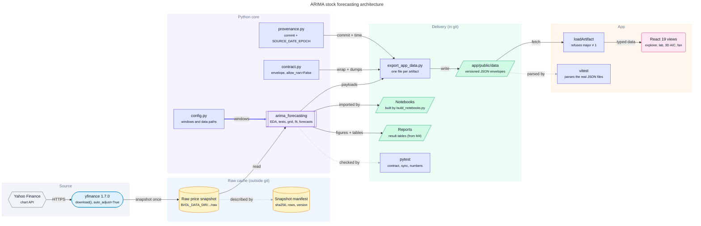
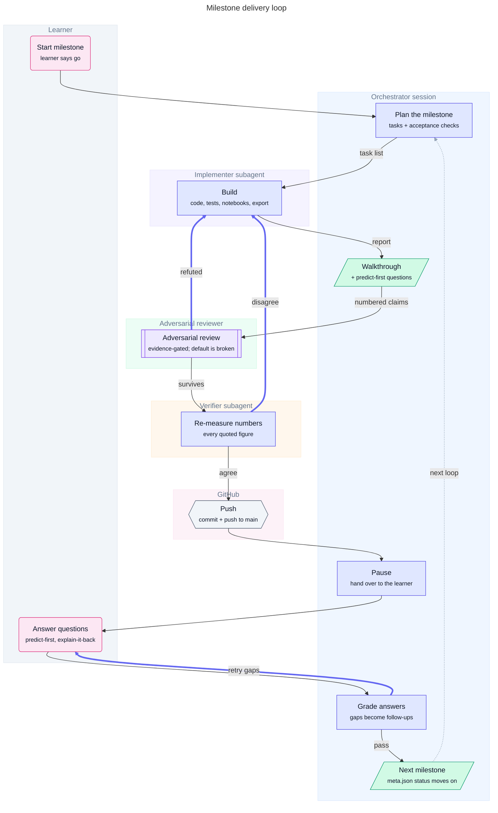
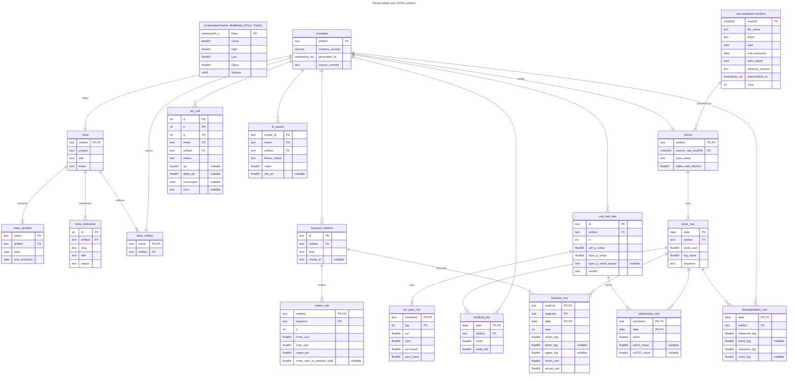
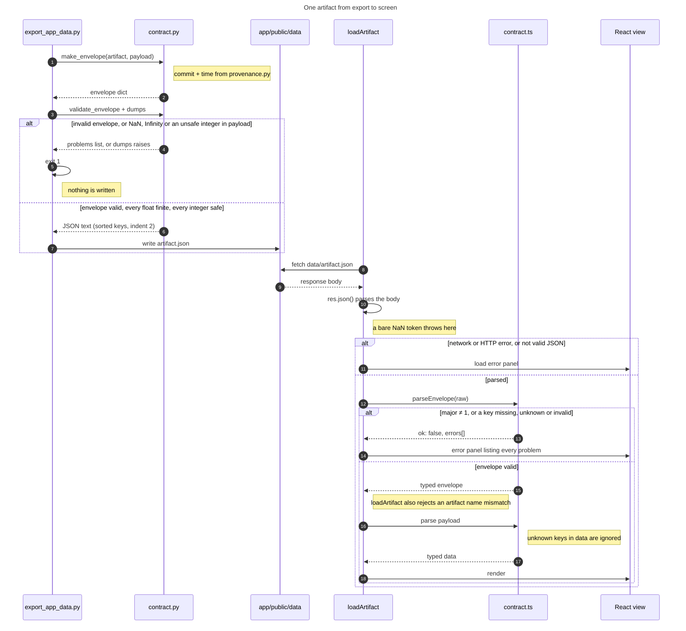

# Architecture

How this project is put together, why, and what flows between the parts. Start with the two
decision records, then the contract, then the diagrams.

## Decisions

| Record | Decision in one line |
|---|---|
| [ADR-0001](../adr/0001-python-computes-app-visualises.md) | Python computes every number; a static React app only draws versioned JSON. Raw data stays outside git. |
| [ADR-0002](../adr/0002-order-selection.md) | d comes from ADF + KPSS on the training split; p, q and the drift come from a full statsmodels AIC grid within that d; pmdarima is a cross-check, not the source of truth. |

## The contract

[`contract.md`](contract.md) describes every JSON file the app reads: the fixed envelope, the
value conventions (explicit `null`, units in field names, half-open date windows), the
versioning policy, and one section per artifact from `meta` (milestone 0) to `metrics`
(milestone 4).

## Diagrams

Each diagram has a YAML source in [`specs/`](specs/) and a generated Mermaid file next to this
README. The blocks below are byte-for-byte copies of those `.mmd` files, so GitHub can draw them
inline. Do not edit the `.mmd` files or these blocks by hand.

The `.mmd` files are generated from the YAML specs by a shared diagram kit (the same kit also
renders SVG, PNG and draw.io versions). The kit is not public yet; the plan is to vendor it into
`tools/diagrams/` so that anyone can rebuild the diagrams. Until then, **the YAML specs are the
source of truth** and the `.mmd` files are committed outputs. The committed files were built
with kit commit `56aad83`, and only the Mermaid output is committed.

### 1. Architecture

**How to read it.** Read left to right: data comes in from Yahoo on the left and ends up on
screen on the right. Each rounded box is a *lane*, meaning where a thing lives. The **Raw
cache** lane is outside git: the price snapshot and its manifest sit in
`$VOL_DATA_DIR/arima-stock-forecasting/raw/`. Everything in **Delivery** is committed. The only
arrow into the app is `app/public/data → loadArtifact`: that is the contract, and it is
the *only* way a number reaches the app. Notice what is missing: no arrow runs from the app
back into Python, and no arrow runs from Yahoo to the app. Dashed arrows are checks, not data:
pytest checks the package, and vitest (`app/src/lib/contract.realdata.test.ts`) runs the app's
production parsers over the very JSON files in `app/public/data/` that the app will load. Indigo
(control) arrows carry configuration (the study windows from `config.py`), not data.

### 2. Data flow

```mermaid
---
title: "Data flow from prices to metrics"
---
flowchart LR
    ohlcv(["Daily OHLCV<br/><small>yfinance, adjusted</small>"])
    closepx["Adjusted close<br/><small>$, .ffill() if gaps</small>"]
    logpx["Log price<br/><small>ln(close)</small>"]
    diffs["Differences<br/><small>d = 1, 2 (pointwise, no leak)</small>"]
    splitpos["Split by position<br/><small>90% train / 10% test + OOS</small>"]
    unitroot[["ADF + KPSS<br/><small>train only → d</small>"]]
    grid[["AIC grid<br/><small>p, q 0–5, trend, per d</small>"]]
    autoarima[["auto_arima check<br/><small>train only</small>"]]
    fitmodel[["Fit ARIMA<br/><small>statsmodels, order + trend</small>"]]
    static[["Static multi-step<br/><small>one origin to horizon h</small>"]]
    walkfwd[["Walk-forward one-step<br/><small>params frozen, filter updated</small>"]]
    randwalk[["Random walk<br/><small>forecast = previous close</small>"]]
    backtx["Back-transform<br/><small>exp(mean), exp(bounds)</small>"]
    scoring["Metrics<br/><small>RMSE, MAE, MAPE; ratio to RW</small>"]
    artifacts[/"JSON artifacts<br/><small>prices … metrics</small>"/]
    ohlcv -->|"Close column"| closepx
    closepx --> logpx
    logpx --> diffs
    diffs --> splitpos
    splitpos -->|"train"| unitroot
    unitroot -->|"d fixed"| grid
    splitpos -->|"train"| autoarima
    autoarima -.->|"cross-check"| grid
    grid -->|"lowest AIC"| fitmodel
    fitmodel --> static
    fitmodel --> walkfwd
    splitpos -->|"actuals"| randwalk
    static --> backtx
    walkfwd --> backtx
    randwalk --> backtx
    backtx -->|"vs actual $"| scoring
    scoring -->|"metrics"| artifacts
    backtx -.->|"forecasts"| artifacts
    grid -.->|"aic_grid"| artifacts
    unitroot -.->|"stationarity"| artifacts
    logpx -.->|"prices, eda"| artifacts
    classDef source fill:#E0F2FE,stroke:#0284C7,color:#0F172A
    class ohlcv source
    classDef process fill:#E0E7FF,stroke:#4F46E5,color:#0F172A
    class closepx,logpx,diffs,splitpos,backtx,scoring process
    classDef model fill:#EDE9FE,stroke:#7C3AED,color:#0F172A
    class unitroot,grid,autoarima,fitmodel,static,walkfwd,randwalk model
    classDef output fill:#D1FAE5,stroke:#059669,color:#0F172A
    class artifacts output
    linkStyle 7 stroke:#94A3B8
    linkStyle 17 stroke:#94A3B8
    linkStyle 18 stroke:#94A3B8
    linkStyle 19 stroke:#94A3B8
    linkStyle 20 stroke:#94A3B8
```

**How to read it.** This is the life of one number, from a daily price bar to a forecast
error. Everything before **Split by position** is pointwise: the log at day t uses only day t,
and the difference at day t uses days t and t−1. So it is safe to compute over the whole series.
Everything after the split that *estimates* something (the unit-root tests, the AIC grid, the
`auto_arima` cross-check, the fit) sees only the training part. The fit then feeds two of the
three forecast methods; the random walk needs no fit at all, only the actual prices. All three
pass through the same **Back-transform** (exp of the log forecast and of its interval bounds)
before being scored in dollars, so they are compared like for like. Dashed arrows into
**JSON artifacts** show which step produces which file.

### 3. Delivery process

**How to read it.** Each horizontal band is an actor (the learner, the orchestrator session,
three kinds of subagent, GitHub); read top to bottom. The solid path is the happy path: plan,
build, walk through, review, re-measure, push, pause, answer, grade, advance. The indigo
arrows are the loops that make the process trustworthy. An adversarial reviewer who
**refutes** a claim sends the work back to Build; a verifier who **disagrees** with a number
does the same. Nothing reaches GitHub until both have passed it. The push happens *before*
the learner answers the explain-it-back questions, so the learner is graded on work that is
already public and fixed, not on a moving target.

### 4. Entity-relationship diagram

**How to read it.** Two worlds share this page.

**Left: the raw side.** `yf.download frame` is exactly what yfinance 1.7.0 returns for one
ticker with its defaults: a `Date` index (tz-naive for daily bars, `datetime64[s]` under
pandas 3.1) and five columns, `Close`, `High`, `Low`, `Open` and `Volume`, in that alphabetical
order. Because `auto_adjust=True` is the default, `Close` is the dividend- and split-adjusted
close, and there is **no** `Adj Close` column. By default the columns are a two-level
MultiIndex named `(Price, Ticker)`, so the close is addressed as `df[("Close", "AAPL")]`;
passing `multi_level_index=False` flattens it to plain `Close`. (Verified offline by running
the real `download` path with only the HTTP response faked; sources:
`yfinance/multi.py:55-59, 209-229`, `yfinance/utils.py:506-523`,
`yfinance/scrapers/history.py:595-624`.) The raw file stores this frame flattened to the
`Price` level. The manifest records its SHA-256, which the `prices` artifact quotes, linking a
published number back to one exact download.

**Right: the contract side.** Every artifact hangs off `envelope` by its `artifact` key; that
relation is how the JSON nests (`envelope.data` holds the rows). Row tables are keyed the way
the app looks them up: a forecast row by **method + segment + date**, an AIC cell by
**d + p + q + trend**, an autocorrelation by **transform + lag**. `price_row.date` is the
spine: decomposition rows, stationarity rows, residuals and forecast actuals all point at it.
A column with the comment `"nullable"` can be `null` (the kit's SVG, which is not committed,
draws the same columns as `type?`). Each one is null for a documented reason (the
moving-average edges of a decomposition, a failed fit, the random walk's missing interval).

How the boxes map onto the JSON in [`contract.md`](contract.md):

- **Columns that are not JSON fields.** `artifact` names the envelope a payload or row sits in.
  `transform` on `stationarity_row` and `acf_pacf_row`, and `model_id` on `fit_param`, name the
  parent object a row is nested under. `name` on `meta_window` is a key of `data.windows`
  (`course` or `oos`), and `name` on `meta_artifact` is one string of `data.artifacts`.
- **Every other column is a JSON field.** Each box shows a subset of its object's fields, not
  all of them. A field inside a nested object is written with an underscore: `source_raw_sha256`
  is `source.raw_sha256`, `splits_train_fraction` is `splits.train_fraction` and `adf_p_value`
  is `adf.p_value`.
- **`meta` is the only artifact implemented so far** (milestone 0). Its windows are nested
  objects, `data.windows.course` and `data.windows.oos`, each with `start` and
  `end_exclusive`, so they are drawn as `meta_window` rows keyed by window name.

One caveat when reading the raw side: if yfinance hits an error, `download` does not raise. It
logs the error and returns an **empty** frame, whose columns include an `Adj Close` that a
successful call would not have (`yfinance/multi.py:191-208, 298-302`; `yfinance/utils.py:269-276`).
The download step must check for an empty frame explicitly.

### 5. Contract sequence

**How to read it.** Time runs downward; each vertical line is one participant. The top half
is export time on the developer's machine, and the bottom half is load time in a visitor's
browser. They never run together: they meet only through the file on disk. Each half has a
refusal branch. Python refuses to *write* an invalid envelope, or a payload containing NaN,
Infinity or an integer outside JavaScript's safe range ±(2^53−1): `dumps` raises, and nothing
is written. The app refuses to *render* a file it cannot parse, a major version other than 1,
an envelope with a missing, unknown or invalid top-level key, or an artifact name that does
not match the file it asked for. Either way the failure shows up next to its cause, not as a
silently wrong chart. The note on step 16 is the other half of the versioning policy: the
envelope's top level is closed, but the app ignores unknown keys inside `data`, which is what
lets a minor version add fields safely ([`contract.md` §1](contract.md#1-envelope-rules-fixed)).
