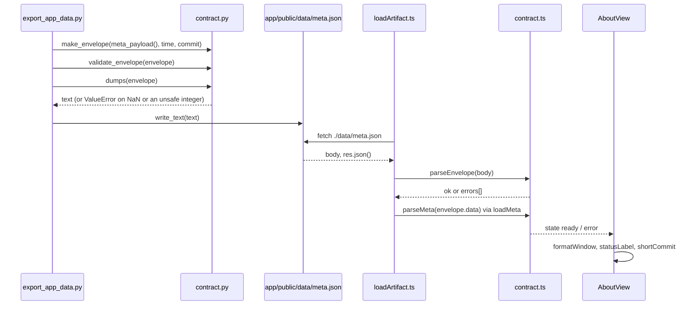

# Milestone 0: scaffold, data contract, design

This is the walkthrough for milestone 0. It explains what exists, why it is built this way, and how
each piece works line by line. No model is fitted in this milestone. What exists is the plumbing
that every later number will travel through.

How to use it:

1. Read the first four sections.
2. Answer the [predict-before-you-look](#predict-before-you-look) questions on paper.
3. Only then read [Results (measured)](#results-measured).
4. Read the concept notes: [00-background](../concepts/00-background.md) and
   [01-reproducibility-and-contracts](../concepts/01-reproducibility-and-contracts.md).
5. Answer the [explain-it-back](#explain-it-back) questions without notes.

Every `file:line` reference is relative to the repository root. Every number in this document
was measured on 2026-10-28 with the commands shown in the Results section.

---

## What was built, and why this design

**The one rule.** Python computes every number. The browser app only draws. Between them sits a
file format, the *contract*. This is [ADR-0001](../adr/0001-python-computes-app-visualises.md).

The pieces:

- **Python computes.** All logic lives in the package `src/arima_forecasting/`. Notebooks import
  it. Tools wrap it. Nothing copies its code. If a number could appear in a notebook, it must
  come from Python (`docs/adr/0001-python-computes-app-visualises.md:70-75`).
- **A versioned JSON envelope.** An *artifact* is one JSON file the app reads, such as
  `app/public/data/meta.json`. Every artifact has the same outer shape, the *envelope*: five keys,
  `schema_version`, `artifact`, `generated_at`, `source_commit` and `data`
  (`docs/architecture/contract.md:14-34`). `schema_version` follows *semantic versioning*
  (semver: `MAJOR.MINOR.PATCH`, where a major bump means "old readers must refuse this").
- **React only draws.** The app in `app/` fetches the JSON, checks it, and renders it. It may
  format a date. It may not compute a result.
- **Data lives outside the repo.** Raw downloads go to `$VOL_DATA_DIR/arima-stock-forecasting/raw/`
  (default `~/data/vol-projects`), never into git. That avoids redistributing Yahoo's data and
  avoids whole-file diffs when Yahoo re-adjusts history (`docs/adr/0001-python-computes-app-visualises.md:130-145`).
- **Exact pins.** Every Python dependency is pinned with `==` in `pyproject.toml:6-15` and
  `pyproject.toml:29-34`, and resolved in `uv.lock`. Every app dependency is an exact version
  in `app/package.json:16-42`, resolved in `app/package-lock.json`. A test checks that each
  Python pin equals the locked version (`tests/test_package.py:53-57`).
- **Generated notebooks.** `tools/build_notebooks.py` is the only source of truth for
  `notebooks/*.ipynb`. A test fails if a committed notebook differs from the builder by a byte.

**Rejected alternatives** (full reasoning in ADR-0001, "Options considered"):

- **Jupyter only:** hidden state from out-of-order cells, numbers locked in cell outputs that no
  test can check, and no interactivity on GitHub.
- **Streamlit or Dash:** a Python server to host, and numbers recomputed on demand instead of
  computed once, verified, and frozen.
- **FastAPI + React:** two services, an API and a server to secure, for no gain when every view
  can be precomputed.
- **Compute in the browser** (Pyodide, or ARIMA re-written in TypeScript): either a huge download
  per visitor, or a second implementation of Kalman-filter maximum likelihood that will not agree
  with statsmodels to the last digit.

The deciding trade-off is *live flexibility* against *verified, frozen numbers*
(`docs/adr/0001-python-computes-app-visualises.md:242-252`). Every interactive choice in this
project is a small finite set, so precomputing all of it is cheap.

---

## Map of the repo

| Path | What it holds | Hand-written or generated |
|---|---|---|
| `src/arima_forecasting/` | The package: `config.py`, `contract.py`, `provenance.py`, `export.py`, `__init__.py` | Hand-written |
| `tests/` | pytest suites, one per module, plus `test_contract_corpus.py` (the shared envelope corpus), `test_package.py` (pins), `test_notebooks.py` (sync and execution) and `test_gitignore.py` (ignore rules) | Hand-written |
| `tools/` | `export_app_data.py` (writes the JSON), `build_notebooks.py` (writes the notebooks), `blender/` (hero renders) | Hand-written |
| `notebooks/` | `00_project_tour.ipynb` | **Generated** by `tools/build_notebooks.py`. Never edit by hand. |
| `app/src/` | The React app: `lib/` (pure logic, coverage-gated), `data/` (the loader and hook), `views/` (pages), `test/` (fixtures, including `envelope_cases.json`, which the Python tests also run) | Hand-written |
| `app/public/data/` | `meta.json` | **Generated** by `tools/export_app_data.py`, and committed |
| `app/dist/`, `app/coverage/` | Production build and coverage report | **Generated**, git-ignored (`.gitignore:26-27`) |
| `app/package-lock.json`, `uv.lock` | Fully resolved dependency trees | **Generated** by npm and uv, committed |
| `docs/adr/`, `docs/architecture/contract.md`, `docs/prfaq.md` | Decisions, the contract, the product framing | Hand-written |
| `docs/architecture/out/*.mmd` | Mermaid diagrams | **Generated** from `docs/architecture/specs/*.yaml` by a shared diagram kit that is not public yet (`docs/architecture/README.md:22-31`) |
| `docs/concepts/`, `docs/milestones/` | Concept notes and walkthroughs like this one | Hand-written |
| `docs/images/` | Screenshots of the app views (`README.md:15-29`) | Generated by browser automation |
| `pyproject.toml`, `.python-version`, `.gitignore` | Project metadata, Python 3.12, ignore rules | Hand-written |
| `reports/` | Result tables from milestone 4 on (`README.md:77`). Until then it holds only `reports/README.md`, which says the tables are produced by the pipeline and never edited by hand | **Generated** (from milestone 4) |
| `$VOL_DATA_DIR/arima-stock-forecasting/raw/` | Raw price snapshots | Outside the repo, never committed |

---

## Code walkthrough by `file:line`

For each piece: what it does, why it is written that way, and what breaks if you write it the
obvious way.

### Python side

#### `config.py`: where data lives, which dates we study

**`data_root`** (`src/arima_forecasting/config.py:24-39`)

```python
    if env is None:
        env = os.environ
    chosen = env.get(DATA_DIR_VARIABLE)
    if not chosen:
        chosen = DEFAULT_DATA_ROOT
    # Path() does not understand "~" on its own; expanduser turns it into the home folder.
    return Path(chosen).expanduser()
```

- *What.* Returns `$VOL_DATA_DIR` if it is set and not empty, otherwise `~/data/vol-projects`,
  with `~` expanded to the home folder.
- *Why.* `env` is a parameter (`config.py:24`), so a test passes a plain dict instead of editing
  `os.environ`, which would leak into other tests. `if not chosen` (`config.py:36`) treats an
  empty string as "not set".
- *Naive version.* `Path(os.environ.get("VOL_DATA_DIR", "~/data/vol-projects"))` has two bugs.
  An exported but empty variable gives `Path("")`, which is `PosixPath('.')` (measured): raw
  downloads would land in whatever folder you ran from, possibly inside the repo. And without
  `expanduser`, `Path("~/x")` stays `PosixPath('~/x')` (measured): a folder literally named `~`.
  Tests: `test_data_root_empty_string_counts_as_unset`, `test_data_root_override_expands_tilde`.

**`raw_dir`** (`config.py:42-44`) returns `data_root(env) / PROJECT_SLUG / "raw"` and nothing
else. It builds a path; it never creates a folder. If it called `mkdir`, merely importing and
calling it from a notebook or test would create folders in your home directory. Test:
`test_raw_dir_does_not_create_anything`.

**`StudyWindow`** (`config.py:47-67`)

```python
    def __post_init__(self) -> None:
        # An empty window (start == end) would silently select no data, so reject it too.
        if self.start >= self.end_exclusive:
            raise ValueError(
                f"StudyWindow {self.name!r}: start {self.start} must be before "
                f"end_exclusive {self.end_exclusive}"
            )
```

- *What.* A frozen dataclass for a half-open window $[\text{start}, \text{end\_exclusive})$:
  `start` is in, `end_exclusive` is out. `COURSE_WINDOW` is 2015-01-01 to 2024-01-01
  (`config.py:74`) and `OOS_WINDOW` (out-of-sample) is 2024-01-01 to 2026-10-01 (`config.py:78`).
- *Why exclusive.* yfinance treats `end` as exclusive (its own docstring says so, at
  `yfinance/multi.py:78` in the virtual environment). Half-open windows tile: the course window
  ends on exactly the date the OOS window starts, with no gap and no shared day
  (`test_windows_are_contiguous_and_do_not_overlap`). The length is `end - start` with no "+1":
  3287 and 1004 calendar days (`test_window_lengths_in_days`).
- *Why `>=`, not `>`.* `start == end_exclusive` is an empty window. It would select no data and
  raise no error. Changing `>=` to `>` makes exactly one test fail,
  `test_study_window_rejects_equal_dates` (measured, see Results).
- *Why frozen.* A notebook cannot reassign `COURSE_WINDOW.start` by accident
  (`test_study_window_is_frozen`).
- *Naive version.* An inclusive end of `2023-12-31` would need `+1 day` arithmetic everywhere
  the window meets yfinance or the next window. Each of those is an off-by-one bug waiting to
  happen. (Here it would be invisible, because 30 and 31 December 2023 are a weekend; see the
  comment at `config.py:70-73`.)

#### `contract.py`: the envelope

**The regexes, and `fullmatch` instead of `$`** (`contract.py:36-42`)

```python
# We match with fullmatch(), never with "^...$" and match(). In Python, "$" also matches just
# before a trailing newline, so "meta\n" would slip through a "^...$" pattern. [0-9] is spelled
# out because "\d" also accepts digits from other scripts.
_ARTIFACT = re.compile(r"[a-z][a-z0-9_]*")
_COMMIT = re.compile(r"(?:[0-9a-f]{40}|[0-9a-f]{64})(-dirty)?")
_TIMESTAMP = re.compile(r"[0-9]{4}-[0-9]{2}-[0-9]{2}T[0-9]{2}:[0-9]{2}:[0-9]{2}Z")
_SEMVER = re.compile(r"(0|[1-9][0-9]*)\.(0|[1-9][0-9]*)\.(0|[1-9][0-9]*)")
```

- *What.* Four patterns, always applied with `fullmatch` (`contract.py:52`, `:56`, `:60`,
  `:126`). `fullmatch` succeeds only if the pattern consumes the whole string. A commit id is
  40 hex characters in a SHA-1 repository and 64 in a SHA-256 one (`git init
  --object-format=sha256`); both are accepted, with or without `-dirty`.
- *Why.* In Python, `$` matches at the end of the string *or just before a final newline*. So
  `re.match(r"^[a-z]+$", "abc\n")` returns a match (measured). A commit string with a stray
  newline would pass. `\d` in a Python `str` pattern matches any Unicode decimal digit:
  `re.fullmatch(r"\d", "١")` (Arabic-Indic one) matches; `[0-9]` does not (measured).
- *Naive version.* `re.match(r"^(?:[0-9a-f]{40}|[0-9a-f]{64})(-dirty)?$", value)` accepts
  `"a"*40 + "\n"`. Swapping `fullmatch` for that makes 6 tests of the full suite fail
  (measured): three newline cases of `test_make_envelope_rejects_bad_commits`, one of
  `test_validate_catches_bad_formats` and two cases of the shared corpus.
- *The JavaScript side differs.* Without the `m` flag, JavaScript's `$` matches only at the true
  end of input: `/^[a-z]+$/.test("abc\n")` is `false` (measured). That is why
  `app/src/lib/contract.ts:58-65` can safely use `^...$`.

**`make_envelope`** (`contract.py:70-104`)

```python
    # A naive datetime has no zone, so it could mean any hour of the day. We refuse to guess.
    if generated_at.tzinfo is None or generated_at.utcoffset() is None:
        raise ValueError("generated_at must be timezone-aware (it has no tzinfo)")
    ...
    # Always store UTC so the same instant gives the same text on every machine. timespec
    # "seconds" drops the microseconds (it truncates; it does not round up).
    utc = generated_at.astimezone(timezone.utc)
    stamp = utc.isoformat(timespec="seconds").removesuffix("+00:00") + "Z"
```

(lines 84-86, then 93-96)

- *What.* Checks every input and raises `ValueError` naming the problem (`contract.py:78-91`).
  Converts the time to UTC, writes it as `YYYY-MM-DDTHH:MM:SSZ`, and returns a new dict with a
  copy of `data` (`contract.py:98-104`).
- *Why pure.* The caller passes the time and the commit (`contract.py:18`). The function never
  reads the clock or runs git, so a test can give it any instant and check the exact output
  (`test_make_envelope_converts_aware_datetimes_to_utc` has four hand-worked cases).
- *Why refuse naive datetimes.* A *naive* datetime has no time zone. Python's `astimezone()`
  silently assumes the machine's local zone: on the build machine
  `datetime(2026, 10, 28, 12, 0).astimezone()` printed `2026-10-28T12:00:00-05:00` (measured).
  Two machines would stamp two different instants for the same code. The check asks for
  `utcoffset()` too, because a `tzinfo` object can exist and still return no offset; the
  review round added `test_make_envelope_rejects_a_tzinfo_that_gives_no_offset` for that half
  of the condition.
- *Why `isoformat`, not `strftime`.* On this Linux machine
  `datetime(5, 1, 2).strftime("%Y")` returns `'5'`, while `isoformat` gives `0005-01-02T...`
  (measured). `test_make_envelope_pads_early_years_to_four_digits` pins the four-digit year.
- *Naive version.* `datetime.now().isoformat() + "Z"` labels local time as UTC, keeps
  microseconds, and fails the timestamp pattern.

**`validate_envelope`** (`contract.py:107-149`)

```python
    if "schema_version" in obj:
        version = obj["schema_version"]
        match = _SEMVER.fullmatch(version) if isinstance(version, str) else None
        if match is None:
            problems.append(f"schema_version {version!r} must be a semver string like '1.0.0'")
        elif int(match.group(1)) != SUPPORTED_MAJOR:
            # Compare the major as a number: "10.0.0" starts with "1" but is a different major.
```

(lines 124-130)

- *What.* Returns a list of *every* problem, or `[]` if the envelope is valid. It reports missing
  keys and **unexpected** keys (`contract.py:119-122`): the envelope's top level is closed, here
  and in the app (`contract.py:11-13`). The export tool runs it; the app does not (it has its
  own parser, below).
- *Why a list.* One run shows everything to fix (`test_validate_returns_all_problems_not_just_the_first`).
- *Why `int(...)`.* The naive check `version.startswith("1")` accepts `10.0.0`. Replacing the
  integer comparison with a string-prefix check makes 4 tests fail (the `10.0.0`, `11.2.3` and
  `100.0.0` cases of `test_validate_rejects_other_major_versions`, and the corpus case for
  `10.0.0`; measured).
- *Why validate after `make_envelope`.* `make_envelope` checks its *inputs*;
  `validate_envelope` checks the *finished object* against `ENVELOPE_KEYS` (`contract.py:34`).
  Two independent statements of one rule catch drift between them.

**`dumps`** (`contract.py:173-191`)

```python
    text = json.dumps(envelope, sort_keys=True, indent=2, allow_nan=False) + "\n"
    _check_safe_integers(envelope, "envelope")
    return text
```

(lines 189-191)

- *What.* The exact bytes written to disk: keys sorted at every level, two-space indent, one
  trailing newline.
- *Why `allow_nan=False`.* By default `json.dumps(float("nan"))` returns `'NaN'` (measured), a
  token that is not JSON. The browser's `JSON.parse` then throws a `SyntaxError` and rejects the
  *whole file* (measured in Node 22). With `allow_nan=False`, `dumps` raises
  `ValueError: Out of range float values are not JSON compliant: nan` and nothing is written.
  Flipping it to `True` makes 6 tests of the full suite fail (measured), from the four
  `test_dumps_refuses_non_finite_floats…` cases to `test_tool_never_writes_nan_to_disk`.
- *Why `sort_keys=True`.* Output no longer depends on dict insertion order, so the same data
  gives the same bytes and git diffs show only real changes. Turning it off makes 2 tests fail:
  `test_dumps_exact_text` and `test_dumps_is_independent_of_insertion_order` (measured).
- *Why `_check_safe_integers`* (`contract.py:152-170`, limit `MAX_SAFE_INTEGER = 2**53 - 1` at
  `:48`). Python writes any integer exactly, but the browser's `JSON.parse` turns every number
  into a 64-bit float, which holds integers exactly only up to 2^53 − 1. Measured in Node 22:
  `JSON.parse("9007199254740993")` gives `9007199254740992`, and a 310-digit `10**309` gives
  `Infinity`. So `dumps` raises `ValueError` for any integer beyond ±(2^53 − 1), naming its path
  (`envelope.data.x`). It walks dicts, lists and tuples, and skips `bool`. It runs *after*
  `json.dumps`, so a NaN or a circular reference is still reported by `json` itself first
  (`test_dumps_reports_a_circular_reference_as_json_does`). Tests:
  `test_dumps_refuses_integers_a_browser_would_round`,
  `test_dumps_accepts_integers_up_to_the_largest_a_browser_reads_exactly`,
  `test_dumps_does_not_print_a_huge_integer_in_full`.

#### `provenance.py`: which commit, what time

*Provenance* means "where a file came from". This module is the only one that talks to git and
the clock (`provenance.py:3-4`).

**`source_commit`** (`provenance.py:43-90`)

```python
    try:
        head = _git(repo, "rev-parse", "HEAD")
        if head.returncode != 0:  # no commits yet, or not a repo
            return UNCOMMITTED
        sha = head.stdout.strip()
```

(lines 53-57)

```python
        status = _git(
            repo,
            "status",
            "--porcelain",
            "--untracked-files=normal",
            "--",
            ":(top)",
            f":(exclude){EXPORT_DIR}",
        )
    except OSError:  # no `git` on PATH, or one we are not allowed to run (PermissionError)
        return UNCOMMITTED
    # If the status command itself fails we cannot show that the tree is clean, so we do not
    # claim it is.
    if status.returncode != 0 or status.stdout.strip():
        return f"{sha}-dirty"
    return sha
```

(lines 75-90; `EXPORT_DIR = "app/public/data"` is at line 26)

- *What.* Three outcomes. `uncommitted`: no git, a git that cannot be run, no repo, or no
  commits yet. `<sha>`: a *SHA* (the id of a commit: 40 hex characters, or 64 in a SHA-256
  repository) with a clean working tree. `<sha>-dirty`: the tree had changes, so the SHA alone
  cannot reproduce the file. A problem with git never raises.
- *Why `git -C repo`* (`provenance.py:35`). Git runs as if started inside `repo`, so the answer
  does not depend on the caller's current folder
  (`test_tool_asks_git_about_this_repo_not_the_current_folder`).
- *Why the pathspec `-- ':(top)' ':(exclude)app/public/data'`.* The exclusion leaves out the
  exporter's own output. Provenance names the *code* that produced a file, and regenerating the
  output does not change the code. Without it, the first export rewrites the tracked
  `meta.json`, the second export stamps `-dirty`, and `SOURCE_DATE_EPOCH` can no longer give
  byte-identical files (the comment at `provenance.py:64-71` says so).
  `':(top)'`, not `'.'`, is what keeps the rest of the repository in view: a bare `.` limits the
  check to the folder `repo` names, so a call from a subfolder would miss a change elsewhere.
  Tests: `test_regenerating_the_exported_file_does_not_make_the_tree_dirty`,
  `test_a_change_elsewhere_is_still_dirty_beside_regenerated_output`,
  `test_only_the_export_folder_itself_is_left_out_of_the_check`,
  `test_a_change_outside_a_subfolder_still_counts_when_asked_from_the_subfolder` and
  `test_two_exports_with_a_fixed_source_date_epoch_are_byte_identical`.
- *Why `errors="surrogateescape"`* (`provenance.py:38`). With `core.quotePath=false`, git
  prints a file name's raw bytes. A name that is not valid UTF-8 then made the old strict
  decoding raise `UnicodeDecodeError` (measured in a scratch repo with a file named `b"\xff.txt"`;
  the current code reports `<sha>-dirty`). Test:
  `test_a_file_name_that_is_not_utf8_makes_the_tree_dirty_instead_of_raising`.
- *Why `except OSError`* (`provenance.py:84`), around both git calls. `FileNotFoundError` covers
  a missing git only; a `git` on `PATH` that is not executable raises `PermissionError`, and one
  that is not a program raises another `OSError`. Test:
  `test_a_git_that_cannot_be_run_is_uncommitted`.
- *Why `--porcelain`.* It is git's stable, machine-readable status format: one line per change,
  and no output at all when the tree is clean.
- *Why `--untracked-files=normal`.* A user's git config can set `status.showUntrackedFiles=no`.
  With that config, `git status --porcelain` printed **0** lines although an untracked file
  existed; with the flag it printed `?? scratch.txt` (measured). A new, uncommitted source file
  changes what the code does, so it must count as dirty. Test:
  `test_untracked_file_is_dirty_even_when_git_config_hides_untracked_files`, which sets that
  config in its temp repo and first checks that plain `git status --porcelain` prints nothing.
- *Why a failed `status` means dirty.* If git cannot prove the tree is clean, the function does
  not claim it is. This is *failing closed*. Test: `test_a_failing_git_status_counts_as_dirty`
  writes garbage into `.git/index`. Then `git status` exits 128 (`fatal: .git/index: index file
  smaller than expected`) while `git rev-parse HEAD` still works (measured).
- *Naive versions.* `git rev-parse HEAD` alone stamps a clean-looking SHA on output built from
  edited code. `git describe --always --dirty` ignores untracked files: with only an untracked
  file present it printed `c15daab` with no `-dirty`, while `source_commit` printed
  `c15daab…-dirty` (measured, in a scratch repo).
- *A known limit, git's rather than ours* (`provenance.py:73-74`). A file marked
  `git update-index --assume-unchanged` or `--skip-worktree` is not looked at, so editing it
  leaves `git status` empty and the commit is not called dirty.
- *A gap this milestone found and closed.* On the first mutation run, deleting
  `"--untracked-files=normal"` (now line 79) or deleting `status.returncode != 0 or` (now line
  88) left all 23 provenance tests of that time passing (measured). The behaviour was right, but
  no test would have noticed if it broke. The two tests above were added for exactly these
  lines; against today's full suite each mutant fails exactly one test (see Results).

**`build_time`** (`provenance.py:93-112`)

```python
    epoch = env.get(SOURCE_DATE_EPOCH_VARIABLE)
    if not epoch:
        return datetime.now(timezone.utc)
    if _EPOCH.fullmatch(epoch) is None:
        raise ValueError(
            f"{SOURCE_DATE_EPOCH_VARIABLE} must be a whole number of seconds written in ASCII "
            f"digits only, got {epoch!r}"
        )
    return datetime.fromtimestamp(int(epoch), tz=timezone.utc)
```

(lines 104-112; `_EPOCH = re.compile(r"[0-9]+")` is at line 22)

- *What.* If `SOURCE_DATE_EPOCH` is set, returns that many seconds after 1970-01-01 00:00 UTC.
  If it is empty or unset, returns now, in UTC. If it is anything but ASCII digits, raises.
- *Why.* `SOURCE_DATE_EPOCH` is the reproducible-builds convention for "use this fixed time
  instead of the clock". With it set, two exports of the same code produce byte-identical files
  (measured; see Q4). The spec allows only what `date +%s` prints.
- *Why a regex and not just `int()`.* An earlier version used `try: int(epoch)`, and `int()` is
  looser than the spec: it accepted `"1_000"`, `" 5 "` and `"-86400"` (measured), and also
  `"5\n"`, `"+5"` and the Arabic-Indic `"١٠"`, which it reads as 10. The ASCII-digits
  `fullmatch` rejects all six; restoring the `int()` version makes all six cases of
  `test_build_time_rejects_what_int_accepts_but_the_spec_does_not` fail (measured).
- *Naive version.* `try: int(epoch) except ValueError: return now()` hides a typo: the build
  silently stops being reproducible. Tests: `test_build_time_rejects_a_value_that_is_not_a_whole_number`,
  `test_tool_fails_on_a_malformed_source_date_epoch`.

#### `export.py` and `tools/export_app_data.py`: building and writing `meta.json`

**`meta_payload`** (`src/arima_forecasting/export.py:34-50`) builds the `data` part of the
`meta` artifact. Ticker, slug and windows come from `config.py` (`export.py:11`), never retyped,
so the app cannot show dates the Python code does not use. The milestone list is a tuple of tuples
(`export.py:17-24`) and the payload is a new dict on every call. A module-level dict would let
one caller's edit leak into every later export; `test_meta_payload_returns_a_fresh_object_each_call`
tampers with one result and checks the next. `test_meta_payload_takes_ticker_and_project_from_config`
monkeypatches the constants and checks the payload follows.

**The exporter** (`tools/export_app_data.py:25-62`) is a thin wrapper. The clock and git are read
once, at the edge (`export_app_data.py:36-41`), then handed to the pure code. It validates the
finished envelope and exits 1 with every problem listed if it fails (`export_app_data.py:48-53`).
Then:

```python
    # Serialise first: if the data contains NaN, dumps raises here and no half-written file
    # is left behind.
    text = dumps(envelope)
    args.out.mkdir(parents=True, exist_ok=True)
    path = args.out / "meta.json"
    path.write_text(text, encoding="utf-8")
```

(lines 55-60)

- *Why serialise before opening the file.* The naive version,
  `with open(path, "w") as f: json.dump(envelope, f, allow_nan=False)`, streams to the file and
  raises halfway. Measured: it left a truncated file ending in `"z": `. Here, a NaN raises before
  the folder even exists. `test_tool_never_writes_nan_to_disk` asserts the output folder was
  never created.
- *Why `REPO_ROOT` comes from `__file__`* (`export_app_data.py:21`). Git is asked about this
  repo even when you run the tool from somewhere else.

#### `tools/build_notebooks.py`: notebooks as build output

```python
    for index, (kind, source) in enumerate(cells):
        # nbformat 4.5+ gives every cell a random id. We set our own so the file is identical
        # on every build.
        cell_id = f"cell-{index:02d}"
        if kind == "markdown":
            nb_cells.append(new_markdown_cell(source, id=cell_id))
        elif kind == "code":
            # new_code_cell already means no outputs and execution_count None.
            nb_cells.append(new_code_cell(source, id=cell_id))
```

(lines 201-209)

- *What.* Each notebook is a Python function returning `(kind, source)` pairs (`build_notebooks.py:40`,
  registered at `:194-196`). `build_notebook` turns them into cells with fixed ids `cell-00`,
  `cell-01`, ... and fixed metadata (`:31-34`). `render` validates the notebook against the
  nbformat schema (`:218`) and ensures one trailing newline (`:220`).
- *`--check`* (`:255-263`) rebuilds every notebook in memory, compares the text with the file on
  disk (`stale_notebooks`, `:228-237`), prints `missing:` or `stale:` lines, exits 1, and writes
  nothing.
- *Naive version.* nbformat's `new_code_cell()` gives each cell a random 8-hex id. Two calls
  gave `bd6a5883` and `6e7f134d` (measured). Every build would differ, and `--check` could never
  pass. Removing `id=cell_id` from the code cell makes 4 of the 10 notebook tests fail (measured).
  Fixed metadata matters for the same reason: Jupyter otherwise writes the saver's Python
  version into the file.

#### The notebook sync and execution tests (`tests/test_notebooks.py`)

Two halves. **(a) Sync:** `test_committed_notebook_equals_the_builder_output` (`:44-51`) compares
bytes; `test_every_notebook_file_in_the_folder_is_known_to_the_builder` (`:54-57`) stops a
hand-made notebook from escaping the check; `test_notebook_build_is_byte_deterministic_and_clean`
(`:60-77`) builds twice and checks ids, metadata and empty outputs. **(b) Execution:** every
notebook really runs.

The kernel is built inside `tmp_path` (`tests/test_notebooks.py:120-150`):

```python
    (spec_dir / "kernel.json").write_text(
        json.dumps(
            {
                "argv": [sys.executable, "-m", "ipykernel_launcher", "-f", "{connection_file}"],
                "display_name": "arima-test",
                "language": "python",
            }
        )
    )
    monkeypatch.setenv("JUPYTER_PATH", str(tmp_path / "jupyter"))
```

(lines 131-140)

- *What.* A *kernelspec* is a small `kernel.json` that tells Jupyter which program to launch as
  the kernel. This one launches `sys.executable`, the very interpreter running pytest, which is
  the project's virtual environment.
- *Why.* A kernel named `python3` could resolve to some other Python on another machine, one
  that cannot import `arima_forecasting`. Jupyter searches `JUPYTER_PATH` before anything else:
  with it set, `KernelSpecManager().kernel_dirs` listed the temp folder first, then
  `.venv/share/jupyter/kernels`, then `~/.local/share/jupyter/kernels` (measured). The name
  `arima-test` is unique anyway. `JUPYTER_RUNTIME_DIR` (`:142`) keeps connection files in the
  temp folder too, so nothing is installed outside it.
- *Why `IPYTHONDIR` too* (`:143-149`). The interpreter was pinned, but the kernel still ran the
  developer's own IPython startup files: the code review pointed `IPYTHONDIR` at a startup file
  that put a decoy package first on `sys.path`, and the notebook tests passed while importing the
  decoy. The fixture now points `IPYTHONDIR` at an empty folder. Two tests pin this:
  `test_a_startup_file_in_the_ipython_dir_does_run_in_a_kernel` is the control (it shows a decoy
  startup file really does run), and `test_the_test_kernel_ignores_the_users_ipython_startup_files`
  shows that it does not run in the test kernel.
- `execute` (`:153-167`) runs the notebook in memory with `nbclient`; the file on disk is never
  touched. `test_project_tour_prints_the_values_it_explains` (`:221-242`) then checks printed
  values worked out by hand (3287 days, `10:00:00Z`, the NaN rejection). "No error" alone would
  not prove the cells called the real package.
- *Naive version.* `jupyter nbconvert --execute --inplace` would write outputs into the
  committed notebook, and the sync test would fail on the next run.

### App side

#### `contract.ts`: `parseEnvelope` and `parseMeta`

**The Result type** (`app/src/lib/contract.ts:55-56`):
`{ ok: true; envelope: Envelope } | { ok: false; errors: string[] }`. This is a *discriminated
union*: TypeScript lets you read `envelope` only after checking `ok`. The naive alternative,
`JSON.parse(text) as Envelope`, is a type assertion. It has no effect at run time, so a `2.0.0`
file would sail through and be drawn wrongly.

**`parseEnvelope`** (`contract.ts:132-180`)

```ts
  const schemaVersion = readString(raw, 'schema_version', '', errors)
  if (schemaVersion !== undefined) {
    const m = SEMVER.exec(schemaVersion)
    if (m === null) {
      errors.push(`schema_version: "${schemaVersion}" is not a semantic version (MAJOR.MINOR.PATCH)`)
    } else if (Number(m[1]) !== SUPPORTED_MAJOR) {
      errors.push(`schema_version: major version ${m[1]} is not supported (this app reads ${SUPPORTED_MAJOR}.x.y)`)
    }
  }
```

(lines 136-144)

- *Collecting every error.* Each check pushes onto one `errors` array and carries on. Only at the
  end does it decide (`contract.ts:173-175`). Test: "reports every problem in one pass, not just
  the first" (five problems, five errors).
- *Refusing major ≠ 1.* `Number(m[1])` compares the major as a number. Replacing it with a
  first-character check makes 2 app tests fail, "refuses major 10.0.0" and the shared corpus's
  `10.0.0` case (measured).
- *`Object.hasOwn`* (`contract.ts:116`). A key inherited through the prototype does not count as
  present (test: "does not count inherited properties as present"). `key in obj` would count it.
- *A closed top level, an open `data`.* Any top-level key outside the five is an error
  (`contract.ts:166-171`, keys listed at `:66`), exactly as in `contract.py:121-122`, so a new
  envelope field is a major bump. `Object.keys` lists own keys only, so a key the file calls
  `"__proto__"` or `"constructor"` is reported like any other. Inside `data` the reader stays
  tolerant: the payload parsers build a **new** object from the keys they know and ignore the
  rest, which is what lets a minor version add fields
  (`docs/architecture/contract.md:43-47`). The success value is a new object built from the five
  known keys (`contract.ts:176-179`). The [concept note](../concepts/01-reproducibility-and-contracts.md)
  explains the trade-off.
- *The artifact name.* `parseEnvelope` applies the same pattern as Python, `^[a-z][a-z0-9_]*$`
  (`contract.ts:146-149`, pattern at `:65`). The loader adds the "is this the file I asked for"
  check.
- *The calendar, by plain arithmetic.* `isUtcTimestamp` (`contract.ts:102-107`) and `isIsoDate`
  (`:96-99`) call `isCalendarDay` (`:91-94`), which uses a month-length table (`:78`) and the
  Gregorian leap-year rule (`isLeapYear`, `:81-83`). It does not use `Date.UTC`, because that
  function reads the years 0–99 as 1900–1999 (measured in Node 22: `Date.UTC(1, 0, 1)` is in
  1901), so a `Date`-based check wrongly rejected every day in the years 0001–0099 that Python
  accepts. Years run 0001–9999, hours 00–23, minutes and seconds 00–59, so a leap second (a seconds
  field of 60) is refused.

**`parseMeta`** (`contract.ts:226-273`) validates the `meta` payload in the same style. Errors
carry a path such as `data.milestones[1].status`. It enforces the closed status enum
(`contract.ts:218-220`), unique milestone ids (`:210`) and `start < end_exclusive` for each window
(`:194`; ISO dates compare correctly as strings). It requires exactly one milestone with status
`current` (`:251-259`), as `docs/architecture/contract.md:118` says; the check runs only once
every milestone parsed, so one bad status does not also produce a "no current milestone" error.
Tests: 'rejects a payload with no "current" milestone, including an empty milestone list' and
'rejects two "current" milestones and names their ids'. The Python side has the same rule in
`test_meta_payload_milestones_are_numbered_in_order_with_one_current` (`tests/test_export.py:84-89`).
It returns a fresh object (`contract.ts:272`), so extra payload keys are ignored.

**The shared corpus** (`app/src/test/fixtures/envelope_cases.json`) is the main guard against
the two readers drifting apart. It is one list of 142 envelopes (34 valid, 108 invalid), each with
a name and the verdict both sides must reach. `tests/test_contract_corpus.py` runs every case
through Python's `validate_envelope`, and `app/src/lib/contract.corpus.test.ts` runs the same
file through `parseEnvelope`, so a rule changed on one side only fails a test on that side.
Before it existed, the code review fed 82 envelopes to both readers and found 14 disagreements:
three timestamps in the years 0001–0099 that Python accepted and the app refused, eight artifact
names (`Meta`, `1meta`, `méta`, …) and three extra top-level keys that Python refused and the app
accepted. Re-run on the current code, those 82 envelopes give 0 disagreements, and so does
a grid of 1,120,100 timestamp strings (every `YYYY-MM-DDT12:00:00Z` for years 0000–9999, months 00–13 and days 00, 01 and 27–32, plus `2026-10-28` with hours 00, 01, 23, 24, 25 × minutes 00, 01, 59, 60 × seconds 00, 01, 59, 60, 61).
The code before the fix disagreed on 6,459 of them, every one in the years 0001–0099 (all
measured by the final verifier pass).

**`contract.realdata.test.ts`** (`app/src/lib/contract.realdata.test.ts`) is the other
cross-language check. The other parser tests use hand-built fixtures on purpose, so a parser
bug cannot hide behind a file the same code produced. This one reads whatever Python last
exported:

```ts
const FILES = import.meta.glob<string>('../../public/data/*.json', { query: '?raw', import: 'default', eager: true })
```

(`contract.realdata.test.ts:12`)

- *What.* For every file in `app/public/data/`, it runs `JSON.parse` on the raw text (standing in
  for `res.json()`), then `parseEnvelope`, checks that `artifact` equals the file name, and runs
  that artifact's payload parser from `PAYLOAD_PARSERS` (`:17-19`). It also checks that the files
  present are exactly `meta.data.artifacts` (`:40-46`).
- *Why `import.meta.glob` with `?raw`.* Node's `fs` would need `@types/node`, which is not in the
  app's TypeScript `types` (`app/tsconfig.app.json:8`). The glob is a Vite feature typed by
  `vite/client`, it picks up a new artifact file automatically, and `?raw` hands over the bytes
  unparsed, so a bare `NaN` fails at `JSON.parse` exactly as it would in the browser.
- *What it catches* (each measured on a scratch copy): renaming `ticker` to `symbol` in the real
  `meta.json`, a bare `NaN` in it, and a new `aic_grid.json` with no registered payload parser
  each fail 2 tests.

#### `loadArtifact.ts`: typed errors, and `BASE_URL` with `base: './'`

```ts
  if (!ARTIFACT_NAME.test(name)) return { ok: false, error: { kind: 'invalid_name', name } }
  // BASE_URL is './' in the built app (vite base), so the data folder resolves next to index.html.
  const url = `${import.meta.env.BASE_URL}data/${name}.json`
```

(`app/src/data/loadArtifact.ts:19-21`)

- *What.* The only place the app does I/O for study data (`loadArtifact.ts:1-3`). It refuses a
  bad name before building a URL (`:13`, `:19`), so `../secret` is never fetched. Then each
  failure becomes a typed value: `network` (`:24-28`), `http` (`:29`), `json` (`:32-36`),
  `contract` (`:38-39`) and `artifact_mismatch` (`:40-42`). The union is declared in
  `app/src/lib/loadError.ts:6-12`, and `describeLoadError` (`loadError.ts:15-30`) turns each into
  a sentence.
- *Why typed values, not exceptions.* The caller switches over `kind`. A throwing loader would
  need a `try` in every caller, and an unhandled rejection inside a React effect would leave the
  page on "Loading…" forever.
- *Why `fetchImpl` is a parameter* (`loadArtifact.ts:9`, `:17`). Tests pass a fake; the app uses
  the real `fetch`.
- *Why `BASE_URL` plus `base: './'`* (`app/vite.config.ts:7`). Vite resolves `BASE_URL` to `/`
  for the dev server and `./` for the build (measured with `resolveConfig`). The built bundle
  contains `./data/${f}.json` (measured). A relative URL resolves next to `index.html`, so the
  build works under any sub-path, such as a GitHub Pages project site at `/<repo>/`. A hard-coded
  `/data/meta.json` would ask the domain root and get a 404 there. Hash routing (below) keeps the
  document path fixed at `index.html`, which is what makes the relative URL safe.
- Dropping the `artifact_mismatch` check makes exactly one test fail, "rejects an envelope whose
  artifact name is not the one requested" (measured).

#### `useMeta.ts`: three states

```ts
export type MetaState =
  | { status: 'loading' }
  | { status: 'error'; error: ArtifactLoadError }
  | { status: 'ready'; envelope: Envelope; meta: Meta }
```

(`app/src/data/useMeta.ts:9-12`)

- `loadMeta` (`useMeta.ts:14-20`) loads the envelope, then parses the payload. A payload problem
  becomes a `contract` error too (`:18`).
- `useMeta` (`:22-34`) starts in `loading`, runs `loadMeta` once, and uses a `live` flag
  (`:25-30`) so a result that arrives after unmount is ignored.
- *Naive version.* Three separate variables `isLoading`, `error`, `data` allow impossible
  combinations (loading *and* failed). The union makes `meta` reachable only when `status` is
  `ready`.

#### Routing in `shell.tsx`

```ts
function readRoute(fallback: string): string {
  const m = /^#\/([a-z0-9-]+)/i.exec(window.location.hash)
  return m ? m[1] : fallback
}
```

(`app/src/lib/shell.tsx:16-19`)

The route lives in the URL *hash* (`#/architecture`). The hash never reaches the server, so a
static host serves `index.html` for every page. An unknown route falls back to the first page
(`shell.tsx:54`). `go` (`:57-61`) prevents the browser's default jump, sets the hash only if it
changed, and updates state. A `hashchange` listener (`:47-51`) handles the back button. *Naive
version:* path routes like `/architecture` need the server to rewrite every path to `index.html`.
A plain static host has no such rewrite, so reloading that page gives a 404.

#### `AboutView` and `ArchitectureView`

`AboutView` (`app/src/views/AboutView.tsx:36-82`) has fixed copy plus `DataFacts`
(`:84-142`), which renders one branch per state: a `role="status"` loading line (`:85-91`), a
`role="alert"` panel listing every problem plus the exact command to regenerate the data
(`:92-107`), or the facts (`:108-140`). The provenance footer appears only when ready
(`:75-79`). The window labels come from `formatWindow` and the short commit from `shortCommit`
(`app/src/lib/present.ts:8-12`, `:26-28`). Those are presentation transforms, not results:
`formatWindow` turns the end-exclusive `2024-01-01` into the inclusive label `2023-12-31` for
human readers. Its helper `dayBefore` (`present.ts:15-23`) uses `setUTCFullYear` rather than
`Date.UTC`, for the same 0–99 reason as the parser (test: "keeps years 0001-0099 as they are
(Date.UTC would read them as 1901-1999)"). `shortCommit` shortens a 40- or 64-hex id to 7
characters and keeps `-dirty`.

`ArchitectureView` (`app/src/views/ArchitectureView.tsx:50-113`) is static. It reads no data
(`:2-3`). It draws three SVG diagrams and the 3D wiring check (`:109`).

#### The lazy `AicAxesPreview` → `AicAxesScene` chunk split

```ts
const LazyScene = lazy(() => import('./AicAxesScene'))
```

(`app/src/views/AicAxesPreview.tsx:12`)

`import()` is a *dynamic import*: the bundler (Vite, via Rollup) puts the imported module and
everything only it uses (three.js, react-three-fiber, drei) into a separate file, a *chunk*, and
downloads it only when `LazyScene` first renders. `React.lazy` needs a default export, hence
`export default function AicAxesScene` (`app/src/views/AicAxesScene.tsx:30`). Measured build: the
main `index` chunk is 224.51 kB and the `AicAxesScene` chunk is 1,082.42 kB. The main chunk
contains the string `WebGLRenderer` zero times; the scene chunk contains it 39 times. A static
`import AicAxesScene from './AicAxesScene'` would put three.js in the main chunk, downloaded by
every visitor, including those who only read About.

#### `hasWebGL` and its fallback

```ts
export function hasWebGL(doc: CanvasHost = document): boolean {
  try {
    return Boolean(doc.createElement('canvas').getContext('webgl2'))
  } catch {
    return false
  }
}
```

(`app/src/lib/capabilities.ts:18-24`)

- *What.* Tries to create a WebGL2 context on a throwaway canvas. Any failure means `false`
  (*fail closed*). It asks for `webgl2` specifically because three.js has needed WebGL2 since
  r163 (`capabilities.ts:14-17`).
- *Two fallback paths* (`AicAxesPreview.tsx:59-67`). If the probe says no, the static
  `AicAxesFallback` (`:16-30`) renders and `LazyScene` never renders, so the 1 MB chunk is never
  even requested. If the probe says yes but the scene throws anyway, the error boundary
  `PreviewBoundary` (`:33-44`) catches it and shows the same fallback. The probe runs once per
  mount (`useMemo`, `:55`).
- *Naive version.* No probe and no boundary. In React, an error thrown while rendering, with no
  error boundary above it, unmounts the whole tree: the entire app goes blank, not just the 3D
  card. (Measured in a scratch vitest run with React 19.2.8: rendering
  `<main><h1>About</h1><Boom /></main>`, where `Boom` throws, threw out of `render`, and the
  sibling `<h1>` was no longer in the document.) Tests: "does not even try to build the scene when WebGL is unavailable", "falls back to
  the static description if the scene throws (probe said yes, context creation failed)", "is
  false when only WebGL1 is available, because three.js needs WebGL2".

#### Reduced motion

`prefersReducedMotion` (`capabilities.ts:27-33`) reads the `prefers-reduced-motion: reduce`
media query once. `useReducedMotion` (`app/src/views/hooks.ts:8-18`) follows later changes.
`motionSettings` (`app/src/lib/aicAxes.ts:154-157`) maps the answer to scene settings:

```ts
export function motionSettings(reducedMotion: boolean): MotionSettings {
  if (reducedMotion) return { autoRotate: false, autoRotateSpeed: 0, enableDamping: false, frameloop: 'demand' }
  return { autoRotate: true, autoRotateSpeed: 0.6, enableDamping: true, frameloop: 'always' }
}
```

These feed `OrbitControls` (`AicAxesScene.tsx:58-60`) and the canvas `frameloop`
(`AicAxesScene.tsx:37`). `'demand'` renders only when something changes. *Naive version:* a CSS
`@media (prefers-reduced-motion)` rule. It cannot stop a JavaScript render loop, and three.js
auto-rotation is JavaScript. Tests: "turns auto-rotate off and renders on demand when the reader
prefers reduced motion", "follows a live change of the reduced-motion preference".

---

## The data flow through it

One artifact, end to end.

| # | Hop | Where |
|---|---|---|
| 1 | `meta_payload()` builds the `data` dict from `config.py` constants | `src/arima_forecasting/export.py:34-50`, called at `tools/export_app_data.py:38` |
| 2 | `build_time()` and `source_commit(REPO_ROOT)` read the clock and git, once | `src/arima_forecasting/provenance.py:93`, `:43`; called at `tools/export_app_data.py:39-40` |
| 3 | `make_envelope` checks inputs, converts to UTC, wraps the dict | `src/arima_forecasting/contract.py:70-104`, called at `tools/export_app_data.py:36` |
| 4 | `validate_envelope` checks the finished envelope; exit 1 if any problem | `contract.py:107-149`, called at `tools/export_app_data.py:48` |
| 5 | `dumps` serialises, refusing NaN and integers beyond ±(2^53 − 1) | `contract.py:173-191`, called at `tools/export_app_data.py:57` |
| 6 | The text is written to `app/public/data/meta.json` | `tools/export_app_data.py:58-60` (default folder at `:22`) |
| 7 | Vite serves `app/public/` in dev and copies it into `app/dist/` at build (measured: `app/dist/data/meta.json` exists after `npm run build`) | `app/vite.config.ts:7` |
| 8 | `useMeta` calls `loadMeta`, which calls `loadArtifact('meta')` | `app/src/data/useMeta.ts:26`, `:15` |
| 9 | `fetch` of `${BASE_URL}data/meta.json`, then `res.json()` | `app/src/data/loadArtifact.ts:21`, `:25`, `:33` |
| 10 | `parseEnvelope` checks the five keys and refuses any other; the loader checks the artifact name | `loadArtifact.ts:38-42` → `app/src/lib/contract.ts:132-180` |
| 11 | `parseMeta` checks the payload; state becomes `ready` | `useMeta.ts:17-19` → `contract.ts:226-273` |
| 12 | `App` passes the state to `AboutView` | `app/src/App.tsx:9`, `:16` |
| 13 | `present.ts` formats for display: `formatWindow`, `statusLabel`, `shortCommit` | `app/src/views/AboutView.tsx:118`, `:122`, `:133`, `:77` → `app/src/lib/present.ts:26-28`, `:32-34`, `:8-12` |
| 14 | The About page shows `2015-01-01 to 2023-12-31` and `2024-01-01 to 2026-09-30` | asserted by "loads data/meta.json through the contract and renders the study facts on About" (`app/src/App.test.tsx:28-39`) |



The two halves never run together. They meet only through the file. A test replays hops 9–11
against the committed file without a browser: `app/src/lib/contract.realdata.test.ts` (see the
`contract.ts` section), so a change at hop 1 that the app cannot read fails `npm test` once
Python re-exports. See also the fuller diagram in `docs/architecture/README.md:478-524`.

---

## Pitfalls met in this milestone, and how each is guarded

**1. NaN and Infinity in JSON.**
- *Failure.* `json.dumps(float("nan"))` returns `'NaN'` by default (measured). In Node 22,
  `JSON.parse('{"x": NaN}')` throws `SyntaxError: Unexpected token 'N', "{"x": NaN}" is not
  valid JSON` (measured). One bad float blanks a whole view, far from its cause.
- *Guard.* `allow_nan=False` at `src/arima_forecasting/contract.py:189`; serialise before writing
  at `tools/export_app_data.py:55-60`; in the app, a parse failure becomes a `json` error panel
  (`app/src/data/loadArtifact.ts:32-36`).
- *Tests.* `test_dumps_refuses_non_finite_floats`, `test_dumps_refuses_non_finite_floats_nested_in_lists`,
  `test_tool_never_writes_nan_to_disk`; in the app, "turns invalid JSON (for example an HTML
  fallback page served with 200) into a typed json error", and the real-data test, which fails if
  a committed file contains a bare `NaN` (measured on a scratch copy).

**2. Naive datetimes.**
- *Failure.* A datetime without `tzinfo` is read as local time: `astimezone()` gave `-05:00` on
  this machine (measured), so the stamp depends on where you run.
- *Guard.* `src/arima_forecasting/contract.py:85-86` raises; `provenance.py:106` and `:112` only
  ever produce UTC-aware times.
- *Tests.* `test_make_envelope_rejects_naive_datetime`, and
  `test_make_envelope_rejects_a_tzinfo_that_gives_no_offset` for a `tzinfo` whose `utcoffset()`
  is `None`. Removing the guard fails exactly these two (measured).

**3. `$` matching before a trailing newline.**
- *Failure.* `re.match(r"^[a-z]+$", "abc\n")` returns `<re.Match object; span=(0, 3), match='abc'>`
  (measured), so `"meta\n"` or a SHA plus newline would pass.
- *Guard.* `fullmatch` everywhere (`contract.py:52`, `:56`, `:60`, `:126`; comment at `:36-38`),
  and the same idea for `SOURCE_DATE_EPOCH` (`provenance.py:107`), which now rejects `"5\n"`.
- *Tests.* `test_make_envelope_rejects_bad_artifact_names` (`"meta\n"`),
  `test_make_envelope_rejects_bad_commits` (`"a"*40 + "\n"`, `"a"*40 + "-dirty\n"`),
  `test_validate_catches_bad_formats` (`"…Z\n"` and others).

**4. nbformat's random cell ids.**
- *Failure.* Two `new_code_cell()` calls gave ids `bd6a5883` and `6e7f134d` (measured). Every
  build differs, so the sync check can never pass.
- *Guard.* `id=f"cell-{index:02d}"` at `tools/build_notebooks.py:204-209`.
- *Tests.* `test_notebook_build_is_byte_deterministic_and_clean`,
  `test_committed_notebook_equals_the_builder_output`, `test_cli_check_passes_on_the_committed_notebooks`,
  `test_cli_write_then_check_then_detect_stale_and_missing` (all four fail without the guard;
  measured).

**5. The `.gitignore` `data/` trap.**
- *Failure.* A bare `data/` pattern matches a folder named `data` at *any* depth. In a scratch repo
  with that rule, `git check-ignore -v` reported both `app/src/data/loadArtifact.ts` and
  `app/public/data/meta.json` as ignored by `.gitignore:1:data/`, and `git status` listed neither
  (measured). The loader and the exported JSON would never be committed: the app works on your
  machine and breaks on a fresh clone.
- *Guard.* The root rule is anchored with a leading slash, `/data/` (`.gitignore:4`, with the
  reason at `.gitignore:2-3`). In this repo, `git check-ignore -v --no-index` on those two files
  plus `data/raw.csv` matched only `data/raw.csv` (measured).
- *Tests.* `tests/test_gitignore.py`: `test_files_the_app_needs_are_not_ignored`,
  `test_a_new_file_in_app_src_data_is_not_ignored_either` and
  `test_raw_data_at_the_repo_root_is_ignored_by_the_anchored_rule`, which asks about a
  hypothetical `data/raw/AAPL.csv`. Changing `/data/` back to `data/` on a scratch copy fails all
  4 tests (measured). The helper passes `--no-index` (`tests/test_gitignore.py:30`), and that flag
  matters: in a scratch repo, a *tracked* `data/t.csv` was not reported as ignored without it
  (exit 1, no output) and was reported with it (exit 0) (measured). Without the flag, the test
  would go blind to a bad rule as soon as these files are committed. One more measured detail:
  `/data/` does not match the bare name `data` (exit 1), because for a path that does not exist
  git cannot tell it is a folder; the test asks about a file inside it.

**6. A file cannot contain the SHA of the commit that contains it.**
- *Failure.* A commit's SHA is a hash of its contents. If `meta.json` held the SHA of its own
  commit, writing the SHA would change the contents, which changes the SHA.
- *Guard.* The two-commit procedure (`docs/adr/0001-python-computes-app-visualises.md:157-162`):
  commit the code, export on the clean tree, commit only the regenerated JSON in a second commit.
  That second commit's JSON names the first commit. `source_commit` counts untracked files, so the
  procedure only works from a genuinely clean tree (the export folder itself is left out of the
  check; see pitfall 12).
- *Tests.* `test_untracked_file_is_dirty`, `test_modified_tracked_file_is_dirty`,
  `test_staged_but_uncommitted_change_is_dirty`, `test_returns_to_clean_after_committing_the_change`,
  and, since this milestone's mutation run, `test_untracked_file_is_dirty_even_when_git_config_hides_untracked_files`.

**7. pandas 3.1 removed `fillna(method=...)`.**
- *Failure.* The course's `fillna(method='ffill')` raises
  `TypeError: NDFrame.fillna() got an unexpected keyword argument 'method'` in pandas 3.1.0
  (measured). `.ffill()` gives `[1.0, 1.0, 3.0]` for `[1.0, None, 3.0]` (measured).
- *Guard.* The port will use `.ffill()` (`docs/adr/0002-order-selection.md:88-92`,
  `docs/architecture/contract.md:139`).
- *Test.* None yet; the loader is milestone 1.

**8. yfinance 1.7.0's shape: a MultiIndex and no `Adj Close`.**
- *Failure.* With the default `auto_adjust=True` (`yfinance/multi.py:56`), `Close` is already the
  adjusted close and there is **no** `Adj Close` column. For a single ticker the columns are still
  a two-level MultiIndex `(Price, Ticker)`, so the close is `df[("Close", "AAPL")]`
  (`docs/architecture/README.md:437-448`; `docs/adr/0001-python-computes-app-visualises.md:134-137`).
  On an error, `download` returns an empty frame instead of raising
  (`docs/architecture/README.md:473-476`). Course code written for older yfinance reads the wrong
  column or nothing. (Nothing was downloaded for this milestone; these are cited, not re-measured.)
- *Guard.* Planned for the milestone-1 loader: `price_basis: "adjusted_close"` in the contract
  (`docs/architecture/contract.md:133`) and an explicit empty-frame check.
- *Test.* None yet.

**9. The statsmodels-vs-pmdarima trend mismatch.**
- *Failure.* With d = 1, `auto_arima` starts its search with an intercept, and here the
  stepwise search kept it; in SARIMAX that intercept is a drift. The course then refits
  `statsmodels` `ARIMA(order=...)`, which defaults to no trend when d ≥ 1. Measured on simulated
  data: the refit's 200-step forecast is flat at 4.8874; pmdarima's rises to 5.0529 (Q5 below;
  [ADR-0002](../adr/0002-order-selection.md), Context, problem 2, lines 59-79).
- *Guard.* The trend is part of the model and chosen explicitly: for d = 1 the grid fits both
  `'n'` and `'t'` (`docs/adr/0002-order-selection.md:222-241`). The `fit` artifact will keep the
  course's refit as `course_refit` so the app can show the dropped drift
  (`docs/architecture/contract.md:301`).
- *Test.* None yet; the grid and fit are milestones 2 and 3.

The eight pitfalls below were found by the adversarial review of this milestone
([`docs/validation/m0-code-review-ledger.md`](../validation/m0-code-review-ledger.md)) and fixed
before the first commit. Each has the same shape: the obvious code was right on the cases its
author thought of and wrong on an input nobody had tried.

**10. `Date.UTC` reads the years 0–99 as 1900–1999.**
- *Failure.* The app checked a date by building it with `Date.UTC` and reading the parts back.
  ECMAScript maps a year argument from 0 to 99 to 1900 + year, so `Date.UTC(1, 0, 1)` lands in
  1901 (measured in Node 22), and every day in the years 0001–0099 failed the check while Python's
  `datetime` accepted it. Over a grid of 1,120,100 timestamp strings (every `YYYY-MM-DDT12:00:00Z` for years 0000–9999, months 00–13 and days 00, 01 and 27–32, plus `2026-10-28` with hours 00, 01, 23, 24, 25 × minutes 00, 01, 59, 60 × seconds 00, 01, 59, 60, 61),
  the two readers disagreed on 6,459, every one in those years (measured on the code before the
  fix; the fixed readers disagree on none).
- *Guard.* Plain calendar arithmetic: `isCalendarDay` with a month-length table and the
  Gregorian leap-year rule (`app/src/lib/contract.ts:78-94`). The display helper `dayBefore`
  uses `setUTCFullYear` instead (`app/src/lib/present.ts:15-23`). On the same grid the two
  readers now agree on every string (measured).
- *Tests.* "calendar arithmetic" in `app/src/lib/contract.test.ts` ("agrees with the Date oracle
  on every year 0001-9999 around the end of February and in every month length", "refuses year
  0000 on every day, as Python datetime does"), "parseEnvelope: generated_at" ("accepts
  0001-01-01T00:00:00Z" and others), and in `present.test.ts` "keeps years 0001-0099 as they are
  (Date.UTC would read them as 1901-1999)". Restoring the `Date.UTC` check fails 9 tests
  (measured).

**11. The app's reader accepted names and keys that Python refused.**
- *Failure.* `parseEnvelope` only checked that `artifact` was non-empty and ignored unknown
  top-level keys, while Python refused both. Fed the same 82 envelopes, the two readers disagreed
  on 14: three early-year timestamps (pitfall 10), eight artifact names such as `Meta`, `1meta`
  and `méta`, and three extra top-level keys, `extra`, `__proto__` and `constructor` (the code
  review's count). Two hand-written test suites had each tested its own reader and never
  compared them.
- *Guard.* The envelope's top level is now closed on both sides (`contract.ts:166-171`,
  `src/arima_forecasting/contract.py:121-122`) and both apply `^[a-z][a-z0-9_]*$`
  (`contract.ts:65`, `contract.py:39`). One shared list of 142 envelopes with their expected
  verdicts, `app/src/test/fixtures/envelope_cases.json`, runs through both readers. Re-run on the
  current code, the review's 82 envelopes give 0 disagreements (measured).
- *Tests.* `tests/test_contract_corpus.py::test_validate_envelope_agrees_with_the_corpus` and, in
  `app/src/lib/contract.corpus.test.ts`, "parseEnvelope agrees: …" (one test per case), plus a
  check on each side that the file really is a list of cases.

**12. The exporter dirtied its own provenance.**
- *Failure.* `source_commit` ran plain `git status`. In a committed repo, the first export
  rewrote the tracked `meta.json`, so the second export of the *same* code stamped
  `<sha>-dirty`, and `SOURCE_DATE_EPOCH` no longer gave byte-identical files (the code review
  measured this in a scratch repo; Q3 below shows the fixed behaviour).
- *Guard.* The pathspec `-- ':(top)' ':(exclude)app/public/data'`
  (`src/arima_forecasting/provenance.py:75-83`). The exclusion leaves out only the exporter's own
  output folder. `':(top)'` keeps the whole repository in the check; a bare `'.'` would see only
  the folder `source_commit` was asked about, so a call from a subfolder would miss a change
  elsewhere.
- *Tests.* `test_regenerating_the_exported_file_does_not_make_the_tree_dirty`,
  `test_two_exports_with_a_fixed_source_date_epoch_are_byte_identical`,
  `test_a_change_elsewhere_is_still_dirty_beside_regenerated_output`,
  `test_only_the_export_folder_itself_is_left_out_of_the_check` and
  `test_a_change_outside_a_subfolder_still_counts_when_asked_from_the_subfolder`.

**13. A Python integer can be a number JavaScript cannot hold.**
- *Failure.* `json.dumps({"x": 10**309})` writes all 310 digits, and in Node 22 `JSON.parse` reads
  them as `Infinity`; `9007199254740993` comes back as `9007199254740992` (both measured). JSON
  numbers become 64-bit floats in the browser, exact for integers only up to 2^53 − 1.
- *Guard.* `dumps` refuses any integer beyond ±(2^53 − 1) after serialising
  (`src/arima_forecasting/contract.py:189-190`, the walk at `:152-170`, the limit at `:48`).
- *Tests.* `test_dumps_refuses_integers_a_browser_would_round`,
  `test_dumps_accepts_integers_up_to_the_largest_a_browser_reads_exactly`,
  `test_dumps_does_not_print_a_huge_integer_in_full`,
  `test_dumps_reports_a_circular_reference_as_json_does`.

**14. A file name that is not valid UTF-8.**
- *Failure.* With `core.quotePath=false`, git prints a file name's raw bytes. In a scratch repo
  with an untracked file named `b"\xff.txt"`, the old `source_commit` raised
  `UnicodeDecodeError: 'utf-8' codec can't decode byte 0xff` instead of returning a value
  (measured).
- *Guard.* `errors="surrogateescape"` when decoding git's output
  (`src/arima_forecasting/provenance.py:38`); the same repo now gives `<sha>-dirty` (measured).
- *Test.* `test_a_file_name_that_is_not_utf8_makes_the_tree_dirty_instead_of_raising`.

**15. A SHA-256 repository.**
- *Failure.* In a repository made with `git init --object-format=sha256`, `git rev-parse HEAD`
  prints 64 hex characters. The old contract accepted only 40, so `make_envelope` raised
  `ValueError` and the export aborted (measured).
- *Guard.* Both readers accept 40 or 64 hex, optionally with `-dirty`
  (`src/arima_forecasting/contract.py:40`, `app/src/lib/contract.ts:62`), and `shortCommit`
  shortens either (`app/src/lib/present.ts:8-12`).
- *Tests.* `test_a_sha256_repository_gives_a_commit_the_envelope_accepts`,
  `test_validate_accepts_a_sha256_commit`, and the 64-hex cases of the shared corpus.

**16. IPython startup files leaking into the test kernel.**
- *Failure.* The kernelspec pinned the interpreter, but IPython still ran every file in
  `$IPYTHONDIR/profile_default/startup/`. The code review pointed `IPYTHONDIR` at a startup file
  that put a decoy package first on `sys.path`, and the notebook tests passed while the kernel
  imported the decoy.
- *Guard.* The `kernel_name` fixture points `IPYTHONDIR` at an empty folder
  (`tests/test_notebooks.py:143-149`).
- *Tests.* `test_a_startup_file_in_the_ipython_dir_does_run_in_a_kernel` (the control: the decoy
  does run when `IPYTHONDIR` points at it) and
  `test_the_test_kernel_ignores_the_users_ipython_startup_files`.

**17. The 3D labels' font fallback reaches a CDN.**
- *Failure.* The 3D labels are drawn by troika-three-text, which fetches a fallback font from
  `cdn.jsdelivr.net` for any character the bundled font lacks. Its `unicodeFontsURL` setting
  cannot close that path: if the custom URL fails, troika 0.52.5 retries the default CDN
  (`app/node_modules/troika-three-text/libs/unicode-font-resolver-client.factory.js:6`, a minified
  file that `npm ci` installs).
  The built scene chunk still contains the URL
  `cdn.jsdelivr.net/gh/lojjic/unicode-font-resolver@v1.0.1/packages/data` (measured). By that
  code, a Greek `φ` or `Δ` in a label, which the bundled font lacks, would make the browser ask
  a third party for a font.
- *Guard.* Labels stay inside the bundled Inter font's coverage, and a test checks every label
  character against that font file's character map (`app/src/views/AicAxesScene.tsx:8-11`
  explains why).
- *Tests.* In `app/src/views/AicAxesScene.test.tsx`: "uses only Basic Latin, so troika never
  needs its CDN fallback", "draws only characters that the bundled font file really has a glyph
  for", "loads every label with the bundled Inter font file". Not confirmed at run time: no
  browser session was run to show that the fallback URL is never requested.

---

## Predict before you look

**Write your answers down before you scroll.** Commit to a definite answer, even a guess. Then
read [Results (measured)](#results-measured) and mark yourself.

1. In Node 22, what does `JSON.parse('{"x": NaN}')` do? With default arguments, what string does
   Python's `json.dumps(float("nan"))` return?
2. In Python, what does `re.match(r'^[a-z]+$', 'abc\n')` return: a match or `None`? And
   `re.fullmatch(r'[a-z]+', 'abc\n')`? In JavaScript, what does `/^[a-z]+$/.test('abc\n')` return?
3. Before the repo's first commit, what did `source_commit` in `app/public/data/meta.json` say? After the first commit,
   what does an export on a clean tree write? If that export wrote `meta.json` into the repo and
   you export again without committing, what does the second export write? And a third export,
   after you add an untracked `notes.txt`?
4. Run the exporter twice with `SOURCE_DATE_EPOCH=1700000000`. Are the two files byte-identical?
   Run it twice without the variable, about a second apart. How many lines differ, and which?
5. Simulate a log-price random walk with drift (seed `20261028`, 2,000 days, drift 0.0008/day,
   sd 0.017, start $\ln 30$; train on the first 1,800). Fit `ARIMA(train, order=(0,1,0))` with
   statsmodels defaults. Is the 200-step forecast flat, rising or falling? What does pmdarima's
   `auto_arima` (the course's arguments) choose, and is its forecast flat, rising or falling?
6. On the same training series: is the log-likelihood of `ARIMA(1,1,0)` on the levels equal to
   that of an ARMA(1,0) with no constant on the first differences? How many observations does
   each one score?
7. Is three.js in the main bundle? Which built chunk is larger, `index` or `AicAxesScene`, and by
   roughly what factor?
8. How many tests run on each side (pytest; vitest)? If you delete `"--untracked-files=normal"`
   from `src/arima_forecasting/provenance.py:79`, how many of the 45 provenance tests fail? And
   how many failed when this milestone's first mutation round did the same thing, back when there
   were 23?

---

## Results (measured)

### Environment

All commands run from the repository root unless they `cd app`. Measured on 2026-10-28 on Linux
aarch64.

| Tool | Version |
|---|---|
| Python | 3.12.13 |
| numpy / pandas | 2.5.4 / 3.1.0 |
| statsmodels / pmdarima | 0.15.0 / 2.1.1 |
| nbformat / jupyter_client | 5.11.1 / 8.10.0 |
| Node / npm / uv | v22.23.1 / 10.9.8 / 0.11.25 |
| git | 2.43.0 |

Random seed for every simulation: `20261028` (`numpy.random.default_rng`). No market data was
downloaded.

### Q1. NaN in JSON

```bash
node -e 'try { JSON.parse("{\"x\": NaN}") } catch (e) { console.log(e.name + ": " + e.message) }'
uv run python -I -c 'import json; print(repr(json.dumps(float("nan"))))'
uv run python -I -c 'import json; json.dumps(float("nan"), allow_nan=False)' 2>&1 | tail -1
```

```text
SyntaxError: Unexpected token 'N', "{"x": NaN}" is not valid JSON
'NaN'
ValueError: Out of range float values are not JSON compliant: nan
```

`JSON.parse` throws, and it throws for the whole document, not just one field. Python's default
writes a token that no strict JSON parser accepts, because the JSON grammar (RFC 8259) has no NaN
or Infinity. That mismatch is why `dumps` sets `allow_nan=False`: the error moves from a reader's
browser to the export, next to its cause.

### Q2. `$` and a trailing newline

```bash
uv run python -I -c 'import re; print(re.match(r"^[a-z]+$", "abc\n")); print(re.fullmatch(r"[a-z]+", "abc\n"))'
node -e 'console.log(/^[a-z]+$/.test("abc\n"))'
```

```text
<re.Match object; span=(0, 3), match='abc'>
None
false
```

Python's `$` matches just before a final `\n`, so `match` succeeds on the first three characters.
`fullmatch` demands the whole string, newline included, so it fails. JavaScript's `$` (without the
`m` flag) matches only at the very end, so the JS test is `false`. Same-looking regex, different
languages, different answers: this is why `contract.py` uses `fullmatch` while `contract.ts` can
use `^…$`.

### Q3. `source_commit` now, and after the first commit

```bash
grep source_commit app/public/data/meta.json
uv run python -I -c 'from pathlib import Path; from arima_forecasting.provenance import source_commit; print(source_commit(Path(".")))'
```

```text
  "source_commit": "uncommitted"
uncommitted
```

Then, in a throwaway copy: copy the code to a temp folder, make one commit, export twice into its
own `app/public/data/`, then add an untracked file and export a third time. The SHA differs on
every run, because a commit includes a timestamp.

```bash
(
R=$PWD; T=$(mktemp -d); export GIT_CONFIG_GLOBAL=/dev/null
mkdir -p $T/tools && cp -r src pyproject.toml .gitignore $T/ && cp tools/export_app_data.py $T/tools/
cd $T && git init -q && git config user.name t && git config user.email t@example.com
git add -A && git commit -qm code
export SOURCE_DATE_EPOCH=0
$R/.venv/bin/python -I tools/export_app_data.py >/dev/null; grep source_commit app/public/data/meta.json
$R/.venv/bin/python -I tools/export_app_data.py >/dev/null; grep source_commit app/public/data/meta.json
touch notes.txt
$R/.venv/bin/python -I tools/export_app_data.py >/dev/null; grep source_commit app/public/data/meta.json
git rev-parse HEAD
)
```

```text
  "source_commit": "375f0e3b13a144d9768e3fceb1dc226be38069a2"
  "source_commit": "375f0e3b13a144d9768e3fceb1dc226be38069a2"
  "source_commit": "375f0e3b13a144d9768e3fceb1dc226be38069a2-dirty"
375f0e3b13a144d9768e3fceb1dc226be38069a2      <- git rev-parse HEAD
```

When the first block was run (2026-10-28, before the repo's first commit), the repo had no commits,
so `git rev-parse HEAD` failed and the answer was `uncommitted`. The committed `meta.json` was then
re-exported after the first commit, so it now names that commit's SHA.
After the first commit, a clean tree gives the bare SHA. The first export wrote `meta.json`, an
untracked file, but inside `app/public/data/`, which the dirty check leaves out
(`src/arima_forecasting/provenance.py:75-83`), so the second export still gave the bare SHA. Any
other change still counts: the untracked `notes.txt` made the third export `-dirty`. Before the
review round the second export already said `-dirty`, because the check counted the exporter's
own output (pitfall 12). The two-commit procedure is still needed for the other reason in
pitfall 6: a file cannot hold the SHA of the commit that contains it.

### Q4. `SOURCE_DATE_EPOCH` and byte-identical exports

```bash
D=$(mktemp -d)
SOURCE_DATE_EPOCH=1700000000 uv run python tools/export_app_data.py --out $D/a >/dev/null
SOURCE_DATE_EPOCH=1700000000 uv run python tools/export_app_data.py --out $D/b >/dev/null
cmp $D/a/meta.json $D/b/meta.json && echo identical
uv run python tools/export_app_data.py --out $D/c >/dev/null; sleep 1
uv run python tools/export_app_data.py --out $D/d >/dev/null
diff $D/c/meta.json $D/d/meta.json
```

```text
identical
59c59
<   "generated_at": "2026-10-28T15:12:51Z",
---
>   "generated_at": "2026-10-28T15:12:52Z",
```

With the variable set, the only clock value in the file is fixed, so the bytes are identical
(both files had the SHA-256 prefix `c95c4c2b98a07116` and `"generated_at": "2023-11-14T22:13:20Z"`).
Without it, exactly one line differs, line 59, `generated_at`. Sorted keys and fixed indentation
are what keep everything else stable. These runs write outside the repo (`--out`); for the
default output folder inside a committed repo, byte identity also needs the exclusion shown in
Q3, and `test_two_exports_with_a_fixed_source_date_epoch_are_byte_identical` checks exactly that.

### Q5. The drift trap

The script (`uv run python -I - <<'EOF'` … `EOF`):

```python
import warnings
import numpy as np
import pmdarima as pm
import statsmodels
from statsmodels.tsa.arima.model import ARIMA

warnings.simplefilter("ignore")
print("numpy", np.__version__, "statsmodels", statsmodels.__version__, "pmdarima", pm.__version__)
rng = np.random.default_rng(20261028)
y = np.log(30.0) + np.cumsum(0.0008 + 0.017 * rng.standard_normal(2000))
train, H = y[:1800], 200
print(f"last train {train[-1]:.4f}  actual at step {H} {y[1800 + H - 1]:.4f}")
for label, res in [("sm (0,1,0) default", ARIMA(train, order=(0, 1, 0)).fit()),
                   ("sm (0,1,0) trend='t'", ARIMA(train, order=(0, 1, 0), trend="t").fit())]:
    f = res.forecast(H)
    print(f"{label:22} trend={res.model.trend!r:4} step1 {f[0]:.4f}  step{H} {f[-1]:.4f}")
auto = pm.auto_arima(train, start_p=1, start_q=1, test="adf", max_p=5, max_q=5, seasonal=False,
                     error_action="ignore", suppress_warnings=True, stepwise=True)
f = auto.predict(H)
print(f"{'pmdarima auto_arima':22} order={auto.order} intercept={auto.with_intercept} "
      f"step1 {f[0]:.4f}  step{H} {f[-1]:.4f}")
lev = ARIMA(train, order=(1, 1, 0)).fit()
dif = ARIMA(np.diff(train), order=(1, 0, 0), trend="n").fit()
for label, res in [("ARIMA(1,1,0) levels", lev), ("ARMA(1,0) diffs", dif)]:
    print(f"{label:20} llf {res.llf:.4f}  burn {res.loglikelihood_burn}  nobs_eff {res.nobs_effective}")
print(f"llf gap {lev.llf - dif.llf:.1e}")
p = lev.params
print(f"gap at identical parameters {lev.model.loglike(p) - dif.model.loglike(p):.2e}")
for kappa in (1e4, 1e6, 1e8):
    m = ARIMA(train, order=(1, 1, 0))
    m.ssm.initial_variance = kappa
    m.initialize_default(kappa)
    print(f"  diffuse variance {kappa:.0e}: gap {m.loglike(p) - dif.model.loglike(p):.2e}")
d0 = ARIMA(train, order=(1, 0, 0), trend="c").fit()
d1 = ARIMA(train, order=(0, 1, 0), trend="t").fit()
print(f"d=0 (1,0,0)+c aic {d0.aic:.2f} nobs_eff {d0.nobs_effective} | "
      f"d=1 (0,1,0)+t aic {d1.aic:.2f} nobs_eff {d1.nobs_effective}")
lp1 = d0.llf_obs[0]
print(f"log p(y1) under the d=0 fit {lp1:.3f}; d=0 aic on y2..yn {-2 * (d0.llf - lp1) + 2 * len(d0.params):.2f}")
```

```text
numpy 2.5.4 statsmodels 0.15.0 pmdarima 2.1.1
last train 4.8874  actual at step 200 5.1442
sm (0,1,0) default     trend='n'  step1 4.8874  step200 4.8874
sm (0,1,0) trend='t'   trend='t'  step1 4.8882  step200 5.0519
pmdarima auto_arima    order=(0, 1, 0) intercept=True step1 4.8882  step200 5.0529
ARIMA(1,1,0) levels  llf 4798.4549  burn 1  nobs_eff 1799
ARMA(1,0) diffs      llf 4798.4549  burn 0  nobs_eff 1799
llf gap -4.1e-09
gap at identical parameters -3.47e-09
  diffuse variance 1e+04: gap -3.51e-08
  diffuse variance 1e+06: gap -3.47e-09
  diffuse variance 1e+08: gap 1.76e-06
d=0 (1,0,0)+c aic -9588.58 nobs_eff 1800 | d=1 (0,1,0)+t aic -9597.08 nobs_eff 1799
log p(y1) under the d=0 fit -1.074; d=0 aic on y2..yn -9590.73
```

The statsmodels default is **flat**: every one of the 200 steps equals the last training value,
4.8874. statsmodels `ARIMA` sets `trend='n'` whenever d ≥ 1, and an ARIMA(0,1,0) with no drift is
a pure random walk, whose best forecast is "the last value". pmdarima, called with the course's
arguments, chose (0,1,0) **with** an intercept, which SARIMAX places in the differenced equation,
so it is a drift and the forecast **rises** to 5.0529. In statsmodels the drift comes back with
`trend='t'` (5.0519; `trend='c'` raises a `ValueError` when d ≥ 1). The simulated actual was
5.1442. These match the table in `docs/adr/0002-order-selection.md:70-74`.

### Q6. The d = 1 likelihood is the likelihood of the differences

Same script, from the `ARIMA(1,1,0) levels` line on. **Yes**: both log-likelihoods are 4798.4549,
and both score 1,799 observations. The levels model *burns* (leaves out of the likelihood) its
first observation, `loglikelihood_burn = 1`, because its starting level has a diffuse prior; the
differences model has one observation fewer to begin with.

Why they are equal: differencing maps $(y_1, y_2, \dots, y_n)$ to $(y_1, \Delta y_2, \dots, \Delta y_n)$,
a linear map with Jacobian 1, so densities carry over unchanged. The d = 1 likelihood is
therefore $\log p(\Delta y_2,\dots,\Delta y_n) = \log p(y_2,\dots,y_n \mid y_1)$: a *conditional*
density. A d = 0 likelihood is the *joint* $\log p(y_1,\dots,y_n) = \log p(y_1) + \log p(y_2,\dots,y_n \mid y_1)$.

The gap of $-4.1\times 10^{-9}$ is **not** optimiser noise. At identical parameters it is still
$-3.47\times 10^{-9}$, and it moves with the variance of the approximate diffuse prior: $-3.5\times10^{-8}$
at $10^4$, $-3.5\times10^{-9}$ at statsmodels' default $10^6$, and $+1.8\times10^{-6}$ at $10^8$, where
rounding error takes over. "Approximately diffuse" means a large but finite starting variance,
and that approximation leaves this tiny trace in the likelihood.

What the last two lines say about AIC across d. The d = 0 ARIMA(1,0,0) + constant scores 1,800
observations and the d = 1 ARIMA(0,1,0) + drift scores 1,799; the extra term, $\log p(y_1)$
under the d = 0 fit, is $-1.074$. Taking it out moves the d = 0 AIC from −9588.58 to −9590.73,
so the gap to the d = 1 AIC (−9597.08) shrinks from 8.50 to 6.35. The two likelihoods are on the
same scale; they differ by that term and by what they condition on. The reason AIC still does not
choose d is a different one: "d = 0 or d = 1?" is a test for a unit root, which sits on the
boundary of the stationary region, where the regularity behind AIC's $2k$ penalty fails. So d
comes from unit-root tests and AIC compares models only within one d
(`docs/adr/0002-order-selection.md:151-220`; the background note's Section 6 gives the full
argument).

### Q7. Is three.js in the main bundle?

```bash
cd app && npm run build
grep -o WebGLRenderer dist/assets/index-*.js | wc -l
grep -o WebGLRenderer dist/assets/AicAxesScene-*.js | wc -l
```

Build output (abridged) and counts:

```text
dist/assets/index-CfuO5Low.js                       224.51 kB │ gzip:  71.98 kB
dist/assets/AicAxesScene-Bz-DlqRl.js              1,082.42 kB │ gzip: 304.14 kB
0
39
```

No. The main chunk has no three.js renderer code. The scene chunk is about 4.8 times larger
(1,082.42 / 224.51). The dynamic `import()` at `app/src/views/AicAxesPreview.tsx:12` is the split
point: the name `AicAxesScene-Bz-DlqRl.js` appears once in the main chunk, inside
`import("./AicAxesScene-Bz-DlqRl.js")`. (The hash in each file name changes whenever the content
does.) Vite prints a "larger than 500 kB" warning for the scene chunk; that is expected, because
only visitors with WebGL2 who open Architecture download it.

### Q8. Test counts, and a mutant that used to survive

```bash
uv run pytest -q
cd app && npx vitest run      # or: npm run coverage
```

- pytest: **530 passed**. Of these, **434** are in the eight milestone-0 files: `test_config.py`
  19, `test_contract.py` 172, `test_contract_corpus.py` 143, `test_export.py` 14,
  `test_gitignore.py` 4, `test_notebooks.py` 10, `test_package.py` 27, `test_provenance.py` 45
  (counted with `pytest --collect-only -q <file>`). The remaining 96 are in
  `tests/test_blender_layout.py`, for the Blender renders.
- vitest: **21 test files, 458 tests passed**.

The mutant, applied to a temporary copy:

```bash
R=$PWD; M=$(mktemp -d); cp -r src tests tools pyproject.toml $M/
sed -i '/"--untracked-files=normal",/d' $M/src/arima_forecasting/provenance.py
cd $M && $R/.venv/bin/python -m pytest -q -p no:cacheprovider tests/test_provenance.py | tail -1
```

```text
1 failed, 44 passed in 0.52s
```

The one failure is `test_untracked_file_is_dirty_even_when_git_config_hides_untracked_files`.
That test did not exist on this milestone's first mutation run. Then the same mutant left all
23 provenance tests of the time passing: **zero** failures. Every untracked-file test ran git
with the default config, where untracked files are shown anyway, so deleting the flag changed
nothing they could see. (`tools` is copied because one provenance test runs the real exporter.)

**Three rounds of mutation testing.** A *mutant* is a deliberately broken copy of the code. If a
test fails, the mutant is *killed*; if every test passes, it *survives*, and you have found a
behaviour no test pins. An *equivalent* mutant changes nothing observable, so no test can kill
it. Each round ran on scratch copies; the real repo was never changed. The lesson of the three
rounds together: each new pair of eyes found survivors that the previous author was sure were
covered.

1. **The author's round.** 12 mutants: 9 killed, 1 equivalent, and 2 survived, both in
   `provenance.py` (the flag above, and ignoring a failing `git status`). A test was added for
   each survivor; the re-run gave 11 killed, 1 equivalent, 0 survivors, and 7 new mutants for
   guards added in the same round were all killed: 19 mutants, 18 killed, 1 equivalent.
2. **The reviewer's round** ([`docs/validation/m0-code-review-ledger.md`](../validation/m0-code-review-ledger.md),
   C9). Six new mutants, of which **three survived**: S2 (a `tzinfo` whose `utcoffset()` is
   `None` treated as aware), A2 (the year check of the old `Date.UTC` calendar dropped) and A3
   (a whitespace-only entry accepted in `meta.artifacts`). All three are killed now. Re-run on a
   scratch copy of the current code: S2 fails
   `test_make_envelope_rejects_a_tzinfo_that_gives_no_offset`; A3 fails 4 cases of "rejects a
   whitespace-only artifacts entry"; and since A2's line no longer exists, its stand-in,
   restoring the whole old `Date.UTC` check, fails 9 tests (all measured).
3. **The fix round.** The code that closed the review findings came with 55 more mutants,
   covering the safe-integer walk, the provenance pathspec and decoding, the calendar arithmetic,
   the artifact pattern, the shared corpus, the notebook kernel's `IPYTHONDIR`, the 3D labels'
   font coverage and the Blender script: 53 killed and 2 equivalent (`abs(True)` is 1, so the
   `bool` guard in `_check_safe_integers` never changes a verdict; and an out-of-range month
   already fails the month-length lookup). This tally is from that round's log; the 55 were not
   re-run for this walkthrough.

The table re-runs the author's 19 mutants against **today's full suites** (`uv run pytest` for a
Python mutant, `npx vitest run` for an app one). The counts are larger than in the first round
for some rows, because the corpus and the review-round tests now also catch them.

| Mutation | First round | Today's suite: what fails |
|---|---|---|
| `allow_nan=False` → `True` (`contract.py:189`) | 4 failed | 6: `test_dumps_refuses_non_finite_floats[nan, inf, -inf]`, `…_nested_in_lists`, `test_tool_never_writes_nan_to_disk`, `test_project_tour_prints_the_values_it_explains` |
| `_COMMIT.fullmatch` → `match` with `^…$` (`contract.py:56`) | 3 failed | 6: three newline cases of `test_make_envelope_rejects_bad_commits`, one of `test_validate_catches_bad_formats`, two corpus cases |
| `^…$` added to `_COMMIT` but `fullmatch` kept (`contract.py:40`); *equivalent* | 0 failed | 0 (it changes nothing) |
| delete the naive-datetime check (`contract.py:85-86`) | 1 failed | 2: `test_make_envelope_rejects_naive_datetime`, `test_make_envelope_rejects_a_tzinfo_that_gives_no_offset` |
| `sort_keys=True` → `False` (`contract.py:189`) | 2 failed | 2: `test_dumps_exact_text`, `test_dumps_is_independent_of_insertion_order` |
| major compared as a string prefix (`contract.py:129`) | 3 failed | 4: `test_validate_rejects_other_major_versions[10.0.0, 11.2.3, 100.0.0]`, one corpus case |
| `>=` → `>` in `StudyWindow` (`config.py:63`) | 1 failed | 1: `test_study_window_rejects_equal_dates` |
| drop `id=cell_id` for code cells (`build_notebooks.py:209`) | 4 failed | 4: the four sync and CLI tests named in pitfall 4 |
| delete `--untracked-files=normal` (`provenance.py:79`) | **0 failed** | 1: `test_untracked_file_is_dirty_even_when_git_config_hides_untracked_files` |
| ignore a failing `git status` (`provenance.py:88`) | **0 failed** | 1: `test_a_failing_git_status_counts_as_dirty` |
| major compared as its first character (`contract.ts:141`) | 1 failed | 2: "refuses major 10.0.0", and the corpus case for `10.0.0` |
| drop the artifact-name check (`loadArtifact.ts:40`) | 1 failed | 1: "rejects an envelope whose artifact name is not the one requested" |
| `SOURCE_DATE_EPOCH` back to plain `int()` (`provenance.py:107-112`) | (new) | 6: every case of `test_build_time_rejects_what_int_accepts_but_the_spec_does_not` |
| `/data/` → `data/` in `.gitignore:4` | (new) | 4: all of `test_gitignore.py` |
| two `current` milestones in `meta_payload` (`export.py:19`) | (new) | 4: `test_meta_payload_matches_the_agreed_contract_exactly`, `…_milestones_are_numbered_in_order_with_one_current`, `…_returns_a_fresh_object_each_call`, `test_tool_writes_a_valid_meta_envelope` |
| drop the exactly-one-current check (`contract.ts:255`) | (new) | 2: 'rejects a payload with no "current" milestone…', 'rejects two "current" milestones…' |
| rename `ticker` → `symbol` in the real `public/data/meta.json` | (new) | 2: both per-file tests in `contract.realdata.test.ts` |
| a bare `NaN` in the real `public/data/meta.json` | (new) | 2: same |
| add `public/data/aic_grid.json` with no registered payload parser | (new) | 2: its per-file test, and "are exactly the artifacts that meta.json lists" |

The "First round" column was measured against the single test file of that time (or all of
vitest); "(new)" marks the seven mutants added in the re-run, all killed then.

### Gate results

| Gate | Command | What it printed |
|---|---|---|
| Python tests | `uv run pytest -q` | `530 passed in 4.90s` |
| Notebook sync | `uv run python tools/build_notebooks.py --check` | `notebooks are in sync` (exit 0) |
| App lint | `npm run lint` (part of `npm run verify`) | no findings |
| App tests | `npm run coverage` (part of `npm run verify`) | `Test Files 21 passed (21)`, `Tests 458 passed (458)` |
| App coverage, `src/lib/**` | same | statements 97.99% (440/449), branches 95.34% (328/344), functions 98.24% (112/114), lines 99.46% (370/372). Thresholds: lines 85%, functions 85%, branches 75% (`app/vite.config.ts:13-17`) |
| App build | `npm run build` (part of `npm run verify`) | `index` 224.51 kB (gzip 71.98 kB), `AicAxesScene` 1,082.42 kB (gzip 304.14 kB), CSS 5.20 kB, font 30.70 kB |
| Runtime advisories | `npm audit --omit=dev` | `found 0 vulnerabilities` |
| All advisories | `npm audit` | 3 moderate, all in the test toolchain (`@vitest/mocker`, `vitest`, `@vitest/coverage-v8`); the fix is vitest 4.1.12 |

One note on the coverage gate. Coverage counts lines that *ran*, not lines whose behaviour a test
*checked*. The two Python mutants that survived the first round sit in lines that run in every
provenance test that makes a commit, so a coverage report would have shown them as covered all
along.

---

## Explain it back

Answer out loud or on paper, without notes. Each answer should name files, lines and functions.
The session grades your answers.

1. **The contract, and why the app never computes.** Walk through every function call between
   `meta_payload()` returning a dict and the About page showing `2015-01-01 to 2023-12-31`. Where
   is each check, what does it reject, and what happens to the reader when it fires? Why is
   `formatWindow` allowed in the app while an RMSE computed in TypeScript is not, and what would go
   wrong if the app recomputed one number itself?
2. **Semver, a closed envelope and an open payload.** Python adds a field `data.notes` and bumps
   the version to `1.1.0`. Trace what `parseEnvelope` and `parseMeta` do with it, line by line.
   Then Python adds a sixth *top-level* key instead. What happens, which line produces it, and
   what must the version become? Why is the envelope's top level closed while unknown keys inside
   `data` are ignored, and what does the reader lose by being tolerant there?
3. **NaN and big integers.** A failed fit sets `aic = float("nan")`. Trace what happens with
   `allow_nan=True` and with `allow_nan=False`, from the export to the browser. Why does JSON have
   no NaN? What is NaN as an IEEE 754 bit pattern, and why is `nan == nan` false? Then a payload
   holds the integer `2**53 + 1`: what would the browser read, and what does `dumps` do instead?
4. **Provenance and dirty trees.** Give the three possible values of `source_commit` and the exact
   git command and return code behind each. Why `--porcelain`, why `--untracked-files=normal`,
   why `':(exclude)app/public/data'`, and why `':(top)'` rather than `'.'`? Why does a failing
   `git status` count as dirty? Why can `meta.json` never contain the SHA of the commit that
   contains it, and what procedure follows from that? The first mutation round found two lines of
   `provenance.py` that no test pinned. Which lines, and how does each of the two tests added for
   them make git behave in the way the line exists to handle?
5. **Exact pins, ranges and the lockfile.** `pyproject.toml` says `statsmodels==0.15.0`. What does
   `uv.lock` add on top of that pin? What could go wrong with `statsmodels>=0.15` instead? What do
   `package-lock.json`'s `integrity` fields protect against? The app's lock used a 14-day minimum
   age; how does that rule interact with the vitest advisory that `npm audit` reports, why does it
   matter that the advisory is in a dev dependency, and what would applying the same rule to the
   Python lock change?
6. **AIC across d.** Using `loglikelihood_burn`, `nobs_effective` and the identity
   $\log p(y_1,\dots,y_n) = \log p(y_1) + \log p(y_2,\dots,y_n \mid y_1)$, say what the
   log-likelihoods of ARIMA(1,0,0) and of ARIMA(0,1,0) on the same log prices each score, and how
   they differ. Can their AICs be used to choose between d = 0 and d = 1? Give your reasons, and
   say what your answer means for the design of the 3D AIC landscape.
7. **The drift trap.** The course runs `auto_arima`, gets (0,1,0), and refits
   `ARIMA(train, order=(0,1,0))` in statsmodels. Why is the refit's 200-day forecast a flat line,
   while pmdarima's rises? Where does each library put the constant, why does statsmodels raise on
   `trend='c'` when d = 1, and how do you get the drift back?
8. **Two readers, one contract.** The envelope rules are written twice, in `contract.py` and in
   `contract.ts`. Before the review round the two disagreed on 14 of 82 envelopes. Name the three
   kinds of disagreement and the check that was missing or wrong in each language. How does
   `envelope_cases.json` stop a new disagreement from reaching a commit, what does it not catch,
   and what does `contract.realdata.test.ts` check that the shared corpus does not?

---

## What is next, and open decisions

**Milestone 1** (course modules 2–4) downloads AAPL once through yfinance into
`$VOL_DATA_DIR/arima-stock-forecasting/raw/` with a manifest (SHA-256, rows, download time,
yfinance version). It cleans the series with `.ffill()`, takes logs, and exports the `prices` and
`eda` artifacts under schema `1.1.0`, with the price explorer as the first data-driven view.

**Open decisions for the owner.** These belong to you, not to the code:

- **Should `prices.json` be committed?** Committing it lets the app run from GitHub, but it
  redistributes Yahoo-derived prices. The options and the proposed default are in
  [ADR-0001, "Open question for the learner"](../adr/0001-python-computes-app-visualises.md#open-question-for-the-learner-a-decision-not-a-default).
  Milestone 1 should not ship `prices.json` until you decide.
- **Should the 14-day package-age rule apply to Python too?** The app's lock holds every npm
  package to at least 14 days old; `uv.lock` has 17 entries that were younger than that when it
  was written, among them `pandas==3.1.0` and `pytest==9.2.0`. Applying the rule would change the
  pinned statistics stack whose behaviour the docs cite at `file:line`. This is question 5 of the
  [PR/FAQ owner questions](../prfaq.md#open-questions-for-the-owner-to-settle-at-the-milestone-0-checkpoint);
  the [concept note](../concepts/01-reproducibility-and-contracts.md#8-supply-chain-hygiene) has
  the details.
- **The other PR/FAQ questions:** your own leader quote, the main reader of the README, and whether
  milestone 4 adds a Diebold–Mariano test. See
  [PR/FAQ, "Open questions for the owner"](../prfaq.md#open-questions-for-the-owner-to-settle-at-the-milestone-0-checkpoint).

**Two course failures for milestones 4 and 5.** Found by the milestone-0 review on simulated
data and reproduced since (background note, Section 11): the course code no longer runs as
written on the pinned versions.

- **The Module 9 forecast raises.** statsmodels 0.15.0's `get_forecast` raises
  `ValueError: No supported index is available.` for a model fitted on a date index with no
  frequency, and a trading-day index has none because of holidays. Milestone 4 must forecast
  from a plain array or a supported index.
- **The Module 10 MAPE is `nan`.** Under yfinance 1.7.0 the course's `df['Close']` is a
  one-column DataFrame, and subtracting it from a Series aligns the Series' index with the
  DataFrame's columns, so every value is NaN. Milestone 4 must not compute its metrics that way,
  and milestone 5 explains the trap.

One ADR-0001 action item is still open for milestone 1: an export check mode that regenerates
every artifact and diffs its `data` against the committed files
(`docs/adr/0001-python-computes-app-visualises.md:296-297`). Action item 3, app tests that parse
every real file in `app/public/data/`, is done in this milestone
(`docs/adr/0001-python-computes-app-visualises.md:298-300`, `app/src/lib/contract.realdata.test.ts`).
When milestone 1 adds `prices.json` and `eda.json`, that test fails until a payload parser for
each is registered in it and `meta.data.artifacts` lists both.
