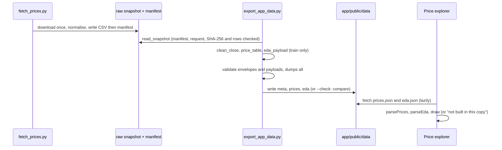

# Milestone 1: data and EDA

Status: built and reviewed. Reviewed by: two adversarial reviews on 2026-10-29, one of the code
and one of the statistics and docs ([code ledger](../validation/m1-code-review-ledger.md),
[stats ledger](../validation/m1-stats-review-ledger.md), [summary](../validation/m1-summary.md)).
A re-review after that fix round found three more defects, fixed in a second round; this
walkthrough describes the final tree.

This walkthrough covers course modules 2 to 4 (get the prices, clean them, take logs, describe
them), plus the 90/10 split that the course makes in module 7. It explains what exists, why it is
built this way, and where each guard lives.

How to use it:

1. Read the sections up to "Pitfalls met".
2. Answer [Predict before you look](#predict-before-you-look) on paper.
3. Only then read [Measured results](#measured-results).
4. Read the three concept notes listed at the end.
5. Answer [Explain it back](#explain-it-back) without notes.

Every `file:line` reference is relative to the repository root. Every number was measured on
2026-10-29 with the command shown next to it in [Measured results](#measured-results), unless it
says otherwise.

---

## What we built and why

The package downloads AAPL's daily prices **once**, into a snapshot file outside git, with a
manifest that records the file's SHA-256, its row count, the download time, the yfinance version
and all 19 request arguments. It cleans the close with `.ffill()` (refusing any fill that carries a
close more than 7 days), takes the natural log, and splits the course window 90/10 by position into
train and test, followed by the out-of-sample (OOS) window. It describes the **training segment
only**: summary statistics, a KDE of the log price, a KDE of the daily log return, and an additive
decomposition of the log price with a period of 252 days. Two new artifacts, `prices` and `eda`,
carry all of that to the app under schema `1.1.0`. The app has its first data-driven page, the
**Price explorer**: the price on a dollar or log axis with the three segments shaded, and side
panels for both KDEs and all four decomposition parts.

**The owner gate.** Whether Yahoo-derived prices may go into this public repository was the owner's
decision. **Update: the owner decided on 2026-10-29 to commit them** (ADR-0001, `DATA.md`): since
milestone 2 both files are committed and `held_artifacts` is empty. What follows describes milestone 1,
when the decision was open. Then `prices.json` and `eda.json` were **not committed**:
both are git-ignored and built locally by two commands. `eda.json` is held too, because its
decomposition rows carry `observed_log`, the training log closes themselves. The committed
`meta.json` names both in `held_artifacts`. A fresh clone therefore passes every gate, the tests
that need a held file skip with a message that names it, and the Price explorer says that its data
is not built in this copy and how to build it.

---

## Why this design

| Choice | Alternatives | Why this one | What it costs |
|---|---|---|---|
| **One download for both windows, kept as a snapshot plus a manifest** (`data.py`) | Download on every run; one download per window | Two downloads disagree: two of the same request, 90 minutes apart, differed on 2,125 of 2,953 rows (measured). One file, one SHA-256, and both windows from the same response | A refresh is a deliberate act (`--refresh`) and changes the numbers |
| **All 19 yfinance arguments spelled out** (`data.py:53-73`), and a test that the keys equal the installed signature's parameters | Rely on defaults, as the course does | A default can change between versions; the manifest records what was asked, and reuse refuses a manifest made with another request | A yfinance upgrade that adds a parameter fails a test until the request names it |
| **Keep yfinance's `(Price, Ticker)` columns and flatten them in one guard** (`normalize_download`) | `multi_level_index=False`; `df['Close'].squeeze()` in every caller | One place checks the ticker level and the exact column set, so the trap cannot reappear downstream | The snapshot's header is the flattened one; the manifest keeps the original column tuples |
| **CSV snapshot**, shortest float repr, SHA-256 of the bytes | Parquet (needs `pyarrow`, not installed: a new dependency); pickle (not portable, unsafe to load) | No new dependency; human-readable; pandas 3.1 reads every float back bit for bit (tested) | Larger on disk than a binary format (check your local `data/` folder for the size) |
| **A closed column set**: exactly Open, High, Low, Close, Volume | Accept any frame with a `Close` | An `Adj Close` column means `auto_adjust` was off, so `Close` is not the promised adjusted close | A future yfinance that adds a column fails loudly and needs a code change |
| **`.ffill()` on existing rows, a 7-day limit on how far a fill may carry, and a coverage check** | Unlimited ffill (the first version); reindex to a weekday calendar; an exchange-calendar package | Unlimited ffill turned 25 missing closes, or a missing tail, into a flat line that every check accepted (the review's probe). A weekday calendar would "fill" every holiday | A single missing day inside a normal week looks like a holiday and is not caught |
| **Raw data may not land inside the repo**, except under `<repo>/data`: `data_root` checks where `<root>/arima-stock-forecasting` really is, symlinks resolved; plus ignore rules for any `arima-stock-forecasting/raw/` and `cache/`, and the repo's own `/raw/` and `/cache/` | Rely on the `/data/` rule alone; check the root's own path (the first fix) | With `VOL_DATA_DIR=<repo>/snapshots`, and then with `VOL_DATA_DIR` set to the repo's parent (data in `<repo>/raw`), `git add -A` staged the raw CSV (the two reviews' probes) | `realpath` reads symlinks from the disk |
| **Split by truncation, `int(n * 0.9)`**, as the course does | `round(n * 0.9)`; exact `n * 9 // 10` | Same rows as the course. The exact form gives the same answer for every n up to 200,000 (tested) | None measured |
| **EDA on the training segment only** | The course's whole-series EDA | What you notice in the test period can shape the model you pick (ADR-0002 §1) | The summary covers 2015-01-02 to 2023-02-03, not the course's full window |
| **Two KDEs: `log_close` and `log_return`**, Scott's bandwidth, 200 points, grid ±3 bandwidths, a normal curve beside each | The course's KDE of the dollar close; pandas' default grid (1,000 points over ±50% of the range); scipy's `'silverman'` | The log return is the series a model sees and shows the fat tails; the normal curve makes them visible without the app computing anything | The course's own dollar-close KDE is not drawn (the open enum allows adding it later) |
| **Additive decomposition of `log_close`**; the course's multiplicative-on-logs version only in the notebook and the docs | Ship both decompositions in `eda.json` | The additive model on logs is the meaningful one; the comparison is a teaching point, not a view | The app cannot show the course's version |
| **`prices.json` and `eda.json` on hold** (git-ignored; named in `meta.data.held_artifacts`) | Commit them (the first version, a default that redistributed the prices); build them in CI; commit only aggregates (ADR-0001) | The owner had not decided yet. (Decided on 2026-10-29: committed, from milestone 2.) | A fresh clone must run two commands before the explorer or notebook 01 show data |
| **`meta.json` lists all three artifacts and names the two held ones** | List only `meta` | `meta` describes what the export writes, so a local export and the committed file agree; `held_artifacts` lets the app and the tests tell "not built here" from "broken" | One more meta field (a 1.1.0 addition; a 1.0.x file reads as `[]`) |
| **`--check` in the exporter**, which also refuses a file the app would refuse; **plus an offline test of the files** | Only `--check` (needs the snapshot); download in CI | `--check` covers the whole chain where the snapshot exists; `test_committed_artifacts.py` covers every step after it wherever the files exist | The snapshot → close step is checked only where the snapshot exists |
| **`source_commit` is the last commit outside `app/public/data`** | HEAD (the first version) | With HEAD, a re-export at the JSON commit rewrote `source_commit` in every file, so the committed JSON never reproduced from its own commit (the review's probe); now it does, byte for byte (tested) | A shallow clone whose only commit is a JSON commit stamps that commit |
| **One payload corpus for both readers** (`payload_cases.json`, 86 cases over meta, prices and eda) | Two hand-written suites | The two readers disagreed on 12 of the reviewer's 34 edge payloads, and the re-review found Python accepting `held_artifacts` values the app refused; a shared corpus makes any new disagreement fail a test | Some rules exist only for agreement: `4.0` counts as an integer, and "blank" is one explicit character class |
| **Payload parsers in `contract.payloads.ts`**, next to `contract.ts` | Put them in `contract.ts` (what the brief asked) | `contract.ts` is imported by the main chunk, and a module imported there is bundled whole. Measured before the review: main chunk 235.24 kB with the parsers in `contract.ts`, 224.97 kB with them beside it | One more file; the brief's wording was not followed literally |
| **The explorer is lazy-loaded and gated on `meta.artifacts`** | A static import; always show the page | The reader of About never downloads the explorer or its 986 KB of data; a view appears only when its files are listed | A spinner on first open |
| **The log axis plots `log_close` on a linear scale** | `close_usd` on a logarithmic scale with dollar ticks | The app never takes a log or an exp of the data (ADR-0001: no back-transforms in the app); the axis shows what the model sees | Tick labels are in ln($), not dollars |
| **The notebook reads the exported JSON, prints, and draws nothing** | Read the snapshot; plot with matplotlib | A test checks every number it prints, and matplotlib would write a font cache outside the repo | The pictures are in the app; on a fresh clone the notebook stops with build instructions |
| **yfinance's own caches moved under the data root** (`cache_dir`) | yfinance's default, `~/.cache/py-yfinance` | Every file a data step writes stays under one folder | None measured |
| **No new dependency**, Python or npm | `pyarrow`; an exchange calendar; a chart library | The 14-day rule for new pins and a smaller supply chain | The SVG plot is hand-written (`SeriesPlot.tsx`, tested) |

---

## Map of what changed

| Path | What | Hand-written or generated |
|---|---|---|
| `src/arima_forecasting/data.py` | Download request, MultiIndex guard, snapshot bytes, manifest checks, `acquire` | Hand-written (new) |
| `src/arima_forecasting/prep.py` | `clean_close` (ffill with a 7-day limit), windows, coverage check, split, price table | Hand-written (new) |
| `src/arima_forecasting/eda.py` | Summary, `tail_share`, KDE, decomposition, course comparison | Hand-written (new) |
| `src/arima_forecasting/payloads.py` | `validate_prices`, `validate_eda` | Hand-written (new) |
| `src/arima_forecasting/artifacts.py` | Read artifacts back; `first_difference`; `compare_exports` | Hand-written (new) |
| `src/arima_forecasting/export.py`, `config.py`, `contract.py`, `provenance.py` | Two new payloads and `HELD_ARTIFACTS`; `DOWNLOAD_WINDOW`, `TRAIN_FRACTION`, `cache_dir` and the in-repo guard; schema `1.1.0`; the last-code-commit stamp | Hand-written (changed) |
| `tools/fetch_prices.py` | The only tool that uses the network | Hand-written (new) |
| `tools/licensing/scan_real_rows.py` | Scans every committable text file for real vendor values (prices, raw sizes, snapshot hashes) by comparing with the local raw snapshots | Added by the hub, adapted from a sibling project |
| `tools/export_app_data.py` | Three artifacts from the snapshot; `--check` | Hand-written (changed) |
| `tools/build_notebooks.py` → `notebooks/01_data_and_eda.ipynb` | The milestone-1 notebook | **Generated** notebook |
| `app/public/data/meta.json` | The exported meta, listing the held artifacts | **Generated**, committed |
| `app/public/data/{prices,eda}.json` | The exported price and EDA artifacts | **Generated**, git-ignored (owner gate) |
| `.gitignore` | The two held files; any `arima-stock-forecasting/raw/` or `cache/` | Hand-written (changed) |
| `app/src/lib/contract.payloads.ts` | `parsePrices`, `parseEda` | Hand-written (new) |
| `app/src/lib/contract.ts`, `loadError.ts` | `held_artifacts` in `parseMeta`; `looksAbsent` | Hand-written (changed) |
| `app/src/lib/plot.ts`, `SeriesPlot.tsx`, `explorer.ts`, `gate.ts` | Plot helpers, the SVG plot, explorer presentation, the view gate | Hand-written (new) |
| `app/src/data/useExplorerData.ts`, `app/src/views/PriceExplorerView.tsx` | Loading both files; the page and its "not built here" state | Hand-written (new) |
| `app/src/App.tsx`, `app/src/index.css` | Lazy explorer page; plot and segment colours for both themes | Hand-written (changed) |
| `app/src/test/fixtures/{payload_cases,meta.data,prices.data,eda.data}.json` | The shared payload corpus (86 cases) and its three hand-written bases, all made-up values | Corpus written by a generator script, bases by hand |
| `tests/test_{data,prep,eda,payloads,payload_corpus,artifacts,committed_artifacts}.py`, `tests/synthetic.py` | New suites; synthetic frames shaped like yfinance 1.7.0 | Hand-written (new) |
| `docs/architecture/specs/{data_flow,erd}.yaml` → `docs/architecture/out/` | Snapshot and EDA nodes; the manifest's real fields | Specs hand-written; outputs **generated** |
| `$VOL_DATA_DIR/arima-stock-forecasting/raw/` | `AAPL_1d_2015-01-01_2026-10-01.csv` and `.manifest.json` | Downloaded; never committed |

---

## Code walkthrough

Read in this order. Each step names one file and line.

1. `src/arima_forecasting/config.py:36` is `data_root`. It resolves where raw data will really land,
   `realpath(<root>/arima-stock-forecasting)` (`:60`), and refuses it if it is the repository itself
   or lies inside it anywhere but under `<repo>/data` (`:62`), so a snapshot cannot land where
   `git add -A` would stage it, not even with `VOL_DATA_DIR` set to the repo's parent.
   `config.py:121` defines `DOWNLOAD_WINDOW`, from the course window's start to the OOS window's
   exclusive end, and `config.py:124` is `TRAIN_FRACTION = 0.9`.
2. `src/arima_forecasting/data.py:53` is `DOWNLOAD_REQUEST`, all 19 keywords of
   `yfinance.download`. `end` is `"2026-10-01"` because yfinance's `end` is exclusive.
   `auto_adjust=True` makes `Close` the adjusted close. `multi_level_index=True` is the 1.7.0
   default, kept on purpose so the guard in the next step always runs on real data. `period` and
   `session` are `None`, which is what yfinance's defaults resolve to when `start` and `end` are
   given.
3. `src/arima_forecasting/data.py:120` is `normalize_download`, the guard against the MultiIndex
   trap. It refuses an empty frame (`:134`), because yfinance returns one instead of raising. It
   checks that the `Ticker` level holds exactly `AAPL` (`:146-148`) and drops it (`:149`). It
   refuses duplicate column names (`:154`), which would make `frame["Close"]` a DataFrame again,
   and any column set other than the five price columns (`:157`), naming `Adj Close` if it is the
   cause. It checks the dates: a `DatetimeIndex`, no time zone, midnight only, unique, ascending
   (`:170-179`).
4. `src/arima_forecasting/data.py:188` is `snapshot_bytes`: CSV with ISO dates and `\n` line ends.
   pandas writes each float as Python's shortest round-trip repr, and `parse_snapshot` (`:199`)
   reads it back exactly. `tests/test_data.py` checks 5,000 random closes bit for bit.
5. `src/arima_forecasting/data.py:215` is `build_manifest`: SHA-256 of the bytes, rows, first and
   last date, `downloaded_at` in UTC, the yfinance and pandas versions, the request and the columns
   exactly as downloaded. It is pure: the caller passes the time.
6. `src/arima_forecasting/data.py:249` is `write_snapshot`. It writes the CSV first and the manifest
   last, each through a temporary file and `os.replace` (`:241`), so a crash leaves the old file or
   the new one, never half of one.
7. `src/arima_forecasting/data.py:259` is `read_snapshot`. It refuses a missing half (`:262-268`),
   a manifest that is not JSON or lacks a key (`:269-275`), a `request`, `rows` or `sha256` of the
   wrong type (`:277-282`), a manifest made with another request (`:283-294`), a file whose SHA-256
   differs from the manifest (`:297-301`), and a row count that disagrees (`:303-304`). Each is a `SnapshotError`, so the exporter exits 2 with a message, never
   a traceback.
8. `src/arima_forecasting/data.py:308` is `acquire`. It reuses the snapshot unless `refresh` is
   true (`:324-326`); half a snapshot raises instead of downloading again. On a download it
   normalises and checks first and writes after (`:328-344`), so a failed refresh leaves the old
   snapshot untouched. The `download` function is a parameter: `yfinance_download` (`:347`) in real
   use, a fake in tests.
9. `tools/fetch_prices.py:22` wires `acquire` to the real download, the clock and yfinance's
   version. It is the only place the network is used.
10. `src/arima_forecasting/prep.py:40` is `clean_close`. It refuses a missing first close (`:53`).
    For every row it finds the date of the last real close (`:57`) and refuses a filled row more
    than 7 calendar days after it (`:60`): a long run of missing closes, or a missing tail. Then it
    forward-fills with `.ffill()` (`:67`), refuses an infinite or non-positive close (`:68-72`),
    and records the filled dates (`:73`).
11. `src/arima_forecasting/prep.py:84` is `check_coverage`. It refuses a late first bar, an early
    last bar, or a gap of more than 7 calendar days between two rows (`:92-103`). It sees only
    which rows exist; step 10 handles rows that exist with an empty close.
12. `src/arima_forecasting/prep.py:106` is `train_size`: `int(n * fraction)` (`:113`), refusing a
    split that leaves either side empty (`:114-115`).
13. `src/arima_forecasting/prep.py:119` is `price_table`. It cuts the course and OOS windows
    (half-open, `select_window` at `:77`), checks coverage, labels the segments (`:130`) and takes
    `np.log` (`:136`).
14. `src/arima_forecasting/eda.py:55` is `summary`, with the estimators named in its docstring.
    `eda.py:101` is `kde`: scipy's `gaussian_kde` with Scott's rule, a grid from 3 bandwidths below
    the minimum to 3 above the maximum (`:118-119`), and the normal curve with the sample's mean and
    sd (`:122`). `eda.py:155` is `decomposition`: `null` where the trend is NaN (`_nullable`,
    `:151`). `eda.py:173` is `course_comparison`, used by the notebook and this walkthrough.
15. `src/arima_forecasting/export.py:50` is `HELD_ARTIFACTS`, the owner gate; `meta_payload`
    (`:58`) lists it. `:104` is `prices_payload`, `:135` is `eda_payload` (training rows only,
    `:137`), and `:150` is `build_payloads`, which turns one snapshot into all three payloads.
16. `src/arima_forecasting/payloads.py:148` is `validate_prices`, `:291` is `validate_eda` and `:378`
    is `validate_meta`: the Python copy of contract §3.1-3.3 (`validate_meta` mirrors `parseMeta`,
    including the `held_artifacts` rule at `:443`). The integer rule (`:99`) accepts `4.0` and refuses anything
    beyond ±(2^53 − 1); the number rule (`:113`) refuses an integer too big for a double; "blank"
    is the explicit class `BLANK` (`:40`); `log_return.n` must be `summary.n − 1` (`:314`); the
    trend is null on exactly the first and last `period // 2` rows (`:357`).
17. `tools/export_app_data.py:43` is the exporter. It exits 2 without a usable snapshot or with a
    data root inside the repo (`:58-62`), validates every envelope and payload before writing
    anything (`:78-87`), serialises every file before writing any (`:91`), and in `--check` mode
    compares instead of writing (`:93-105`).
18. `src/arima_forecasting/artifacts.py:115` is `compare_exports`: extra files, missing files,
    broken JSON, a committed envelope or payload the app would refuse (`:141`), then
    `schema_version`, `artifact` and `data` through `first_difference` (`:83`), which treats `1`
    and `1.0` as different, as JSON does.
19. `src/arima_forecasting/provenance.py:43` is `source_commit`. It now asks
    `git log -1 -- ':(top)' ':(exclude)app/public/data'` (`:69`) for the last commit outside the
    export folder, falls back to HEAD only if that command fails, and gives `uncommitted` when no
    commit ever touched code (`:72`). The dirty check below it is unchanged from milestone 0.
20. `app/src/lib/contract.payloads.ts` holds `parsePrices` and `parseEda`, the TypeScript copy of
    the same rules. `tests/test_payload_corpus.py` and `app/src/lib/contract.payloads.corpus.test.ts`
    run `app/src/test/fixtures/payload_cases.json` through both, and
    `app/src/lib/contract.realdata.test.ts` runs them over the real files, skipping a held file
    that is absent.
21. `app/src/App.tsx` loads the explorer with `lazy(() => import(...))`, offers the page only when
    `hasArtifacts(meta, ['prices', 'eda'])` (`app/src/lib/gate.ts`), and passes it
    `meta.held_artifacts`. `app/src/views/PriceExplorerView.tsx` shows "not built in this copy" when
    a held file is absent (`looksAbsent` in `app/src/lib/loadError.ts`: a 404, or a dev server's HTML
    page that fails to parse), and arranges what `app/src/lib/explorer.ts` returns.
    `app/src/lib/SeriesPlot.tsx` draws each plot from `app/src/lib/plot.ts`'s pure helpers;
    `gapPath` breaks a line at every `null`.

---

## Data flow

One trading day, 2020-08-31, followed from Yahoo to the screen.

| # | Hop | Shape at this hop | Where |
|---|---|---|---|
| 1 | `yfinance.download(**DOWNLOAD_REQUEST)` | DataFrame, 2,953 rows × 5 columns, columns a `(Price, Ticker)` MultiIndex | `data.py:347-361`, called by `tools/fetch_prices.py` |
| 2 | `normalize_download` | Flat DataFrame, columns Open, High, Low, Close, Volume, index `Date` | `data.py:120` |
| 3 | `snapshot_bytes` → `write_snapshot` | A CSV file plus a JSON manifest under `$VOL_DATA_DIR/.../raw/` (size and SHA-256: see your local manifest) | `data.py:188`, `:249` |
| 4 | `read_snapshot` in the exporter | The same flat DataFrame, after the manifest, request, SHA-256 and row checks | `data.py:259`, `tools/export_app_data.py:59` |
| 5 | `clean_close` | A float Series `close_usd`, plus `filled_dates = ()` | `prep.py:40` |
| 6 | `price_table` | DataFrame indexed by `date`: `close_usd`, `log_close` and, for this day, `segment` `"train"` | `prep.py:119` |
| 7 | `prices_payload` | One dict per row: `{"date": "2020-08-31", "close_usd": …, "log_close": …, "segment": "train"}`, each float written at full precision | `export.py:104` |
| 8 | `eda_payload` (train rows only) | The day is one of 2,037 decomposition rows and one of the 2,037 values in the log-close KDE | `export.py:135` |
| 9 | `make_envelope`, `validate_envelope`, `validate_prices`, `dumps` | Three JSON texts, sorted keys, no NaN | `tools/export_app_data.py:67-91` |
| 10 | Written to `app/public/data/` | `prices.json` 456,025 bytes, git-ignored (owner gate); `meta.json` committed | `tools/export_app_data.py:107-111` |
| 11 | The reader opens **Price explorer**; `loadExplorer` fetches both files | Two envelopes, or a 404 in a fresh clone (then "not built in this copy") | `app/src/data/useExplorerData.ts` |
| 12 | `parseEnvelope`, then `parsePrices` and `parseEda` | Typed `Prices` and `Eda` objects | `app/src/lib/contract.payloads.ts` |
| 13 | `pricePlot(prices, axis)` | `xs` = row positions, `ys` = `close_usd` or `log_close`, bands from `segment` runs | `app/src/lib/explorer.ts` |
| 14 | `SeriesPlot` | An SVG path; hovering the day reads `2020-08-31 · $<close> · ln <log close> · Train` | `app/src/lib/SeriesPlot.tsx` |



The diagram in [docs/architecture/README.md](../architecture/README.md) (section 2, "Data flow")
shows the raw snapshot and the EDA step too.

---

## Pitfalls met and how each is guarded

| Pitfall | How it showed up | Guard (`file:line`) |
|---|---|---|
| **The MultiIndex trap.** `frame["Close"]` is a one-column DataFrame under yfinance 1.7.0 | On a hand-built frame in yfinance's shape, a Series minus `frame["Close"]` had shape (3, 4) and was all NaN (test and notebook) | `src/arima_forecasting/data.py:146-149`; tests `test_the_multiindex_trap_is_real_on_a_yfinance_shaped_frame`, `test_normalize_flattens_the_ticker_level_so_close_is_a_series` |
| **yfinance does not raise on failure.** It prints and returns an empty frame | Synthetic empty frame | `data.py:134`; `test_normalize_refuses_an_empty_frame_because_yfinance_does_not_raise`, `test_a_failed_refresh_keeps_the_old_snapshot` |
| **`auto_adjust` off silently changes `Close`** | A frame with `Adj Close` | `data.py:157-165`; `test_normalize_refuses_adj_close_because_then_close_is_not_adjusted` |
| **Two arguments left to defaults** (review) | `inspect.signature(yfinance.download)` has 19 parameters; 17 were passed | `data.py:53-73`; `test_download_request_names_exactly_the_parameters_of_yfinance_download` |
| **A snapshot made with another request is reused** (review) | An edited manifest `request` was accepted, and flowed into `prices.json` | `data.py:283-294`; `test_reuse_refuses_a_manifest_made_with_another_request` |
| **A damaged manifest gives a traceback** (review) | A truncated manifest crashed the exporter with `JSONDecodeError` (exit 1) | `data.py:269-275`; `test_a_damaged_manifest_is_a_snapshot_error_not_a_traceback`, `test_tool_with_a_truncated_manifest_exits_2_with_a_message` |
| **A snapshot edited after download** | One byte changed in the CSV | `data.py:297-301`; `test_read_snapshot_refuses_a_file_that_changed_after_download` |
| **Half a snapshot** (CSV without manifest) | Manifest deleted | `data.py:324-326` and `:262-268`; `test_half_a_snapshot_is_an_error_not_a_reason_to_download` |
| **A raw snapshot one `git add -A` from a commit** (review) | `VOL_DATA_DIR=<repo>/snapshots` → `git add -A --dry-run` listed the CSV, the manifest and a cache file | `config.py:62`; `.gitignore` rules for `**/arima-stock-forecasting/raw/` and `cache/`; `test_data_root_refuses_any_other_folder_inside_the_repo`, `test_a_snapshot_or_cache_anywhere_in_the_repo_is_ignored` |
| **`fillna(method='ffill')` is gone in pandas 3.1** | `TypeError: NDFrame.fillna() got an unexpected keyword argument 'method'` (measured, notebook) | `prep.py:67` uses `.ffill()`; `test_the_course_fillna_method_call_no_longer_exists_in_pandas_3_1` |
| **Fake fills** (review) | 25 consecutive missing closes, and a missing tail of 60, were filled into flat lines that passed every check | `prep.py:57-66`; `test_a_long_run_of_missing_closes_is_refused_not_filled`, `test_a_missing_tail_is_refused_not_filled` |
| **ffill cannot fill the first row** | `[NaN, 11.0]` | `prep.py:53-55`; `test_ffill_cannot_fill_the_first_row_so_that_is_an_error` |
| **A truncated or holed history** | A first bar 8 days late, a last bar 8 days early, an 8-day hole | `prep.py:92-103`; `test_check_coverage_refuses_truncated_or_holed_data` |
| **A float split point** | `int(n * 0.9)` vs `n * 9 // 10` | `prep.py:113`; `test_train_size_equals_exact_integer_arithmetic_for_every_n_up_to_200000` |
| **NaN from a degenerate sample** | Constant prices give sd 0 and an undefined skew | `eda.py:39-44` (`_number`) raises; `test_summary_refuses_to_write_a_nan` |
| **A trading-day index has no frequency** for statsmodels | `seasonal_decompose` needs a period | `eda.py:145-148` passes a plain array and `period=252` |
| **The centred trend is undefined at the ends** | 126 NaN at each end | `eda.py:151-170` writes `null`; both readers pin the exact pattern (`payloads.py:357`, `parseDecomposition`); `gapPath` breaks the line |
| **VOL_DATA_DIR set to the repo's parent** (re-review) | With the checkout named `arima-stock-forecasting`, raw data landed in `<repo>/raw`, which git could stage | `config.py:60-62` checks `realpath(<root>/arima-stock-forecasting)`; `.gitignore` `/raw/` and `/cache/`; `test_data_root_refuses_the_repos_parent_when_the_repo_is_named_after_the_project`, `test_data_root_refuses_a_symlink_that_leads_into_the_repo` |
| **A manifest `request` that is not an object** (re-review) | `"request": null`, `"1d"` or `[]` crashed the exporter with a traceback (exit 1) | `data.py:277-282`; `test_a_manifest_field_of_the_wrong_type_is_a_snapshot_error`, `test_tool_with_a_manifest_request_that_is_not_an_object_exits_2` |
| **Python did not check `meta`** (re-review) | `read_artifact` accepted `held_artifacts` of `5`, `["nope"]` and `[1]`, which the app refused | `validate_meta` (`payloads.py:378`), registered for `meta`; 24 meta cases in the corpus; `test_read_artifact_refuses_a_meta_whose_held_artifacts_the_app_would_refuse` |
| **Real vendor values in committed text** (hub rule) | The scanner flagged 9 price lines and 4 provenance lines (a raw file size, the snapshot hash) in docs, tests and a ledger | Made-up values in tests; derived statistics or "see your local `data/` manifest" in docs; `tools/licensing/scan_real_rows.py` before each commit |
| **The two payload readers disagree** (review) | 12 of 34 edge payloads: `4.0`, `2**53`-scale and 401-digit integers, U+001C, U+0085 and U+FEFF tickers, null patterns, empty rows; Python crashed with `OverflowError` on `1e400` | `payload_cases.json` run by both suites; `payloads.py:99`, `:113`, `:40`; `BLANK` and `Number.isSafeInteger` in `contract.payloads.ts` |
| **A Python float that is a whole number** | `1` and `1.0` compare equal in Python but are different JSON | `artifacts.py:88-89`; `test_first_difference_names_the_path_of_the_first_change` |
| **`--check` passes a file the app would refuse** (review) | A garbage or missing `generated_at`, or an extra top-level key, gave "app data is current" | `artifacts.py:141-147`; `test_check_fails_on_a_committed_envelope_the_app_would_refuse` |
| **Provenance never settles** (review) | Committing the JSON and re-exporting at that commit rewrote `source_commit` in all three files | `provenance.py:69-74`; `test_the_json_commit_reexports_byte_identically`, `test_a_commit_that_only_changes_exported_files_does_not_move_the_source_commit` |
| **Writing half an export** | A NaN in the last payload | `tools/export_app_data.py:91` serialises all before writing any; `test_tool_never_writes_nan_to_disk_and_writes_no_file_at_all` |
| **`JSON.parse("1e999")` is `Infinity`** | A finite-looking number in the file | `Reader.num` in `app/src/lib/contract.payloads.ts`; corpus cases "close_usd 1e400" and "close_usd as a 401-digit integer" |
| **The main chunk grows with every parser** | +10.27 kB when the parsers sat in `contract.ts` (measured before the review) | Parsers in `contract.payloads.ts`; the explorer behind `lazy()`; `App.lazy.test.tsx` |
| **yfinance writes caches to the home folder** | Its default is `~/.cache/py-yfinance` | `data.py:347-361` points it at `cache_dir()` |

---

## Predict before you look

**Write your answers down before you scroll.** Commit to a number, even a guess.

1. The request asks for `start="2015-01-01"` and `end="2026-10-01"`. What are the first and last
   dates in the snapshot, and how many rows does it have? Is 2026-10-01 itself in it? If you
   download the same request twice on one afternoon, are the two files byte-identical?
2. How many trading days are in the course window? Using `int(n * 0.9)`, how many are train and how
   many test? On which date does the test segment start?
3. How many closes needed forward-filling? What is the longest gap, in calendar days, between two
   consecutive bars?
4. Over the training segment, what are the sd, the skewness and the excess kurtosis of the daily log
   return? What share of days lies more than 3 sd from the mean, and what would a normal curve give?
5. Scott's rule sets the KDE bandwidth to n^(−1/5) times the sd. What is the bandwidth of the
   log-return KDE, in log points?
6. In the decomposition, how many rows have no trend? What range do the course's multiplicative
   seasonal factors cover? Is the largest gap between "exp of our log trend" and "the trend of a
   multiplicative decomposition of dollars" under 1%, between 1% and 5%, or above 5%? Is it caused
   mostly by volatility or mostly by drift?
7. How big are `prices.json` and `eda.json`, as a share of the 1 MB budget?
8. How much did the main JavaScript chunk grow from milestone 0's 224.51 kB?

---

## Measured results

### Environment

All commands run from the repository root unless they `cd app`. Data steps ran with
`VOL_DATA_DIR=$PWD/data`, so the snapshot lives under the repo's `data/` folder, which the anchored
`/data/` rule ignores:

```text
$ git check-ignore -v data/arima-stock-forecasting/raw/AAPL_1d_2015-01-01_2026-10-01.csv data/arima-stock-forecasting/raw/AAPL_1d_2015-01-01_2026-10-01.manifest.json data/arima-stock-forecasting/cache/cookies.db
.gitignore:4:/data/	data/arima-stock-forecasting/raw/AAPL_1d_2015-01-01_2026-10-01.csv
.gitignore:4:/data/	data/arima-stock-forecasting/raw/AAPL_1d_2015-01-01_2026-10-01.manifest.json
.gitignore:4:/data/	data/arima-stock-forecasting/cache/cookies.db
$ git check-ignore -v app/public/data/prices.json app/public/data/eda.json
.gitignore:16:/app/public/data/prices.json	app/public/data/prices.json
.gitignore:17:/app/public/data/eda.json	app/public/data/eda.json
```

Versions: Python 3.12.13, pandas 3.1.0, scipy 1.18.1, statsmodels 0.15.0, yfinance 1.7.0, Node
v22.23.1 (unchanged from milestone 0; no dependency was added or upgraded).

**Two downloads.** The first snapshot was downloaded at 12:07:20 UTC. The
review then asked for `period` and `session` to be passed explicitly, so the request changed and
`read_snapshot` refused the old manifest (`records a different download request (keys ['period',
'session'])`). The snapshot was downloaded again with `--refresh` at 13:37:24 UTC. Every number
below comes from that second snapshot.

### Answers to the predictions

| What | Command | Result | Date |
|---|---|---|---|
| Q1. The download | `VOL_DATA_DIR=$PWD/data uv run python tools/fetch_prices.py --refresh` | `rows 2953 (2015-01-02 to 2026-09-30)`; `downloaded_at 2026-10-29T13:37:24Z (yfinance 1.7.0)`; the SHA-256 it printed is in your local `data/` manifest (not published here) | 2026-10-29 |
| Q1. A re-run | the same command without `--refresh` | `reused …` with the same SHA-256; no download | 2026-10-29 |
| Q1. Is `end` exclusive? | the manifest's `last_date` | `2026-09-30`. 2026-10-01 is a Thursday and not a US market holiday, and the download ran four weeks later, so a bar for it would have been there if `end` were inclusive | 2026-10-29 |
| Q1. Two same-day downloads | pandas comparison of the 12:07 and 13:37 CSVs | **Not identical.** Same 2,953 dates and identical volumes, but Open, High, Low and Close differ on 2,125 rows, by at most 7.3 × 10⁻⁷ of the price | 2026-10-29 |
| Q2. Segments | `prices.json`, `data.splits` | train 2015-01-02 to 2023-02-03, n = 2,037; test 2023-02-06 to 2023-12-29, n = 227; OOS 2024-01-02 to 2026-09-30, n = 689. The course window has 2,264 rows and `int(2264 × 0.9) = int(2037.6) = 2037` | 2026-10-29 |
| Q3. Filled closes | `prices.json`, `data.fill` | `{"method": "ffill", "filled_dates": []}`: 0 missing closes in the snapshot | 2026-10-29 |
| Q3. Gaps | numpy diff of the 2,953 dates | 1 day: 2,311; 2 days: 28; 3 days: 530; 4 days: 83; nothing longer. 2025-01-09, the market closure, is absent as expected | 2026-10-29 |
| Q4. Moments of the log return (train, n = 2,036) | `eda.json`, `data.summary.log_return` | mean 0.000902415; sd 0.018861658; skew −0.224657; excess kurtosis 5.200535 | 2026-10-29 |
| Q4. Tails | `eda.tail_share(returns, 3.0)` (notebook cell) | `returns beyond 3 sd: 1.52% observed, 0.27% under a normal` (31 of 2,036 days, against 5.5 expected) | 2026-10-29 |
| Q5. Bandwidths | `eda.json`, `data.kdes[*]` | log_close: n 2,037, factor 0.217872, bandwidth 0.149204 ln($); log_return: n 2,036, factor 0.217894, bandwidth 0.004110 log points | 2026-10-29 |
| Q6. Decomposition | `eda.course_comparison(train)` (notebook cell) | trend undefined for the first 126 and last 126 of 2,037 rows; course's multiplicative factors 0.987413 to 1.013297; trends identical (max difference 0); seasonal gap on one scale 0.016116 log points; dollar-trend gap **3.03314%** (on 2020-08-19); dollar-seasonal gap 0.733796% | 2026-10-29 |
| Q6. Drift or volatility? | the drift script below (weighted variance and a straight-line fit of the 253-day window at 2020-08-19) | half the weighted variance of ln P is 0.0323, against a log gap of 0.0308; a straight line (slope 0.0033 a day) holds 88% of the variance and alone gives a 2.80% gap: **mostly drift** | 2026-10-29 |
| Q7. File sizes | `wc -c app/public/data/*.json` | `prices.json` 456,025 bytes (45.6% of 1,000,000); `eda.json` 529,907 (53.0%); `meta.json` 1,509. Python `gzip.compress(…, 6)`: 67,175, 101,509 and 547 bytes | 2026-10-29 |
| Q8. Chunks | `cd app && npm run build` | main `index` 225.63 kB (gzip 72.32 kB): **+1.12 kB** over milestone 0 (+0.46 kB before the reviews; the rest is `held_artifacts` in `parseMeta`, the shared `BLANK` class and `looksAbsent`). `PriceExplorerView` 24.38 kB (gzip 8.80 kB); `AicAxesScene` 1,082.42 kB, unchanged. With the payload parsers inside `contract.ts` the main chunk was 235.24 kB (measured before the review) | 2026-10-29 |

The file sizes were measured on an export whose `source_commit` ended in `-dirty`; a clean stamp
is 6 bytes shorter per file.

**What the numbers say.**

- **The download is a snapshot, and even one afternoon breaks byte identity.** Two downloads of the
  same request, 90 minutes apart, differed in the seventh significant digit on most rows. Without
  the snapshot and its SHA-256, a re-run could not even tell which data it used.
- **The split is the course's.** 2,264 course rows give 2,037 train rows by truncation. Rounding
  would give 2,038.
- **The tails are fat.** Excess kurtosis 5.2 and 5.6 times the normal share of 3-sd days. Two of
  the three largest training moves fell in March 2020 (−0.1377 on 2020-03-16, +0.1132 on
  2020-03-13); the third is −0.1049 on 2019-01-03, and −0.1040 on 2020-03-12 is fourth. Three of
  the four moves beyond ±0.1 are in March 2020.
- **The split day has no jump.** Across AAPL's 4-for-1 split, from 2020-08-28 to 2020-08-31, the
  adjusted log return is +0.0333, not ln(1/4) = −1.386.
- **The course's decomposition is a small numerical change and a large change of meaning.** The two
  trends are the same moving average. The seasonal effects differ by at most 0.0161 log points.
  And "additive on logs equals multiplicative on dollars" is true for the model but not for the
  estimate: the geometric and arithmetic moving averages differ by up to 3.03%, and that gap comes
  mostly from the 2020 run-up's drift inside one window, not from volatility.
- **Later dividends reach into the training levels.** Back adjustment scales all training closes by
  one factor for every dividend paid after 2023-02-03. Returns do not move; the dollar summary, the
  log-close KDE's location and the decomposition levels do. The size is not measured (concept
  note 02).

### The commands behind the table

```bash
VOL_DATA_DIR=$PWD/data uv run python tools/fetch_prices.py --refresh
VOL_DATA_DIR=$PWD/data uv run python tools/export_app_data.py
VOL_DATA_DIR=$PWD/data uv run python tools/export_app_data.py --check
wc -c app/public/data/*.json
```

The gap counts, the split-day return and the extremes came from this script (`uv run python -I -`):

```python
import json, collections, numpy as np, pandas as pd
d = json.load(open("app/public/data/prices.json"))["data"]
rows = pd.DataFrame(d["rows"]).set_index("date")
r = np.log(rows.close_usd).diff()
print(r.loc["2020-08-31"])  # the split-day log return; the prices stay local
train = np.log(rows[rows.segment == "train"].close_usd).diff().dropna()
print(list(train[train.abs() > 0.1].round(4).items()))
dates = pd.to_datetime(rows.index)
print(sorted(collections.Counter(np.diff(dates.values).astype("timedelta64[D]").astype(int)).items()))
```

The drift script (`uv run python -I -`, with `src` on the path) behind Q6:

```python
import json, math, numpy as np
from statsmodels.tsa.seasonal import seasonal_decompose
from arima_forecasting.artifacts import table_from_prices
t = table_from_prices(json.load(open("app/public/data/prices.json"))["data"]); y = t[t.segment == "train"].log_close.to_numpy()
add = seasonal_decompose(y, model="additive", period=252); dol = seasonal_decompose(np.exp(y), model="multiplicative", period=252)
ratio = np.exp(add.trend) / dol.trend; i = int(np.nanargmax(np.abs(ratio - 1)))   # 2020-08-19
w = np.r_[0.5, np.ones(251), 0.5] / 252; win = y[i - 126:i + 127]; mu = (w * win).sum()
var = (w * (win - mu) ** 2).sum(); x = np.arange(-126, 127); slope = (w * x * (win - mu)).sum() / (w * x * x).sum()
line = mu + slope * x
print(var / 2, -math.log(ratio[i]), slope, (w * (line - mu) ** 2).sum() / var, 1 - math.exp((w * line).sum()) / (w * np.exp(line)).sum())
```

It printed `0.0323…`, `0.0308…`, `0.00329…`, `0.883…` and `0.0280…`.

The tail share, the bandwidths and the decomposition comparison are printed by
`notebooks/01_data_and_eda.ipynb`. `tests/test_notebooks.py` checks its splits, its `int(n * 0.9)`
line, the "matches a fresh computation" line, the bandwidths, the 126-row counts, the tail-share
line and every course-comparison line against the package called on the same rows; the package
functions themselves are pinned by hand-worked cases in `tests/test_eda.py`. (Before the review it
checked only the bandwidths, one comparison value and the 126 counts; four mutants of the
comparison and tail code survived.)

### Mutation testing

A *mutant* is a deliberately broken copy of the code. A test that fails *kills* it; a mutant that
every test survives shows a behaviour no test pins. Every mutant ran on a scratch copy; the real
repo was never changed.

- **Python:** a copy of `src`, `tests`, `tools`, `notebooks`, `app/public/data`, the corpus
  fixtures and the project files, with `PYTHONPATH` pointing at the copy so the tool subprocesses
  and the notebook kernel use the mutant too. The full suite ran except `test_diagrams.py` and
  `test_blender_layout.py`, which do not touch milestone-1 code.
- **App:** a copy of `app/` with `node_modules` linked, running `npx vitest run`. In that copy
  `AicAxesScene.test.tsx` (milestone 0's 3D labels, 5 tests) cannot load, because Vite refuses the
  font file through the link; no app mutant touches that code.

**Round 1, before the review** (an unchanged copy gave `589 passed`; line numbers are where each
mutated line sits now):

| # | Mutation (`file`) | What fails |
|---|---|---|
| P1 | keep the `(Price, Ticker)` columns: `droplevel` → `copy()` (`data.py:149`) | 28 failed and 57 errors: every test that builds a snapshot |
| P2 | accept any ticker (`data.py:147`) | 1: `test_normalize_refuses_two_tickers_and_a_different_ticker` |
| P3 | accept yfinance's empty frame (`data.py:134`) | 3: the empty-frame test, `test_a_failed_refresh_keeps_the_old_snapshot`, `test_fetch_tool_reports_a_failed_download_and_exits_1` |
| P4 | only require a `Close` column, so `Adj Close` passes (`data.py:157`) | 2: `test_normalize_refuses_adj_close_because_then_close_is_not_adjusted`, `test_normalize_refuses_a_missing_column_and_unknown_levels` |
| P5 | skip the SHA-256 check (`data.py:297`) | 1: `test_read_snapshot_refuses_a_file_that_changed_after_download` |
| P6 | download every time instead of reusing (`data.py:324`) | 3: the reuse test, the half-snapshot test, `test_fetch_tool_downloads_then_reuses` |
| P7 | `.ffill()` → `.bfill()`, filling from the future (`prep.py:67`) | 1: `test_ffill_carries_the_last_close_forward_and_records_the_date` |
| P8 | `int(n * 0.9)` → `round(n * 0.9)` (`prep.py:113`) | 7: three `test_train_size_truncates_like_the_course` cases, the 200,000-n test, the empty-side test, the committed-`prices.json` test, the notebook test |
| P9 | `int(n * 0.9)` → `n * 9 // 10` (`prep.py:113`); *equivalent* | 0, as expected: the two agree for every n from 2 to 200,000 |
| P10 | `select_window` keeps `end_exclusive` (`prep.py:80`) | 12 failed and 10 errors (the synthetic calendar has a bar on 2024-01-01; with `<=` it falls in both windows) |
| P11 | describe train + test instead of train (`export.py:137`) | 3: `test_eda_describes_the_training_rows_only`, the committed-`eda.json` test, the notebook test |
| P12 | sd with `ddof=0` (`eda.py:79`) | 4: both summary tests, the committed-`eda.json` test, the notebook test |
| P13 | biased skew g1 instead of G1 (`eda.py:80`) | 3: the bias-corrected test, the committed-`eda.json` test, the notebook test |
| P14 | KDE grid without the 3-bandwidth pad (`eda.py:25`) | 3: the grid test, the committed-`eda.json` test, the notebook test |
| P15 | Python validator skips the segment order (`payloads.py:215`) | 1: `test_validate_prices_names_each_broken_rule[segment order]` |
| P16 | `--check` also compares `generated_at` (`artifacts.py:22`) | 3: `test_check_ignores_generated_at_and_source_commit`, `test_check_passes_on_a_fresh_export_and_writes_nothing`, the `compare_exports` test |
| P17 | `--check` no longer compares `data` (`artifacts.py:22`) | 3: `test_check_fails_on_a_changed_value_and_names_where`, `test_check_says_when_the_snapshot_itself_changed`, the `compare_exports` test |
| P18 | `first_difference` treats `1` and `1.0` as equal (`artifacts.py:88`) | 1: the `d.a: 1 != 1.0` case |
| P19 | `--check` ignores an extra file (`artifacts.py:123`) | 1: `test_check_fails_on_missing_extra_or_broken_files[extra file]` |
| P20 | write each file as soon as it is serialised (`tools/export_app_data.py:91`) | 8: the NaN test and seven `--check` tests |
| P21 | Python validator no longer pins the 126-row null ends (`payloads.py:357`) | 2: the "null in the middle" and "no nulls at the end" cases |

App round 1 (an unchanged copy gave `Tests 552 passed (552)`): A1 (no segment order), A2 (no
splits-vs-rows check), A3 (`Infinity` accepted), A4 (gate `some` instead of `every`), A5 (the log
axis plots dollars), A6 (no gap at a null), A7 (unregistered `prices` parser), A8 (a null trend
beside a numeric residual) and A10 (log-return KDE not required) were each killed by 1 or 2 named
tests. **A9, a static import of the explorer, survived**: no test pinned the lazy load.
`src/App.lazy.test.tsx` was added, and the re-run killed it. A11 and A12, two pointer-mapping
mutants added with a test fix (below), were killed.

**Round 2, after the review**, one mutant per new guard (Python: an unchanged copy gave
`698 passed`; app: `Tests 629 passed (629)`):

| # | Mutation (`file`) | What fails |
|---|---|---|
| Q1 | `data_root` accepts any folder in the repo (`config.py:62`) | 10: seven `test_config.py` cases, `test_fetch_tool_refuses_a_data_root_inside_the_repo`, `test_tool_refuses_a_data_root_inside_the_repo_outside_data` |
| Q2 | drop `"period"` from the request (`data.py:71`) | 2: `test_download_request_names_exactly_the_parameters_of_yfinance_download`, one reuse case |
| Q3 | reuse ignores the manifest's request (`data.py:283`) | 3: every case of `test_reuse_refuses_a_manifest_made_with_another_request` |
| Q4 | a truncated manifest raises `JSONDecodeError` (`data.py:271`) | 2: the "truncated" damaged-manifest case, `test_tool_with_a_truncated_manifest_exits_2_with_a_message` |
| Q5 | no limit on how far a fill carries (`prep.py:60`) | 2: `test_a_long_run_of_missing_closes_is_refused_not_filled`, `test_a_missing_tail_is_refused_not_filled` |
| Q6 | Python refuses `4.0` where JavaScript reads 4 (`payloads.py:97`) | 4 corpus cases (`4.0`, `6.0`, `2.0`, summary.n `4.0`) |
| Q7 | Python's own `strip` decides "blank" (`payloads.py:72`) | 1: the U+FEFF corpus case |
| Q8 | `log_return.n` not tied to `summary.n` (`payloads.py:314`) | 1 corpus case |
| Q9 | empty decomposition rows skip the summary check (the review's defect) | 1 corpus case |
| Q10 | a 401-digit integer crashes the validator (`payloads.py:113`) | 1 corpus case |
| Q11 | `--check` does not validate the committed envelope (`artifacts.py:141`) | 4: every case of `test_check_fails_on_a_committed_envelope_the_app_would_refuse` |
| Q12 | `source_commit` is HEAD again (`provenance.py:70`) | 3: `test_the_json_commit_reexports_byte_identically`, `test_a_commit_that_only_changes_exported_files_does_not_move_the_source_commit`, `test_a_repo_whose_commits_only_touch_the_export_folder_is_uncommitted` |
| Q13 | `HELD_ARTIFACTS = ()` (`export.py:50`) | 6: the gitignore test, two committed-artifact tests, three export tests |
| B1 | `Reader.int` ignores its minimum (the review's surviving OA4) | 3: two corpus cases, the unit test of integer minimums |
| B2 | `Reader.int` accepts 2^53 + 1 (`Number.isInteger` for `isSafeInteger`) | 2: the corpus case, the unit test |
| B3 | `parseEda` drops the `period // 2` null pattern | 4: three corpus cases, the null-pattern unit test |
| B4 | JavaScript's own `trim` decides "blank" | 2: the U+001C and U+0085 corpus cases |
| B5 | `log_return.n` not tied to `summary.n` in TypeScript | 2: the corpus case, the unit test |
| B6 | `looksAbsent` never true (a missing held file shown as an error) | 4: the fresh-clone App test, the `looksAbsent` test, two view tests |
| B7 | `parseMeta` accepts a held name that is not an artifact | 1: "refuses a held name that is not an artifact…" |

| MA | dollar-trend gap computed from `exp(trend + 0.01)` (the stats review's MA, `eda.py`) | 1: `test_the_course_comparison_by_hand_on_a_level_plus_a_pure_seasonal_pattern` |
| MB | the `- 1` dropped from the seasonal gap (MB) | 1: the same hand-worked test |
| MC | `tail_share` with `ddof=0` (MC) | 1: `test_tail_share_uses_the_sample_sd_and_exactly_k_of_them` |
| MD | `tail_share` threshold `0.8 k` (MD) | 1: the same test |

Tally for round 2: 13 Python mutants of the new guards and 7 app mutants, all killed; and the stats
review's four survivors (MA-MD), all killed now. The notebook test does not kill MA or MB on its
own: it compares the printed lines with the package called on the same rows, so a mutant moves both
sides together. The hand-worked unit tests are what pin the values.

**Round 3, after the re-review** (Python: an unchanged copy gave `741 passed, 1 skipped`; the
skip is the parent-of-repo test, because the copy's folder is not named after the project; app:
`Tests 653 passed (653)`):

| # | Mutation (`file`) | What fails |
|---|---|---|
| R1 | check the root's own path, not `realpath(<root>/arima-stock-forecasting)` (`config.py:60`) | 2: `test_data_root_refuses_the_repos_parent_when_the_repo_is_named_after_the_project`, `test_data_root_refuses_a_symlink_that_leads_into_the_repo` |
| R2 | `validate_meta` accepts any `held_artifacts` array (`payloads.py:443`) | 8: four `read_artifact` cases, four meta corpus cases |
| R3 | `meta` not registered in `PAYLOAD_VALIDATORS` (`payloads.py:448`) | 7: five `read_artifact` held cases, the `data.project: missing` case, the validator-set test |
| R4 | no type check of `request`, `rows` and `sha256` (`data.py:277`) | 9: six wrong-type cases, three exporter cases (`null`, string, list) |
| C1 | `parseMeta` accepts a held name twice, or `meta` itself | 3: two meta corpus cases, the `parseMeta` held test |
| C2 | `parseMeta` decides "blank" with `trim` again | 1: the U+001C title corpus case |

**A test that passed for the wrong reason.** The first pointer test fired
`fireEvent.pointerMove(svg, { clientX: 280 })` and expected row 1. It passed. But jsdom has no
`PointerEvent`, so testing-library built a plain `Event` and dropped `clientX`. The plot computed
`NaN`, and `nearestIndex([0, 1, 2, 3], NaN)` returns 1, the very row the test expected. A second
test with a different expected row exposed it. The fix sends a `MouseEvent` named `pointermove`
(which carries `clientX`), and the plot now ignores an event with no position.

### Gate results

Both trees on 2026-10-29, after the second fix round: the working tree (with the snapshot and the
two held files built locally), and a fresh `git clone` of the repo with the working tree copied
over it minus every ignored file (no `data/`, no `prices.json`, no `eda.json`, `VOL_DATA_DIR`
unset).

| Gate | Command | Full tree | Fresh clone |
|---|---|---|---|
| Python tests | `uv run pytest -q` | `839 passed in 36.90s` | `829 passed, 10 skipped in 83.95s`; each skip says why: 5 for `prices.json`, 2 for `eda.json` and 2 notebook-01 tests (the held file and the two build commands), and 1 parent-of-repo test, because the clone's folder is not named after the project |
| Notebook sync | `uv run python tools/build_notebooks.py --check` | `notebooks are in sync` | `notebooks are in sync` |
| App gate | `cd app && npm run verify` | lint clean; `Test Files  30 passed (30)`, `Tests  658 passed (658)` | lint clean; `Test Files  30 passed (30)`, `Tests  656 passed \| 2 skipped (658)`: the two skipped tests are named "prices.json is not built in this copy…" and "eda.json is not built in this copy…" |
| App coverage, `src/lib/**` | same | statements 97.23% (949/976), branches 93.52% (765/818), functions 99.02% (204/206), lines 99.36% (783/788); thresholds 85 / 75 / 85 (`app/vite.config.ts`) | not re-read |
| App build | same | `index` 225.63 kB (gzip 72.32 kB), `PriceExplorerView` 24.38 kB (gzip 8.80 kB), `AicAxesScene` 1,082.42 kB, CSS 7.59 kB | not re-read |
| Export check | `uv run python tools/export_app_data.py --check` | with `VOL_DATA_DIR=$PWD/data`: `app data is current: meta, prices, eda (schema_version, artifact and data compared; generated_at and source_commit are not)` (exit 0) | no snapshot: `error: no complete snapshot: missing …` (exit 2) |
| Vendor-value scanner | `VOL_DATA_DIR=$PWD/data uv run python tools/licensing/scan_real_rows.py` | `clean: 0 price lines flagged in 195 text file(s) against 2 raw snapshot(s)` (exit 0; no provenance note) | not run: it needs the raw snapshots, which a clone lacks |

The scanner (`tools/licensing/scan_real_rows.py`, added by the hub) compares every text file git
would commit with the local raw snapshots and prints only `file:line` and a rule number: a copied
price (rules 1-3), or a raw file size or snapshot hash (rules 4-5). Before the second fix round it
flagged 9 price lines and 4 provenance lines; they were replaced by made-up values in tests, and by
derived statistics or "see your local `data/` manifest" in the docs. (Since the owner's decision of
2026-10-29 the scanner is an optional tool, not a gate; `tests/test_repo_data.py` guards the raw
files instead. See `DATA.md`.)

How a missing held file reaches the app, measured in the fresh clone after the first fix round: the
Vite dev server and `vite preview` both answer `/data/prices.json` with `200 text/html` (their index
page), which fails to parse as JSON; a plain static host answers 404. `looksAbsent` treats both as
"not built". The diagram specs did not change in either fix round, so the mermaid render gate was
not re-run; it passed before the review (`mermaid 12.2.0: 5 spec(s) checked: …`).

New tests in this milestone, counted per file on the full tree: pytest `test_data.py` 44,
`test_prep.py` 28, `test_eda.py` 18, `test_payloads.py` 37, `test_payload_corpus.py` 88,
`test_artifacts.py` 23, `test_committed_artifacts.py` 13 (`test_export.py` grew to 41,
`test_notebooks.py` to 14, `test_config.py` to 34, `test_gitignore.py` to 11, `test_provenance.py`
to 49); vitest `contract.payloads.test.ts` 36, `contract.payloads.corpus.test.ts` 87, `plot.test.ts`
27, `SeriesPlot.test.tsx` 12, `explorer.test.ts` 10, `PriceExplorerView.test.tsx` 10,
`useExplorerData.test.tsx` 4, `gate.test.ts` 2, `App.lazy.test.tsx` 1 (`App.test.tsx` grew to 9,
`contract.realdata.test.ts` to 7, `loadError.test.ts` to 5, `contract.test.ts` to 164). Milestone 0
ended at 530 pytest and 458 vitest tests.

The page was checked by eye in a browser on 2026-10-29 before the review: both axes, the hover
readout, the light theme, and a 375-pixel phone width with no sideways scroll (`scrollWidth` 375 =
`clientWidth` 375). The "not built in this copy" state was not checked by eye; tests render it.

---

## Explain it back

Answer out loud or on paper, without notes. Name files, lines and functions.

1. **The data flow.** Walk 2020-08-31 from `yfinance.download` to the hover readout in the Price
   explorer. Name each function it passes through, the shape it has at each hop, and every check
   that could stop it. Which hops can run without the network, which without the raw snapshot, and
   what does a fresh clone show at hop 11?
2. **The MultiIndex trap.** Under yfinance 1.7.0, what is `type(df["Close"])` for one ticker, and
   why does `series - df["Close"]` give an all-NaN frame instead of an error? Where does this repo
   remove the trap, what exactly does that function check before it drops the level, and why is
   that better than calling `.squeeze()` wherever a close is needed?
3. **Why a snapshot.** Two downloads of the same request, 90 minutes apart, were not identical.
   What does the manifest record, which checks run when a snapshot is reused, and why was the first
   snapshot refused after the review? What happens on `--refresh` if the download fails halfway?
4. **A trade-off: the owner gate.** Why are `prices.json` and `eda.json` not committed, and why is
   `eda.json` held as well? Why does the committed `meta.json` still list both, and how do the app,
   pytest and vitest each tell "held and not built here" from "broken"? What would lifting the hold
   change?
5. **Training only.** The course describes the whole series. Which numbers in `eda.json` would
   change if the EDA used train plus test, and which test catches that? Why is a forward fill over
   the whole series not leakage, while a summary over it is? And in what sense does back adjustment
   still leak a little post-training information into training *levels*?
6. **"Multiplicative on logs".** Explain why additive on log prices is the multiplicative model of
   dollar prices, and why the course's multiplicative decomposition of the log has no clear
   meaning. Then explain why the two are equal as *models* but not as *estimates*: where does the
   3.03% gap come from, and why does a straight line with no noise at all still give 2.80%? Why are
   126 rows null at each end, and how does the app avoid drawing across them?
7. **A failure case: provenance that never settled.** Before the review, `source_commit` was HEAD.
   Walk through "commit the code, export, commit the JSON, export again" and say what the second
   export changed, and why `--check` did not notice. What does `source_commit` mean now, which git
   command computes it, and which test proves the fixed point?
8. **What breaks first as it grows.** Suppose the study grows to 20 tickers and 30 years of data.
   Which of these breaks first, and what is the fix for each: the 1 MB budget of the row-per-object
   `prices.json`, the SVG path of the price plot, the CSV snapshot, the `n * 9 // 10` equivalence,
   or the 252-day period? Use the measured sizes to estimate the first one.

---

## Concepts used

- [02 · Adjusted prices, snapshots and forward fill](../concepts/02-adjusted-prices-snapshots-and-forward-fill.md)
- [03 · Log returns, fat tails and KDE bandwidth](../concepts/03-log-returns-fat-tails-and-kde.md)
- [04 · Classical decomposition, and why additive on logs](../concepts/04-classical-decomposition-additive-on-logs.md)
- From milestone 0: [00 · Background](../concepts/00-background.md) §1 (prices, log prices, log
  returns) and §10 (data-handling facts), and [01 · Reproducibility and contracts](../concepts/01-reproducibility-and-contracts.md)
  §6 (provenance, now with the last-code-commit rule).

---

## What is next, and open decisions

**Milestone 2** (course modules 5 and 6) tests the training log price for a unit root with ADF and
KPSS, chooses d by ADR-0002's rule, and fits the (p, q, trend) grid by AIC, all on the 2,037
training rows above. It adds `stationarity`, `acf_pacf` and `aic_grid` under schema `1.2.0`.

**Open for the owner:**

- **`prices.json` and `eda.json`: decided by the owner on 2026-10-29, committed** (ADR-0001,
  "The owner's decision on the price files"; PR/FAQ question 2, answered; `DATA.md`). Milestone 2
  commits them and empties `held_artifacts`; bulk raw files stay out.
- **Python pins** (PR/FAQ question 5; concept note 01 §8): the current `uv.lock` pins stay, and every
  new or upgraded Python pin must be at least 14 days old on the day it is locked. Milestone 1
  added no dependency.

**Not done in this milestone:**

- **No price-explorer screenshot.** Milestone 0's screenshots were taken by hand; there is no
  script to repeat them, so none was added.
- **The course's own KDE** (of the dollar close) is not drawn. `kdes[].variable` is an open enum, so
  a later minor version can add `close_usd`.
- **The snapshot → close step** is checked only where the snapshot exists (`--check`); elsewhere the
  tests check everything after it, and only where the held files exist.
- **The real-data vitest cannot catch a non-held file going missing in a tree where every file
  exists**, by construction; the Python test
  `test_the_folder_holds_only_exported_artifacts_and_lacks_only_held_ones` states the same rule.
- **The size of the dividend effect on training levels** is not measured (it needs the unadjusted
  closes, which were not downloaded).
