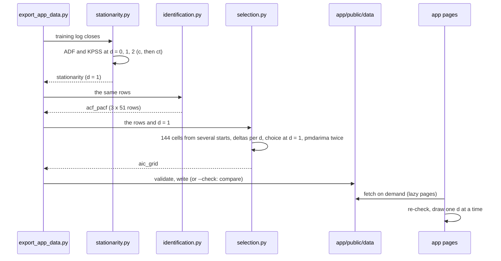

# Milestone 2: stationarity and identification

Status: built, reviewed, and revised in a fix round. Reviewed by: two adversarial reviews (code and
statistics), whose ledgers and the fix round are in [`docs/validation/m2-summary.md`](../validation/m2-summary.md).
The fix round changed the chosen model; every number below is from the revised export.

This walkthrough covers course modules 5 and 6: test the log price for a unit root, choose d, look at
the ACF and PACF, and choose (p, q). Everything runs on the training segment only, the first 90% of
the course window (ADR-0002, §1). It explains what exists, why it is built this way, and where each
guard lives.

How to use it:

1. Read the sections up to "Pitfalls met".
2. Answer [Predict before you look](#predict-before-you-look) on paper.
3. Only then read [Measured results](#measured-results).
4. Read the three concept notes listed at the end.
5. Answer [Explain it back](#explain-it-back) without notes.

Every `file:line` reference is relative to the repository root and was checked by a script against
the final files. Every number was measured on 2026-10-29 with the command shown next to it in
[Measured results](#measured-results).

---

## What we built and why

Three new artifacts carry milestone 2 to the app under schema `1.2.0` (`1.3.0` after the fix round,
which added fields inside them). **`stationarity`** holds ADF
and KPSS results for the training log price and its first and second differences, each run twice
(with a constant, which the rule reads, and with a trend, reported beside it), the four-way verdict
of each, and the choice of d with pmdarima's `ndiffs` as a cross-check. **`acf_pacf`** holds the ACF
and PACF of the same three series up to lag 50, with the 95% band `plot_acf` and `plot_pacf` draw.
**`aic_grid`** holds all 144 ARIMA fits of ADR-0002 (p and q from 0 to 5; d = 0 with a constant,
d = 1 without and with a drift, d = 2 without), each with its status, the choice within the d the
tests picked, BIC's choice, and pmdarima's stepwise search run twice on the same rows.

The app has two new pages. **Stationarity** shows the test table, the 2 × 2 reading and the
decision, and draws the ACF and PACF with their bands for any d. **AIC landscape** draws one d at a
time in 3D on the milestone-0 axes, with a distinct marker for each kind of failure, and a table of
every cell below it.

**The answer on AAPL:** d = 1, and AIC picks ARIMA(3, 1, 4) with a drift: the best the documented
search found, not a proven global optimum. Neither result is the end of the story. The search found
seven other models within 2 AIC of it, a lower bound, and the nearest is 0.036 away: gaps of a few
hundredths of AIC carry no meaning. BIC would pick ARIMA(2, 1, 2) without a drift, and the low-AIC
cells share near-cancelling complex roots. About three quarters of the chosen model's gain over
ARIMA(0, 1, 1) comes from 72 trading days in spring 2020. That is the setting in which AIC
over-selects; milestone 4's out-of-sample test decides. Milestone 3 checks the residuals first.

**The review changed the grid.** One optimiser run per cell had left many cells at local optima: the
first export has 94 pairs of `ok` d = 1 cells in which a model scored below a smaller model it nests
(99 at zero tolerance). Each cell is now fitted from several starts and the highest likelihood is
kept, and both readers refuse a file in which any cell scores below a model it nests. The first
export's answer, ARIMA(3, 1, 5) with no other cell within 2, was an artifact of those stops. A second
review found the first fix incomplete: a zero-padded start can sit exactly at the smaller model's
optimum, where L-BFGS cannot move, so seven cells tied a nested model's likelihood and the choice
(then ARIMA(2, 1, 4)) was 0.037 AIC above a point the search had missed. Perturbed padded starts and
a polish stage (Nelder-Mead from other cells' estimates) fixed that; no cell now ties a model it nests.

**The data rule changed during this milestone.** The owner decided on 2026-10-29 that the real data
the app and the docs need goes into the repository. `prices.json` and `eda.json` are now committed,
`held_artifacts` is empty, bulk raw files stay out, and [`DATA.md`](../../DATA.md) states the source
and its terms. A new test, `tests/test_repo_data.py`, replaces the real-data scanner as the guard.

---

## Why this design

| Choice | Alternatives | Why this one | What it costs |
|---|---|---|---|
| **d from ADF and KPSS together**, both with `regression='c'`, smallest d where ADF rejects and KPSS does not (ADR-0002 §2) | ADF alone (the course); KPSS alone (pmdarima's default) | Opposite nulls: each covers the other's blind spot. The power table in concept note 05 shows ADF misses near-unit-root series and KPSS flags them | Two tests at three d is six tests; 5% is per test |
| **The `'ct'` run reported, never used by the rule** (`with_trend`) | Use `'ct'` for the rule; leave it out | A trending price makes `'c'` an unfair alternative; reporting `'ct'` shows the verdict does not hinge on it (it does not, on AAPL) without changing the rule after seeing data | One more pair of tests per series |
| **ADF's `maxlag` passed explicitly**, computed by statsmodels' own rule | `maxlag=None` | The artifact records the lag range AIC searched; a test proves the result equals statsmodels' default call | A copy of a two-line formula (`stationarity.py:59`) |
| **The KPSS bound read from the p-value and cross-checked with statsmodels' warning**; the export stops if they disagree | Parse the warning text only; ignore the clipping | A reported "0.01" means "0.01 or less", and the app must say so; the guard catches a future statsmodels that clips differently | A `RuntimeError` path (tested) |
| **A fourth verdict, `"inconclusive"`** | The planned three-value enum | The 2 × 2 table has four cells; "neither test rejects" is a real outcome | An enum value added before the artifact shipped |
| **No series rows in `stationarity`** | The planned `rows[]` with rolling means and standard deviations | Measured: 1,680,767 bytes for three transforms, past the 1 MB budget; the level is already in `prices.json`; the page the brief asks for needs no series | No rolling-statistics plot (a later minor version can add one) |
| **ACF and PACF with the plots' defaults**: `fft=False`, `method='ywm'` | `acf()`'s and `pacf()`'s defaults (the planned contract) | The course's pictures come from `plot_acf` and `plot_pacf`; `'ywadjusted'` can leave [−1, 1] | The contract's planned settings were corrected |
| **The band stored as upper limit minus value**, exactly what `plot_acf` draws | Store z/√n and Bartlett's formula computed again | The app draws the same band as the course, with no arithmetic; notebook 02 rebuilds Bartlett from the file to within 1.7e-16 | Not bit-identical to z/√n (differs in the last digit) |
| **All 144 cells fitted; the choice made only at the tests' d** | Fit only the chosen d (72 fits, about half the time) | The d = 0 and d = 2 surfaces show *why* those d are wrong (every AR fit at d = 0 and every MA fit at d = 2 sits on a unit root) | About 40 s more export time |
| **One setting for every cell: L-BFGS, `maxiter=200`** | statsmodels' default 50; a retry with other settings | 63 kept runs needed 50 or more iterations; equal treatment keeps AIC comparable and traceable | 3 cells still report "not converged" (each kept a point where the line search stopped) |
| **Several starts per cell** (fix rounds): the default, every model one step smaller padded with zeros and two perturbed copies of it, 24 seeded random starts; the highest likelihood kept, an unconverged winner restarted once; then a polish stage for the cells within 4 AIC of the best of each d and every cell tied with a model it nests (Nelder-Mead, then L-BFGS, from every such cell's estimates), and a repair of any nesting break | One start (the first export); a global optimiser; more random starts only (round 1, which the second review refuted) | A padded start begins at the smaller model's likelihood, so no cell can end below a model it nests; perturbing it lets L-BFGS leave that point; random starts and Nelder-Mead from neighbours find the other optima of near-cancelling models | 3,890 runs instead of 144; the export took 6 min 50 s on a shared machine (Q7) |
| **The nesting rule in both readers** | Trust the fitting code | A local optimum is visible in the file: a cell below a model it nests. The readers refuse it, as they refuse a wrong delta | An O(n²) check over 144 cells (about 10,000 pairs) |
| **"Past the band" flags exported** (fix round) | The app compares each bar with its band | The app computes nothing; the readers check each flag against its value and band | Two booleans per row and two counts per series |
| **AR and MA roots checked separately; failed, then not converged, then near unit root** | pmdarima's root test (MA overwrites AR) | An AR root at 1 must not hide behind a harmless MA root | A status for each failure kind, which both readers re-derive |
| **Readers re-derive the verdicts, d, every delta_aic and the selection** | Shape-only checks | A delta measured across d, or a selection that is not the lowest eligible AIC, is refused on both sides; the corpus pins it | About 300 lines of checks in each language |
| **pmdarima's agreement per run, with `converged` and `iterations`** | One agreement block (the plan) | Two runs, two answers; the 7.56 gap is explained by data in the file | A refined shape |
| **`OPENBLAS_NUM_THREADS=1` set by the tool before numpy loads** (and in `tests/conftest.py`), and a process pool for the grid (fix round) | `threadpoolctl` (a new direct dependency); nothing | 352 s → 84 s for the single-start grid, results bit-identical; with 3,890 runs a pool of 16 `spawn` workers (which inherit the setting) runs each cell as soon as the cells it nests are done | The setting lives in two places; a caller can override it |
| **A small grid for the tool's wiring tests** (one order, pmdarima stubbed), the full grid in `--check`, a sample of cells refitted in `test_committed_artifacts.py` | The full grid in every test (about a minute per export, about 20 exports) | The suite stays near a minute; the full computation is still checked against the committed file | `--check` must be run by hand (it is a gate) |
| **Two lazy pages, a lazy 3D scene, parsers in `contract.order.ts`, the shared `Reader` in `contract.reader.ts`** | One page; parsers in `contract.payloads.ts` | Each page downloads only its own code; the main chunk grew 1.14 kB | Three new modules |
| **One d at a time, each on its own height scale; a table always below** | Overlay all d; colour-only failures | ADR-0002 §3 forbids a shared AIC axis across d; shapes, not only colours, mark failures; the table works without WebGL and at 375 px | d = 0's cliff dominates its own scale |
| **`held_artifacts` kept, empty** | Remove the field (a major bump, both readers, the corpus and the contract) | Same meaning, no bump, the mechanism still works | One always-empty field |

---

## Map of what changed

| Path | What | Hand-written or generated |
|---|---|---|
| `src/arima_forecasting/stationarity.py` | ADF, KPSS, the 2 × 2 verdict, the rule for d, pmdarima's `ndiffs` | Hand-written (new) |
| `src/arima_forecasting/identification.py` | ACF, PACF and their bands | Hand-written (new) |
| `src/arima_forecasting/selection.py` | The grid fitted from several starts in a worker pool, perturbed padded starts, the polish stage and nesting repair, cell statuses and recorded parameters, deltas, the choice, pmdarima's cross-check | Hand-written (new; reworked in both fix rounds) |
| `src/arima_forecasting/payloads.py` | `validate_stationarity`, `validate_acf_pacf`, `validate_aic_grid` (with the nesting rule, the start labels, the outside flags and z tied to alpha) | Hand-written (changed) |
| `src/arima_forecasting/artifacts.py` | `loads_strict`: the file readers refuse NaN and Infinity, as `JSON.parse` does | Hand-written (changed) |
| `src/arima_forecasting/export.py`, `contract.py` | Three new payloads, milestone 2 current, `HELD_ARTIFACTS` empty, `price_payloads` (no model fits, for notebook 01); schema `1.3.0` | Hand-written (changed) |
| `tools/export_app_data.py` | One BLAS thread; a clean error when no cell can be chosen | Hand-written (changed) |
| `tools/build_notebooks.py` → `notebooks/02_stationarity_and_identification.ipynb` | The milestone-2 notebook | **Generated** notebook |
| `app/public/data/{stationarity,acf_pacf,aic_grid}.json` | The three new artifacts | **Generated**, committed |
| `app/public/data/{prices,eda,meta}.json` | Now all committed (the owner's decision) | **Generated**, committed |
| `app/src/lib/contract.order.ts`, `contract.reader.ts` | The three TypeScript readers; the shared `Reader` | Hand-written (new; `Reader` moved) |
| `app/src/lib/{correlogram,stationarityText,aicLandscape}.ts`, `CorrelogramPlot.tsx` | Presentation helpers and the bar chart | Hand-written (new) |
| `app/src/views/{StationarityView,AicLandscapeView,AicLandscapeScene,SceneBoundary}.tsx` | The two pages, the 3D scene, the shared error boundary | Hand-written (new; the boundary moved) |
| `app/src/data/useOrderData.ts` | Loading and parsing the three files | Hand-written (new) |
| `app/src/test/fixtures/{stationarity,acf_pacf,aic_grid}.data.json`, `payload_cases.json` | Made-up bases and 187 new corpus cases (273 in all, plus 6 NaN and Infinity token cases) | Bases and cases written by generator scripts |
| `tests/test_{stationarity,identification,selection,repo_data}.py`, `tests/conftest.py` | New suites | Hand-written (new) |
| `DATA.md`, `.gitignore`, `LICENSE` | The data rule; the price files no longer ignored; the licence excludes the data | Hand-written |
| `docs/validation/m2-*.md` | The two review ledgers and the summary of the fix round | Hand-written (ledgers copied, paths redacted) |
| `docs/concepts/05-07`, ADR-0001, ADR-0002, `contract.md`, specs | Concept notes, the owner's decision, measurements, the shipped contract, diagrams | Hand-written; diagram outputs **generated** |

---

## Code walkthrough

Read in this order. Each step names one file and line.

1. `src/arima_forecasting/export.py:153` is `order_selection_payloads`. It takes the training rows
   only (`:159`), runs the unit-root tests first, and passes their d to the grid (`:164`). The grid
   never sees the test or out-of-sample rows; `test_the_order_selection_payloads_use_the_training_rows_only`
   triples every later close and checks that nothing moves.
2. `src/arima_forecasting/stationarity.py:59` is `adf_maxlag`, statsmodels' lag rule, and `:69` is
   `adf_test`, which passes it explicitly (`:72`) with `result_object=True`, so statsmodels 0.15 does
   not warn about the return type.
3. `src/arima_forecasting/stationarity.py:87` is `kpss_bound`: "smaller" at the 0.01 floor, "greater"
   at the 0.10 ceiling. `kpss_test` (`:101`) records statsmodels' warnings and stops if they disagree
   with that reading (`:110`); any other warning is passed on.
4. `src/arima_forecasting/stationarity.py:127` is the 2 × 2 table, `:146` the rule for d, and `:158`
   pmdarima's `ndiffs`, imported inside the function so that a broken pmdarima breaks one block.
5. `src/arima_forecasting/stationarity.py:192` is `stationarity_payload`: three transforms, each with
   the rule's tests and the trend run (`:210`). It writes test statistics only.
6. `src/arima_forecasting/identification.py:42` is `correlogram`: `acf` with `fft=False` (`:46`) and
   `pacf` with `method='ywm'` (`:47`), each band as upper limit minus value (`:54`), and `outside`
   (`:63`), which decides once whether a bar is past its band; the payload counts the flags (`:75`).
7. `src/arima_forecasting/selection.py:47` defines the grid, `:50` `MAXITER` and `:57`
   `RANDOM_STARTS`. `:220` is `run_start`, one optimiser run from one start: every setting explicit
   (`:228`), every warning recorded, an exception or a non-finite result turned into a failed run (`:248`).
8. `:168` is `padded_start` (a smaller model's estimates, zeros for the rest) and `:200`
   `random_starts` (seeded by the cell). `:364` `_starts` lists a cell's starts, `:253` `choose` keeps
   the highest likelihood, `:284` `polish_start` restarts an unconverged winner once, and `:297`
   `_cell_from` sets the status: not converged first (`:327`), then near unit root (`:330`, AR and MA
   checked separately at `:326`).
9. `:421` is `fit_grid`: each cell starts when the cells one step smaller (`parents`, `:138`) are
   done, its runs go to a pool of worker processes, and `:408` `nesting_violations` is the check the
   tests and notebook 02 run. `:637` `refit_cell` reproduces one committed cell from its recorded start.
10. `:694` is the ranking, `:699` the best eligible cell of one d, and `:704` `add_delta_aic`: each
    delta from the best of its **own** d. `:713` is `select`, which refuses a d with no eligible cell
    (`:717`) and lists near ties with ΔAIC ≤ 2 (`:719`).
11. `:749` lists pmdarima's two runs; `:797` runs them with `return_valid_fits=True` (`:810`), records
    the chosen fit's convergence, and compares it with our cell of the same order and trend (`:785`),
    mapping pmdarima's intercept to our trend code (`:773`). `:840` is `aic_grid_payload`; it reads
    the grid from module attributes when it runs, which is how the tool tests shrink it, and refuses a
    d outside the grid before fitting anything (`:857`).
12. `src/arima_forecasting/payloads.py:570`, `:666` and `:935` are the three Python readers. The rule
    for d is re-applied at `:627`, each delta re-computed at `:1024`; `:785` re-derives each cell's
    status (`:859`); `:873` checks the start labels and `:906` the nesting rule; `:754` is the table
    that ties z to alpha; `:1114` type-checks each small object before comparing, so `true` cannot
    pass for 1. `src/arima_forecasting/artifacts.py:33` is `loads_strict`, which every file reader uses.
13. `tools/export_app_data.py:26` sets one BLAS thread before numpy loads; `:77` builds the payloads
    and turns a `ModelSearchError` into exit 1 with a message. `app/src/lib/contract.order.ts` mirrors
    every rule; the shared corpus runs both readers on 273 cases, 187 of them added in this milestone.
14. `app/src/App.tsx` offers **Stationarity** and **AIC landscape** only when `meta.json` lists their
    files (`app/src/lib/gate.ts`), each through `lazy()`. `app/src/views/AicLandscapeView.tsx` loads
    `AicLandscapeScene.tsx` lazily, only with WebGL, inside `SceneBoundary`; the table below it needs
    neither. `app/src/lib/aicLandscape.ts` computes heights for one d at a time.

---

## Data flow

The training log price (2,037 values) followed to the two pages.

| # | Hop | Shape at this hop | Where |
|---|---|---|---|
| 1 | `price_table` → training rows | 2,037 log closes, 2015-01-02 to 2023-02-03 | `src/arima_forecasting/export.py:159` |
| 2 | `difference(…, d)` for d = 0, 1, 2 | arrays of 2,037, 2,036 and 2,035 values | `src/arima_forecasting/stationarity.py:49` |
| 3 | ADF and KPSS, twice each | 12 test results; verdicts unit_root, stationary, stationary | `src/arima_forecasting/stationarity.py:140` |
| 4 | `decide_d` and `pmdarima_ndiffs` | d = 1, no conflict; pmdarima 1, 1, 1 | `src/arima_forecasting/stationarity.py:146`, `:158` |
| 5 | `correlogram` on each series | 3 × 51 rows of (lag, acf, pacf, acf_band, pacf_band, acf_outside, pacf_outside) | `src/arima_forecasting/identification.py:42` |
| 6 | `fit_grid` | 3,890 runs in a pool, the polish stage included; 144 cell dicts, 5 of them with warnings; no cell below a model it nests, none tied with one | `src/arima_forecasting/selection.py:421` |
| 7 | `add_delta_aic`, `select` | deltas per d; ARIMA(3, 1, 4) with a drift, seven others found within 2 | `src/arima_forecasting/selection.py:704`, `:713` |
| 8 | `pmdarima_check` | 2 runs, 8 and 22 fits kept | `src/arima_forecasting/selection.py:797` |
| 9 | validate, `dumps`, write | three JSON files (sizes in Measured results) | `tools/export_app_data.py` |
| 10 | The reader opens **Stationarity** | `loadStationarity` fetches two files, both parsers re-check them | `app/src/data/useOrderData.ts` |
| 11 | Table and correlograms | the decision card, two tables, two SVG bar charts | `app/src/views/StationarityView.tsx` |
| 12 | The reader opens **AIC landscape** | `parseAicGrid`; `landscape(grid, 1, ['n', 't'])` gives 72 points and the wireframe | `app/src/lib/aicLandscape.ts` |
| 13 | 3D scene and table | spheres, octahedra, crosses; a 6 × 6 table per trend | `app/src/views/AicLandscapeScene.tsx` |



The data-flow diagram in [docs/architecture/README.md](../architecture/README.md) (section 2) shows
the ACF and PACF step and the three new artifacts.

---

## Pitfalls met and how each is guarded

| Pitfall | How it showed up | Guard (`file:line`) |
|---|---|---|
| **statsmodels 0.15 warns about return types** | `acf(…, alpha=…)` without `result_object` raised a `FutureWarning` (measured) | `result_object=True` on every call: `stationarity.py:72`, `identification.py:46-47` |
| **The KPSS p-value is clipped** | d = 0: η = 6.8235 came back as p = 0.01 with "the actual p-value is smaller" | `kpss_bound` and the guard at `stationarity.py:110`; `p_value_bound` in the artifact; both readers check it |
| **The plots' defaults are not the functions' defaults** | `plot_pacf` uses `'ywm'`, `pacf` `'ywadjusted'`; on the eight-point test series they give −0.75 and −1.00 | `identification.py:36-39`; `test_the_settings_are_the_defaults_of_the_plots_the_course_calls` |
| **statsmodels refuses a constant with d ≥ 1** | `ValueError: In models with integration …` | A failed cell, never a crash (`selection.py:248`, `:375`); `test_a_constant_with_d_1_is_a_failed_cell_with_statsmodels_message` |
| **"Not converged" is not always the iteration limit** | In the first export, (1, 1, 0) with and without a drift, (5, 1, 0) with a drift and (2, 2, 0) stopped after 0 or 1 iterations with warnflag 2 (four cells). After the second fix round three remain, all at d = 1: (0, 1, 2) without a drift (24 iterations) and (4, 1, 4) and (5, 1, 4) with one (0 iterations): each kept the highest likelihood it found from a point where the line search stopped. ARIMA(4, 1, 4) with a drift would sit at ΔAIC 1.806 if it counted; the rule excludes it | The warnflag, iteration count and start in each cell and its reason (`selection.py:327-329`) |
| **One start per cell stops at local optima** | The first export has 94 pairs (99 at zero tolerance) of `ok` d = 1 cells in which a model scored below a smaller model it nests, by up to 21.8 | Several starts (`selection.py:364`), the highest likelihood kept (`:253`); the nesting rule in both readers (`payloads.py:906`, `checkNesting` in `contract.order.ts`); `test_no_cell_of_the_grid_scores_below_a_model_it_nests` and its control, `test_with_one_default_start_per_cell_the_same_grid_has_local_optima` |
| **A stalled padded start can be marked converged** (second review) | Seven cells, among them (3, 1, 4) with a drift, kept a zero-padded start at exactly the smaller model's likelihood with `converged: true`; from other starts (3, 1, 4) reached AIC −10440.245, below the then choice | `perturbed_starts` and `polish_stage` in `selection.py`; `test_no_cell_is_left_at_the_optimum_of_a_model_it_nests` |
| **A file set its own nesting tolerance** (second review) | Both readers took `fit_settings.nesting_tolerance` from the file, so `100` let a 21.8 drop pass | The readers compare with their own 2e-3 (`NESTING_TOLERANCE` in `payloads.py` and `contract.order.ts`) and refuse any other stated value; corpus cases |
| **A padded start can stop where it began** | (4, 1, 5) with a drift, started from (3, 1, 5) padded with zeros, ended after 0 iterations at exactly (3, 1, 5)'s likelihood, flagged not converged; a rule of "converged first" then kept a worse converged run, so 7 nesting breaks survived | `choose` keeps the highest likelihood (`selection.py:253`); a converged run wins only within 1e-4; `test_choose_keeps_the_highest_likelihood_even_from_a_run_that_did_not_converge` |
| **A "converged" run can stop short** | (0, 1, 1) with a drift converged after 2 iterations 1.7e-4 below a padded start that did not converge; restarted from the latter's estimates, it converged above both | `polish_start` (`selection.py:284`); `test_a_best_run_that_did_not_converge_is_polished_once_from_its_own_estimates` |
| **A default argument is read once** | `random_starts(…, count=RANDOM_STARTS)` bound the value at import, so a run that set `RANDOM_STARTS = 6` still drew 2 and reported a false "no change" | `count=None`, read at call time (`selection.py:200`); the polish and nested-start tests set `RANDOM_STARTS` and check `starts_tried` |
| **`np.roots` of a padded polynomial** | A last coefficient of exactly 0 is a root at 0, and statsmodels' `arroots` divides by it: NaN in `max_inv_root_*` | `largest_inverse_root` reads the inverse roots from the polynomial (`selection.py:153`); `test_largest_inverse_root_reads_a_zero_top_coefficient_as_a_root_at_zero` |
| **A start can end at NaN parameters without an error** | A mutant that padded with 0.1 crashed the grid: statsmodels returned NaN parameters for (2, 1, 1) with a drift, and `np.roots` raised outside the run's `try` | `run_start` summarises inside the `try` and refuses a non-finite value (`selection.py:220`); `test_a_run_that_ends_at_nan_parameters_is_a_failure_not_the_result` fails on the old code |
| **A slower export broke a notebook** | Notebook 01 rebuilt every payload from the snapshot to compare two of them; with the several-start grid that cell passed nbclient's 120-second limit in the full-tree gate (2 failed) | `export.price_payloads` builds meta, prices and eda without fitting a model; notebook 01 uses it, `build_payloads` builds on it |
| **Python reads NaN and Infinity; `JSON.parse` does not** | A NaN under an unknown key passed every Python check in a file the app cannot parse (the review's 6 token cases) | `loads_strict` (`artifacts.py:33`); the corpus's `token_cases`, run by both suites |
| **pmdarima hides an unconverged fit** | Its (2, 1, 2) stopped at 50 iterations; statsmodels at 50 gives the same AIC bit for bit | `converged` and `iterations` in each run (`selection.py:797`); concept note 07 |
| **pmdarima's root test lets MA overwrite AR** | ADR-0002 §5 | AR and MA checked separately (`selection.py:326`); `test_an_ma_root_at_one_from_over_differencing_is_flagged_too` |
| **OpenBLAS threads on tiny matrices** | In one sequential timing the grid took 352 s with 20 threads and 84 s with one; a 12-process pool at default threads took 373 s | `tools/export_app_data.py:26`, `tests/conftest.py`; `test_the_tool_limits_openblas_to_one_thread_before_numpy_loads` |
| **A helper named `test_pair` would be collected by pytest** | Any test module importing it would run it as a test | Renamed `run_pair` (`stationarity.py:140`) |
| **Re-serialising the corpus breaks it** | Python reads the literal `1e400` as `inf` and would write `Infinity`, which JavaScript's JSON import refuses | New cases are spliced into the file as text (the generator script refuses to run twice) |
| **`True == 1` in Python** | A `within_2_aic` entry with `p: true` compared equal in Python, not in JavaScript | Typed fields before any comparison (`payloads.py:1114`, `fields()` in `contract.order.ts`); a corpus case |
| **A delta measured across d** | Would rank d = 0 cells against d = 1 | `selection.py:704`; both readers re-compute every delta; corpus case "delta_aic measured from another d's best" |
| **A tie broken the wrong way survived in TypeScript** | Mutants A4 and A5 passed 858 tests | Four tie cases added to the corpus; both killed on re-run |
| **The app counted bars past the band itself** | `correlogram.ts` compared each value with its band; the page counted them | Python exports `acf_outside`, `pacf_outside` and the counts; both readers check them; `correlogram.test.ts` flips the flags and expects the bars to follow |
| **A failed cell sat at the height of the best one** | Its cross was drawn on the floor, where the lowest AIC sits | `FAILED_Y`, below the floor (`aicLandscape.ts`); the landscape and scene tests |
| **The data test measured the disk and read names only** | A raw CSV renamed into `app/public/data/` or `notebooks/`, a `.csv.gz`, or a staged 10 MB blob truncated on disk all passed | `tests/test_repo_data.py` reads HEAD and index blobs with `git cat-file` and recognises a price table by its header; each bypass proved in a scratch clone (Measured results) |
| **The canvas swallowed page scrolling** | Scrolling over the 3D view zoomed it instead | `enableZoom={false}` in `AicLandscapeScene.tsx` |
| **The 3D font has Basic Latin only** | AIC labels are negative; `formatTick` writes U+2212 | ASCII minus in `asciiNumber` (`aicLandscape.ts`); the scene test checks every label |
| **A source-text test pins nothing** | The first OpenBLAS test grepped the tool's source | Replaced by a subprocess test that reads OpenBLAS's real thread count, with a control |

---

## Predict before you look

**Write your answers down before you scroll.** Commit to a number, even a guess.

1. On the training log price, does ADF reject a unit root? Roughly what τ? What p-value will statsmodels
   print for KPSS, and what does that printed number really mean?
2. Which d does the rule choose? Would a trend in the test regression change it? Does the second
   difference pass both tests too, and if so why is d not 2?
3. What is the lag-1 autocorrelation of the first difference, and of the second? Of the 50 ACF bars
   of the first difference, how many cross a band that pure noise would cross about 2.5 times?
4. Of the 144 fits, how many fail, how many do not converge, how many sit near a unit root, and at
   which d do you expect the flags to cluster?
5. Which (p, q) and trend does AIC choose at d = 1? Is there a drift? How many cells are within 2
   AIC of it? Would BIC agree?
6. What does pmdarima choose with the course's arguments, and with its own defaults? How far is its
   AIC from ours for the same model?
7. How long does the export take? Does the number of BLAS threads matter?
8. How big are the three new files against the 1 MB budget, and how much does the main JavaScript
   chunk grow from milestone 1's 225.63 kB?

---

## Measured results

### Environment

Data steps ran with `VOL_DATA_DIR=$PWD/data` on the 13:37 UTC snapshot of milestone 1 (no new
download). Versions: Python 3.12.13, numpy 2.5.4, scipy 1.18.1, statsmodels 0.15.0, pmdarima 2.1.1,
Node v22.23.1; no dependency was added or upgraded. The machine has 20 cores.

### Answers to the predictions

| What | Command | Result | Date |
|---|---|---|---|
| Q1. Tests on the log price | `stationarity.json`, `transforms[0]` | ADF τ −0.407, p 0.909, 9 lags of 0–26; KPSS η 6.8235, printed p 0.01 with `p_value_bound: "smaller"` (0.01 or less), 28 lags: **unit root** | 2026-10-29 |
| Q2. d | `stationarity.json`, `decision` | **d = 1**, `tests_conflict` false. First difference: ADF τ −13.814 (p 8.1 × 10⁻²⁶), KPSS 0.0972 (≥ 0.10). Second difference also "stationary" (τ −13.981; KPSS 0.0185), but the rule takes the smallest d. With a trend: log price ADF p 0.394, KPSS 0.7538 > 0.216: still a unit root. pmdarima `ndiffs`: KPSS 1, ADF 1, PP 1. At d = 2 ADF's AIC search chose lag 26, the top of its range (`maxlag` 26); with `maxlag` 40 it chooses 40 (τ −11.49, p 4.7 × 10⁻²¹) and with 60 it chooses 45 (τ −10.93, p 9.7 × 10⁻²⁰): the statistic moves, the verdict does not, and d = 2 is not the chosen d anyway. The long lag is the over-differencing again: an AR approximation of an MA root at 1 needs ever more lags | 2026-10-29 |
| Q3. Correlograms | `acf_pacf.json` | lag-1 ACF: log 0.9987, first difference −0.0805, second −0.5360. First difference: 11 of 50 ACF and 7 of 50 PACF bars past the band (`acf_outside_count`, `pacf_outside_count`); the band 0.0434 (lag 1) to 0.0465 (lag 50) | 2026-10-29 |
| Q4. Statuses | `aic_grid.json`, `selection.status_counts` | failed 0. d = 0: 6 ok, 30 near unit root. d = 1: 67 ok, 2 near unit root, 3 not converged. d = 2: 6 ok, 30 near unit root. 3,890 runs; the winning start: 62 random, 46 nested (27 of them perturbed), 20 from the polish stage, 16 default. 5 cells kept a warning. No cell below a model it nests, and none with a likelihood equal (within 1e-6) to one it nests. (First export, one start per cell: d = 1 69 ok, 3 not converged; d = 2 1 not converged; 49 cells with a warning) | 2026-10-29 |
| Q5. The choice | `aic_grid.json`, `selection` | **ARIMA(3, 1, 4) with a drift**, AIC −10440.245, 9 parameters, the best the documented search found. Found within 2, all with a drift (a lower bound): (2, 1, 4) +0.036, (4, 1, 3) +0.128, (4, 1, 2) +0.400, (2, 1, 5) +0.593, (3, 1, 5) +0.629, (5, 1, 2) +1.567, (5, 1, 3) +1.859. BIC: ARIMA(2, 1, 2) without a drift, BIC −10405.716 against −10389.677. (First export: ARIMA(3, 1, 5), −10439.170, none within 2; first fix round: ARIMA(2, 1, 4), −10440.208) | 2026-10-29 |
| Q5. How robust | the round-1 search with 2, 6, 12 and 24 random starts, then the round-2 polish stage | with L-BFGS from default, padded and random starts alone the choice was (2, 1, 4) every time and the near ties 3, 5, 4 and 6 cells; Nelder-Mead from other cells' estimates found (3, 1, 4) 0.037 lower. So the choice depends on the search, and differences of a few hundredths of AIC mean nothing | 2026-10-29 |
| Q6. pmdarima | `aic_grid.json`, `pmdarima_check` | course: (0, 1, 1) with an intercept, AIC −10398.937, converged after 2 iterations, 8 fits kept, gap +0.0003. defaults: (2, 1, 2) without an intercept, AIC −10426.231, **not converged after 50**, 22 fits kept, gap +7.578 | 2026-10-29 |
| Q6. Why the gap | the probe script below | statsmodels with `maxiter=50`: AIC −10426.230863341112, 50 iterations, not converged; with 200, from the same default start: −10433.793237719332 at iteration 62. The grid's cell is 0.016 lower again (−10433.809), from a random start. Separately, pmdarima's default run visited (2, 1, 2) with an intercept, which converged (41 iterations) at −10402.059: 34.806 above our (2, 1, 2) with a drift, the same model | 2026-10-29 |
| Q7. Time | `/usr/bin/time -v env VOL_DATA_DIR=$PWD/data uv run python tools/export_app_data.py` (and `--check`) | After the second fix round: the export **6 min 50.2 s** (3,890 runs on 16 worker processes, with a load average of about 21 from other jobs on the 20 cores; a run at a load of 44 to 69 took 9 min 7.0 s); `--check`: see Gate results. After the first fix round (2,827 runs) it was 3 min 17.6 s; with 2 random starts 1 min 9.4 s. The first export, one start per cell: 1 min 0.7 s; the 144 single-start fits alone took 84.2 s with `OPENBLAS_NUM_THREADS=1` and 352.3 s with OpenBLAS's default. A serial fit of the 2-start grid (268.4 s) and the pooled one gave identical cells, as did the 24-start grid on 8 and on 16 workers | 2026-10-29 |
| Q7. Determinism | two exports with `SOURCE_DATE_EPOCH=1793318400`, then `cmp` | all six files identical | 2026-10-29 |
| Q8. Sizes and chunks | `wc -c app/public/data/*.json`; `cd app && npm run build` | `stationarity.json` 6,685 bytes (0.7% of 1,000,000), `acf_pacf.json` 44,899 (4.5%), `aic_grid.json` 153,790 (15.3%, now with each cell's parameters); Python `gzip.compress(…, 6)`: 1,355, 6,624 and 27,717. `meta.json` 1,531; `prices.json` 456,025 and `eda.json` 529,907, unchanged. Main chunk `index` 226.77 kB (gzip 72.78 kB): **+1.14 kB** over 225.63 kB. `StationarityView` 11.47 kB, `AicLandscapeView` 12.06 kB, their shared readers 27.55 kB, `AicLandscapeScene` 3.02 kB plus the three.js chunk 1,081.29 kB (gzip 303.65 kB), which the Architecture page's `AicAxesScene` (now 1.31 kB) shares. Each export's `source_commit` ends in `-dirty`; a clean stamp is 6 bytes shorter | 2026-10-29 |

**What the numbers say.**

- **The unit-root verdict is clear and robust.** KPSS's statistic is nine times its 1% critical
  value, and a trend in the regression changes nothing. The power table of concept note 05 is the
  caveat: with this much data the tests cannot tell a random walk from a series whose shocks halve in
  two to three years.
- **Over-differencing shows in the ACF, not the tests.** The second difference passes both tests;
  its lag-1 autocorrelation of −0.536 and its MA roots at 1 give it away.
- **The bands are too narrow.** 11 crossings where noise gives about 2.5. Most of the structure sits
  in 2020 onwards (concept note 06).
- **AIC's choice is a near-cancelling cycle.** The chosen ARIMA(3, 1, 4) has an AR complex root pair
  at ±154.7° (modulus 0.932) and an MA pair at ±152.1° (0.885), a cycle of about 2.3 days. Of its
  log-likelihood gain over ARIMA(0, 1, 1) with a drift, 26.65 at the grid's recorded parameters, about
  two thirds (64.2%) comes from 2020 onwards (38% of the days) and about three quarters (77.2%) from
  72 days, 2020-02-15 to 2020-05-31 (3.5% of the days). Optima within 0.002 of log-likelihood move
  the third digit of these shares by about half a point.
- **This is where AIC over-fits.** Near-cancelling roots leave four coefficients poorly identified, the
  regime in which AIC's 2-per-parameter penalty is unreliable and over-selection is expected (the same
  argument that keeps AIC away from d), and a gain that concentrated may not generalise. The search
  found eight models within 2 AIC, the chosen one included, and that count is a lower bound. The rule is not changed after seeing this; milestone 4's out-of-sample test is the
  arbiter (concept note 07, "Over-fitting, stated plainly").
- **pmdarima agrees on d and disagrees on the order,** for measured reasons: a local search, and a
  fit it stopped at 50 iterations without saying so.
- **The first two answers were optimiser artifacts.** One start per cell left 94 nesting breaks and
  chose ARIMA(3, 1, 5); several L-BFGS starts removed the breaks and chose ARIMA(2, 1, 4); perturbed
  padded starts and the polish stage removed the stalls and chose ARIMA(3, 1, 4), 0.037 lower. The
  choice is the best this documented search found, and the next search could move it again by a few
  hundredths.

### The commands behind the table

```bash
VOL_DATA_DIR=$PWD/data uv run python tools/export_app_data.py
VOL_DATA_DIR=$PWD/data uv run python tools/export_app_data.py --check
uv run python tools/build_notebooks.py --check
wc -c app/public/data/*.json
```

Notebook 02 prints the tests, the decision, the correlogram counts, the statuses, the starts, the
nesting check, the choice and the cross-check from the committed files; `tests/test_notebooks.py`
checks the printed lines against the files. The sub-sample ACFs, the per-day split of the
log-likelihood and the `maxiter` probe came from this script, run from the repository root with
`OPENBLAS_NUM_THREADS=1 uv run python -I probe.py`:

```python
import json, warnings
import numpy as np, pandas as pd
from statsmodels.tsa.arima.model import ARIMA
from statsmodels.tsa.stattools import acf
from arima_forecasting import selection
warnings.simplefilter("ignore")
rows = [r for r in json.load(open("app/public/data/prices.json"))["data"]["rows"] if r["segment"] == "train"]
y = np.array([r["log_close"] for r in rows]); r = np.diff(y); day = np.array([x["date"] for x in rows])
show = lambda x: np.round(acf(x, nlags=9, fft=False)[[1, 7, 8, 9]], 3).tolist()
print("all", len(r), show(r))
print("2015-2019", (day[1:] < "2020").sum(), show(r[day[1:] < "2020"]))
print("2020-", (day[1:] >= "2020").sum(), show(r[day[1:] >= "2020"]))
s = pd.Series(r); z = (s / s.rolling(21).std().shift(1)).dropna().to_numpy()
print("scaled", len(z), show(z))
# Each day's log-likelihood under the chosen cell and under (0, 1, 1) with a drift, both at the
# parameters the committed grid recorded (selection.refit_cell returns them).
cells = json.load(open("app/public/data/aic_grid.json"))["data"]["cells"]
def per_day(key):
    _, params = selection.refit_cell(y, cells, key)
    model = selection._model(y, *key)
    return model.filter(np.array([params[n] for n in model.param_names])).llf_obs
gain = per_day((1, 3, 4, "t")) - per_day((1, 0, 1, "t"))
spring = (day >= "2020-02-15") & (day <= "2020-05-31")
for name, mask in (("all", day > ""), ("before 2020", day < "2020"), ("2020-", day >= "2020"), ("2020-02-15..05-31", spring)):
    print(f"{name}: {mask.sum()} days, gain {gain[mask].sum():.3f} ({gain[mask].sum() / gain.sum():.1%})")
for maxiter in (50, 200):
    f = ARIMA(y, order=(2, 1, 2), trend="n").fit(method_kwargs={"maxiter": maxiter})
    print("maxiter", maxiter, repr(f.aic), f.mle_retvals["iterations"], f.mle_retvals["converged"])
```

It printed (the day counts include the first training day, which d = 1 does not score):

```text
all 2036 [-0.08, 0.092, -0.087, 0.099]
2015-2019 1257 [0.008, 0.093, -0.029, 0.046]
2020- 779 [-0.146, 0.091, -0.131, 0.139]
scaled 2015 [0.002, 0.049, -0.029, 0.041]
all: 2037 days, gain 26.654 (100.0%)
before 2020: 1258 days, gain 9.534 (35.8%)
2020-: 779 days, gain 17.120 (64.2%)
2020-02-15..05-31: 72 days, gain 20.590 (77.2%)
maxiter 50 np.float64(-10426.230863341112) 50 False
maxiter 200 np.float64(-10433.793237719332) 62 True
```

The first export's walkthrough also compared AIC on each half of the sample alone (2015-2019 and
2020 onwards). Those numbers are withdrawn: both half-sample fits started from statsmodels' default
values, the 2015-2019 one did not converge, and from a better start the review found ARIMA(2, 1, 2)
with a drift 22.98 AIC *below* ARIMA(0, 1, 1) with a drift on the 2020 half, not 5.33 above it. The
per-day split above needs no refit of either half.

The root angles came from the inverse roots at the chosen cell's recorded parameters (`np.roots` of
`polynomial_reduced_ar` and `polynomial_reduced_ma`): AR 0.932 at ±154.7° and −0.465; MA 0.885 at
±152.1°, −0.683 and 0.155. ARIMA(2, 1, 2) with a drift: AR 0.959 at ±158.9°, MA 0.928 at ±160.3°.

The robustness rows (2, 6, 12 and 24 random starts) re-ran the first fix round's `selection.fit_grid`
on the training log closes with `selection.RANDOM_STARTS` set to each value, and the d = 2 lag check in the Q2 row ran
`adfuller` on the second difference with `maxlag` 26, 40 and 60.

The power table of concept note 05 came from this script (`OPENBLAS_NUM_THREADS=1 uv run python -I -`,
about 3 minutes):

```python
import warnings
import numpy as np
from statsmodels.tsa.stattools import adfuller, kpss
warnings.simplefilter("ignore")
rng = np.random.default_rng(20261029)
n, paths = 2037, 400
for phi in (1.0, 0.999, 0.995, 0.99, 0.98, 0.95):
    adf_rej = kpss_rej = both = 0
    for _ in range(paths):
        e = rng.standard_normal(n)
        x = np.empty(n); x[0] = e[0] if phi == 1.0 else e[0] / np.sqrt(1 - phi**2)
        for t in range(1, n):
            x[t] = phi * x[t - 1] + e[t]
        a = adfuller(x, regression="c", autolag="AIC", result_object=True).pvalue < 0.05
        k = kpss(x, regression="c", nlags="auto", result_object=True).pvalue < 0.05
        adf_rej += a; kpss_rej += k; both += (a and not k)
    print(f"phi {phi:<6} ADF rejects {adf_rej / paths:6.1%}   KPSS rejects {kpss_rej / paths:6.1%}   'stationary' verdict {both / paths:6.1%}")
```

It printed `ADF rejects 7.0% / 9.2% / 30.8% / 85.8% / 100.0% / 100.0%` and `KPSS rejects 98.0% / 99.0%
/ 89.5% / 74.0% / 53.0% / 21.5%` for φ = 1, 0.999, 0.995, 0.99, 0.98 and 0.95.

The size of the planned `stationarity.rows[]` (1,680,767 bytes) was measured by building those rows
for the three training series and writing them with `json.dumps(…, sort_keys=True, indent=2)`, as the
exporter writes.

### Mutation testing

A *mutant* is a deliberately broken copy of the code. A test that fails *kills* it. Every mutant ran
on a scratch copy; the real repository was never changed.

- **Python:** a copy of `src`, `tests`, `tools`, `notebooks`, `app/public/data` and the corpus
  fixtures, with `PYTHONPATH` pointing at the copy. Each mutant ran the milestone-2 suites:
  `test_stationarity`, `test_identification`, `test_selection`, `test_payload_corpus`,
  `test_committed_artifacts`, `test_export` and `test_payloads`. An unchanged copy gave
  `396 passed in 61.08s`.
- **App:** a copy of `app/` with `node_modules` hard-linked (so the font file loads), running
  `npx vitest run`. An unchanged copy gave `Tests 858 passed (858)`.

These two tables were run before the fix round, on the tree the reviews saw. Their line numbers are
where each mutated line sits after the fix round. The fix round's own mutants follow them.

**Python** (an unchanged copy gave `396 passed in 61.08s`):

| # | Mutation (`file`) | What fails |
|---|---|---|
| P1 | each delta from the best eligible cell of **any** d (`selection.py:710`) | 11 failed, 15 errors: `test_delta_aic_is_measured_from_the_best_eligible_cell_of_the_same_d_only`, `test_the_committed_selection_follows_from_the_committed_cells`, every tool test (the validator refuses the payload) |
| P2 | any cell with an AIC is eligible (`selection.py:700`) | 8: the select, refuse and delta tests, the committed-selection test, the no-eligible-cell tool test |
| P3 | d from ADF alone, the course's way (`stationarity.py:150`) | 2: the "no d passes" and "KPSS rejects everywhere" cases of `test_decide_d_follows_adr_0002` |
| P4 | the KPSS bound read the wrong way (`stationarity.py:95`) | 15 failed, 59 errors: the guard at `:110` stops every computation that clips |
| P5 | MA roots ignored (`selection.py:326`) | 3: `test_an_ma_root_at_one_from_over_differencing_is_flagged_too`, the small-grid payload, the export validator test |
| P6 | near unit root checked before not converged (`selection.py:327`) | 1 in the first run (the small-grid payload, through the validator); after strengthening `test_not_converged_takes_precedence_over_near_unit_root` (it now sets a threshold of 0 so both conditions hold), 2 |
| P7 | pmdarima's intercept at d = 1 read as a constant (`selection.py:782`) | 3: the trend-mapping case, the small-grid payload, the export validator test |
| P8 | PACF with `pacf()`'s `'ywadjusted'` (`identification.py:39`) | 5: the hand-worked PACF, the ywm/ywadjusted test, the defaults test, the payload test, the committed `acf_pacf.json` test |
| P9 | ACF with `fft=True` (`identification.py:36`) | 2: the defaults test, the committed `acf_pacf.json` test (the values differ in the last bits) |
| P10 | order selection on train + test (`export.py:159`) | 1: `test_the_order_selection_payloads_use_the_training_rows_only` |
| P11 | the Python reader skips the delta check (`payloads.py:1024`) | 2 corpus cases |
| P12 | the Python reader skips the rule for d (`payloads.py:627`) | 2 corpus cases |
| P13 | the Python reader skips the KPSS bound (`payloads.py:546`) | 2 corpus cases |
| P14 | near ties strictly under 2 (`selection.py:719`) | 1: the select test (a cell at exactly ΔAIC 2.0) |
| P15 | ties broken by p + q before parameters (`selection.py:696`) | 0: **equivalent**. k = p + q + (0 or 1) + 1, so a smaller p + q never comes with a larger k, and the two orders always agree |
| P16 | the tool leaves OpenBLAS alone (`tools/export_app_data.py:26`) | 1: `test_the_tool_limits_openblas_to_one_thread_before_numpy_loads` |
| P17 | the rule uses `regression='ct'` (`stationarity.py:34`) | 13 failed, 15 errors |
| P18 | `maxiter` 50 (`selection.py:50`) | 4: the grid test, the fit-settings test, the committed refit sample, the committed grid test |
| P19 | the grid ranks at a hard-coded d = 1 (`export.py:164`) | 1: `test_the_grid_ranks_within_whatever_d_the_tests_chose` (added for this mutant: every real and synthetic series gives d = 1) |

**App** (an unchanged copy gave `Tests 858 passed (858)`):

| # | Mutation | What fails |
|---|---|---|
| A1 | the TS reader skips the delta check | 3: two corpus cases, the parser unit test |
| A2 | the TS reader skips the rule for d | 3: two corpus cases, the parser unit test |
| A3 | the TS reader skips the KPSS bound | 2 corpus cases |
| A4 | the TS reader accepts any selected cell when AIC, BIC and k match | **survived** the first run (858 passed). Four tie cases were added to the corpus; on re-run 1 fails ("a tie broken towards the larger p") |
| A5 | the TS ranking ignores the parameter count | **survived** the first run. On re-run with the tie cases, 3 fail, and 3 again on the fix-round tree (the three tie cases on AIC; the code review counted 2, which this re-run does not reproduce) |
| A6 | the TS reader takes `true` for 1 in a near-tie entry | 1 corpus case |
| A7 | the landscape draws every d on one axis | 4: the never-mixes-two-d test, the height test, two label tests |
| A8 | AIC labels with U+2212 | 3: the ASCII-minus tests and the Basic-Latin font test |
| A9 | a failed cell drawn as a sphere | 1: the scene's marker test |
| A10 | a not-converged cell drawn solid | 1: the scene's marker test |
| A11 | a bar on its band counted as outside | 1: the correlogram edge test |
| A12 | the stationarity page opens on d = 0 | 1: the view test |
| A13 | the stationarity page imported statically | 1: `App.lazy.test.tsx` |
| A14 | the landscape opens on d = 0 | 3 view tests |
| A15 | no warning when another d is shown | 1 view test |
| A16 | `aic_grid` not registered in the real-data test | 1: the real-file test of `aic_grid.json` |
| A17 | a clipped KPSS p shown as a plain number | 2: the text helper test, the view table test |

Tally: 18 of 19 Python mutants killed, the 19th equivalent; 17 of 17 app mutants killed after two
were found surviving and the corpus was extended. With the four tie cases the Python reader runs them
too (`220 passed` in `tests/test_payload_corpus.py`).

**The fix round's guards** (same method, on a copy of the fixed tree; an unchanged Python copy gave
`421 passed` on the suites named in each row's tests, and an unchanged app copy `Tests 921 passed (921)`):

| # | Mutation (`file`) | What fails |
|---|---|---|
| F1 | a converged run always kept over a higher unconverged one, the first multi-start rule (`selection.py:65`) | 3: the two `choose` tests, the small-grid payload (the reader refuses its nesting break) |
| F2 | `fit_grid` passes no nested starts (`selection.py:452`) | 1: `test_no_cell_of_the_grid_scores_below_a_model_it_nests` |
| F3 | a padded start pads with 0.1, not 0 (`selection.py:168`) | 1 failed, 2 errors: the padded-start test, and the grid fixture, which crashed; that crash found the NaN-parameter pitfall above |
| F4 | random starts not seeded by the cell (`selection.py:207`) | 3: the refit, the worker-count and the seeding tests |
| F5 | no polish (`selection.py:292`) | 2: the two polish tests |
| F6 | the Python reader skips the nesting rule (`payloads.py:1014`) | 6 corpus cases |
| F7 | the Python reader skips the start labels (`payloads.py:1012`) | 7 corpus cases |
| F8 | the file readers use plain `json.loads` (`artifacts.py:41`) | 6: every token case |
| F9 | a bar on its band counted as outside (`identification.py:65`) | **survived** (36 passed): no real bar sits exactly on its band. Two tests added (`test_a_bar_is_past_its_band_only_when_strictly_beyond_it`, `test_the_payload_flags_each_bar_and_counts_the_flags`); on re-run 2 fail |
| F10 | the Python reader skips the outside flags (`payloads.py:739`) | 4 corpus cases |
| F11 | the Python reader does not tie z to alpha (`payloads.py:680`) | 4 corpus cases |
| F12 | a cell's padded starts dropped (`selection.py:382`) | 2: `test_a_cell_started_from_a_nested_model_never_ends_below_it`, `test_no_cell_of_the_grid_scores_below_a_model_it_nests` |
| G1 | the TS reader skips the nesting rule | 6 corpus cases |
| G2 | the TS reader skips the start labels | 7 corpus cases |
| G3 | the TS reader skips the outside flags | 4 corpus cases |
| G4 | the TS reader does not tie z to alpha | 4 corpus cases |
| G5 | the bars compare value and band again (`correlogram.ts`) | 2: the flipped-flag test and the lag-0 test |
| G6 | a failed cell marked on the floor (`FAILED_Y = 0`) | 2: the landscape test and the scene's marker test |

All 12 Python and 6 app mutants are killed, F9 after two tests were added.

**The second fix round's guards** (unchanged Python copy `372 passed` on the suites named; app copy
`Tests 936 passed (936)`):

| # | Mutation | What fails |
|---|---|---|
| F13 | no perturbed padded starts (`perturbed_starts` returns none) | 2: `test_a_cell_started_from_a_nested_model_never_ends_below_it`, `test_perturbed_starts_change_only_the_new_coefficients_and_stay_valid` |
| F14 | no polish stage (`fit_grid` skips `polish_stage`) | **survived** (47 passed): on the seed-7 walk the perturbed starts alone free the stalled cell. `test_the_polish_stage_alone_frees_the_same_stalled_cell` added (perturbed starts off); on re-run 1 fails |
| F15 | the Python reader drops its check of the stated tolerance | 2 corpus cases (`nesting_tolerance` 0 and 100) |
| F16 | the Python reader uses the file's tolerance instead of its own | survives (297 passed), and must: the stated-tolerance check refuses any value but 2e-3 first, so the file's value can only be 2e-3. Two layers, one sufficient |
| G7 | the TS reader drops its check of the stated tolerance | 2 corpus cases |
| G8 | the TS reader uses the file's tolerance | survives, for the same reason as F16 |
| G9 | the TS reader skips `params` | 3 corpus cases |

The data test's new cases are proved in a scratch clone instead (`m2-summary.md`, round 2). The data test's four
bypasses are proved separately, in a scratch clone (Gate results).

### Gate results

Both trees on 2026-10-29, at the end of the second fix round: the working tree (with the raw snapshot under
`data/`), and a fresh `git clone` of `16366d1` with the working tree copied over it minus every
ignored file (so no `data/`, `VOL_DATA_DIR` unset). `prices.json` and `eda.json` are in the clone, so
no test skips for them.

| Gate | Command | Full tree | Fresh clone |
|---|---|---|---|
| Python tests | `uv run pytest -q` | `1214 passed in 168.59s` | `1213 passed, 1 skipped in 483.45s`; the skip is `tests/test_config.py:224`, "this checkout is named 'fresh', so its parent puts data elsewhere" |
| Notebook sync | `uv run python tools/build_notebooks.py --check` | `notebooks are in sync` | `notebooks are in sync` |
| App gate | `cd app && npm run verify` | lint clean; `Test Files  39 passed (39)`, `Tests  936 passed (936)` | the same: `Tests  936 passed (936)`, no skips |
| App coverage, `src/lib/**` | same | statements 96.58% (1897/1964), branches 91.86% (1761/1917), functions 99.15% (351/354), lines 99.21% (1519/1531); thresholds 85 / 75 / 85 | the same numbers |
| App build | same | `index` 226.66 kB (gzip 72.74 kB), `StationarityView` 11.47 kB, `AicLandscapeView` 12.07 kB, `AicLandscapeScene` 3.01 kB, three.js chunk 1,081.29 kB | `index` 226.66 kB |
| Export check | `VOL_DATA_DIR=$PWD/data uv run python tools/export_app_data.py --check` | `app data is current: meta, prices, eda, stationarity, acf_pacf, aic_grid (schema_version, artifact and data compared; generated_at and source_commit are not)`, exit 0, 6 min 22.8 s wall clock (load average about 20 from other jobs) | needs the raw snapshot, which a clone lacks: exit 2, "no complete snapshot" |
| Data rule | `uv run pytest -q tests/test_repo_data.py` | part of the 1214 (44 tests) | part of the 1213. In a scratch clone, each of the review's four bypasses passes the first version of the test (`16 passed`) and fails the new one (`1 failed`); all undone, nothing committed. The table is in [`m2-summary.md`](../validation/m2-summary.md) |
| Diagrams | the render gate with `--verify-mermaid --check --no-png` | the diagram specs did not change in the fix round; the earlier result stands: `mermaid 12.2.0: 5 spec(s) checked` | `test_diagrams.py` passes |
| Real-data scanner (optional now) | `VOL_DATA_DIR=$PWD/data uv run python tools/licensing/scan_real_rows.py` | not re-run in the fix round (no new price data; it flagged only `prices.json` before) | not run |

In the first fix round the full-tree pytest run first failed twice (`2 failed, 1180 passed`): notebook 01 rebuilt every
payload from the snapshot, which now includes the several-start grid, and its cell passed nbclient's
120-second limit. `export.price_payloads` fixed it (Pitfalls); the run above is after the fix.

New tests in this milestone, counted per file: pytest `test_stationarity.py` 30, `test_identification.py` 16,
`test_selection.py` 48, `test_repo_data.py` 44, and growth in `test_export.py`, `test_committed_artifacts.py`,
`test_payload_corpus.py` (297 now, with the 6 token cases) and `test_notebooks.py`; vitest grew from 860
to 936 with the two fix rounds (the corpus's new cases, the token cases through `loadArtifact`, the flag and
failed-cell tests), after the held-callout tests were removed. Milestone 1 ended at 839 pytest and 658
vitest tests.

The two pages were checked by eye in the Browser pane on 2026-10-29: dark and light themes, the
3D landscape at d = 0 and d = 1, and a 375-pixel phone width with no sideways scroll
(`scrollWidth` 375 = `clientWidth` 375 on both pages; the AIC table scrolls inside its card).

---

## Explain it back

Answer out loud or on paper, without notes. Name files, lines and functions.

1. **The data flow.** Walk the training log closes from `order_selection_payloads` to the AIC landscape.
   Name each function, the shape at each hop, and every check that could stop it, in Python and in
   the app. Why can the grid never see a test-period price?
2. **Two tests, one decision.** Why run ADF and KPSS, and not one of them? Fill in the 2 × 2 table.
   Using the power table, explain why "the log price has a unit root" is evidence, not proof. The
   second difference passes both tests: why is d still 1, and where does over-differencing show?
3. **AIC within one d.** What changes in the likelihood between d = 0 and d = 1? Why does removing
   the first-day term still not make the comparison valid? How do the artifact, both readers and the
   app each enforce "one d at a time"?
4. **The bands.** Derive the PACF band for n = 2036. Why does the ACF band widen with the lag? Why are
   both too narrow for daily returns, and what do the 2015–2019 and 2020+ halves show?
5. **A failure case: pmdarima's 7.56.** Trace the second cross-check row from `auto_arima`'s defaults
   to the gap in the artifact. Which two settings explain it, and which fields in the file prove it?
6. **A trade-off: what the tests run.** A full export now takes about three minutes. Explain how the
   suite stays fast (the small grid, `SMALL_GRID`, the sample refits through `refit_cell`, which
   needs only each cell's recorded start) and what is then checked only by `--check`. What would you
   lose by fitting only the chosen d, or by going back to one start per cell?
7. **The chosen model.** The chosen ARIMA(3, 1, 4) has an AR pair of complex roots at ±154.7° and an
   MA pair at ±152.1° (ARIMA(2, 1, 2), the BIC neighbourhood, has them at ±158.9° and ±160.3°). What does
   such a pair mean for daily returns, and why do near-cancelling roots make AIC's penalty unreliable?
   Use the per-day split to explain why the gain is probably spring 2020, and why the selection rule
   is still not changed.
8. **What breaks first as it grows.** Twenty tickers, re-selected every month: which breaks first,
   the export time (about three minutes per ticker on 16 processes), the 1 MB budget of
   `aic_grid.json`, the 3D scene, or the corpus? Use the measured sizes and times to estimate.
9. **A local optimum.** A bigger model scores below a model it nests. Why is that impossible at the
   maxima, how do padded starts rule it out, and why do the readers check it anyway? Why does keeping
   the highest likelihood beat keeping "the best converged fit"?

---

## Concepts used

- [05 · ADF and KPSS: power, the deterministic term and the 2 × 2 table](../concepts/05-adf-kpss-power-and-the-two-by-two-table.md)
- [06 · ACF, PACF and their bands](../concepts/06-acf-pacf-and-their-bands.md)
- [07 · AIC within one d, failed fits, and what the landscape shows](../concepts/07-aic-within-one-d-and-the-landscape.md)
- From milestone 0: [00 · Background](../concepts/00-background.md) §3 to §6.

---

## What is next, and open decisions

**Milestone 3** fits the chosen model, and the course's refit beside it, and checks the residuals:
Ljung–Box, Jarque–Bera and ARCH-LM. Concept note 07's reading of the choice predicts volatility
clustering in the residuals.

**Decided in this milestone:** the owner's data rule (ADR-0001, `DATA.md`): the exported files are
committed, bulk raw files are not, and `tests/test_repo_data.py` guards that.

**Open:**

- **The AIC choice is a 9-parameter model** with at least seven near ties and near-cancelling roots, which BIC
  does not prefer. ADR-0002 §6 fixes the rule; whether milestone 3 should also fit BIC's choice, or
  the course's ARIMA(0, 1, 1), for comparison is the owner's call.
- **The choice and the near-tie list are what this search found.** With L-BFGS starts alone the
  near ties grew from 3 to 6 cells as the random starts went from 2 to 24; the polish stage then moved
  the choice itself by 0.037 AIC. Neither is settled, and a gap of a few hundredths means nothing.
- **No break test.** The March 2020 crash sits inside the training segment; neither the unit-root
  tests nor the grid model it.
- **The shared three.js chunk is named after the font module** by Rollup
  (`inter-latin-400-normal-*.js`). A `manualChunks` rule would give it a clearer name.
